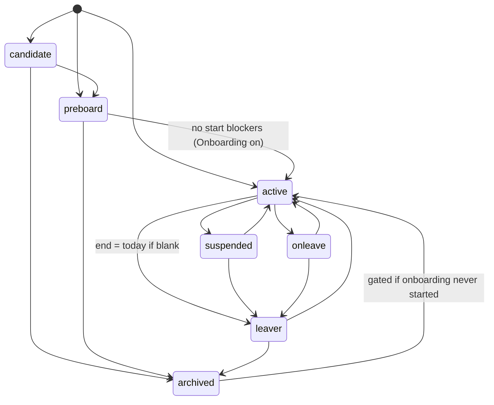
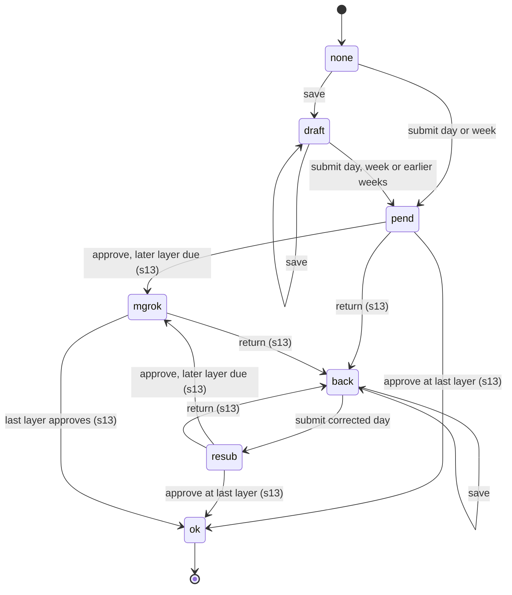
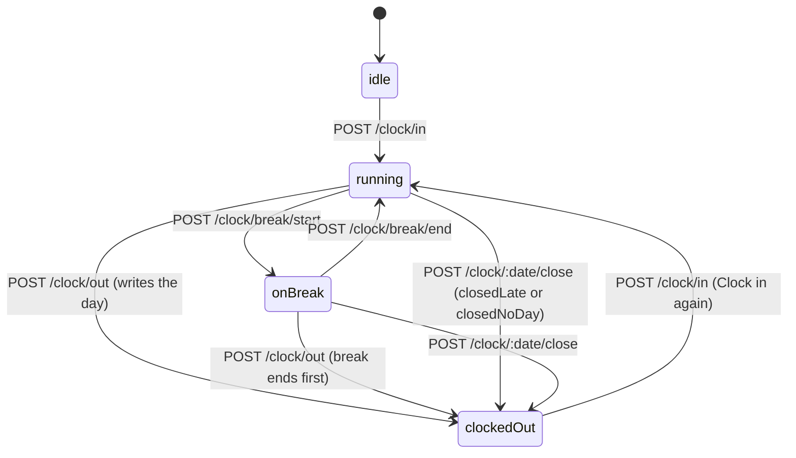
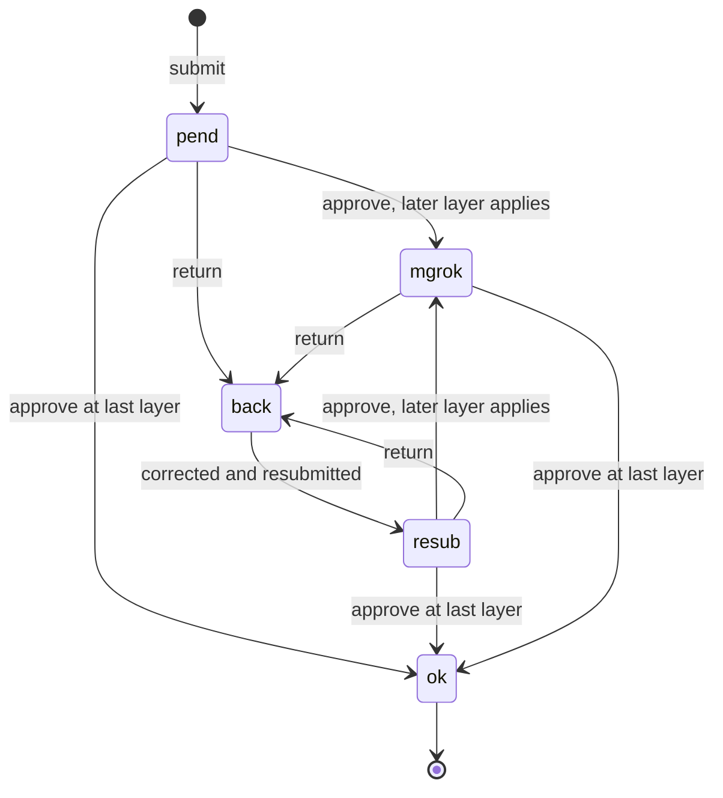
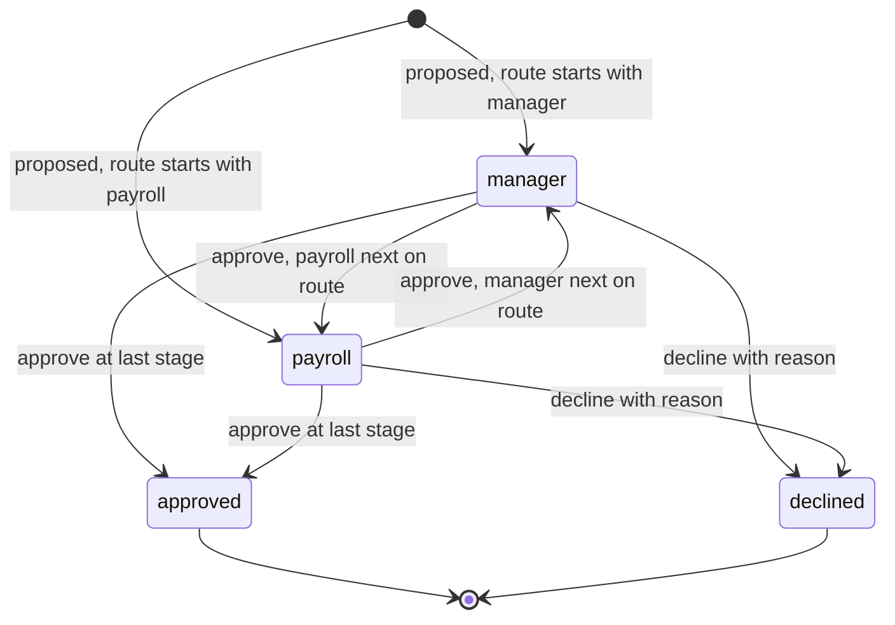
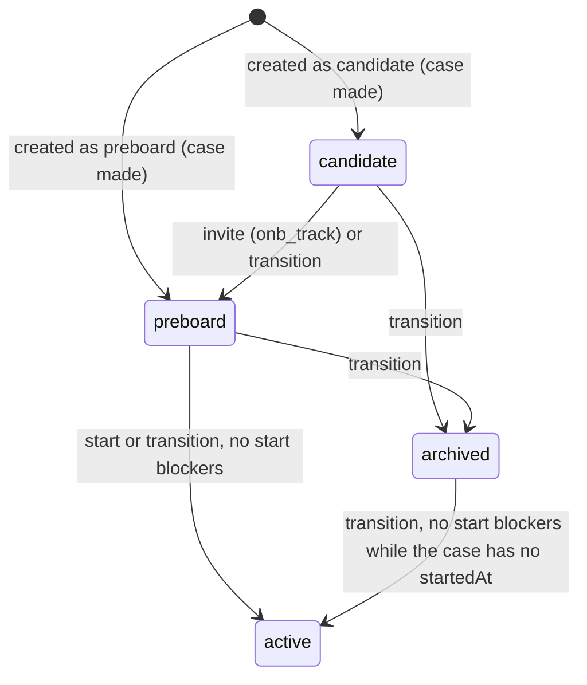
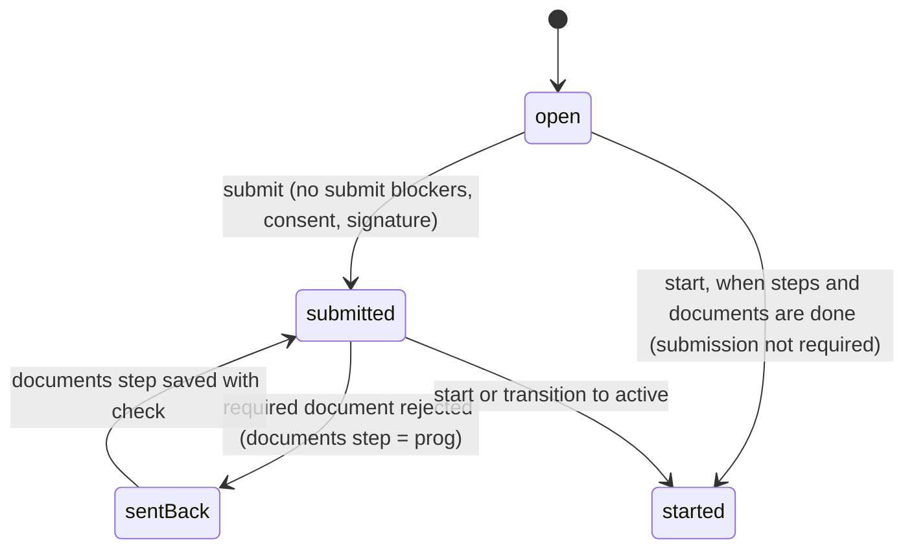
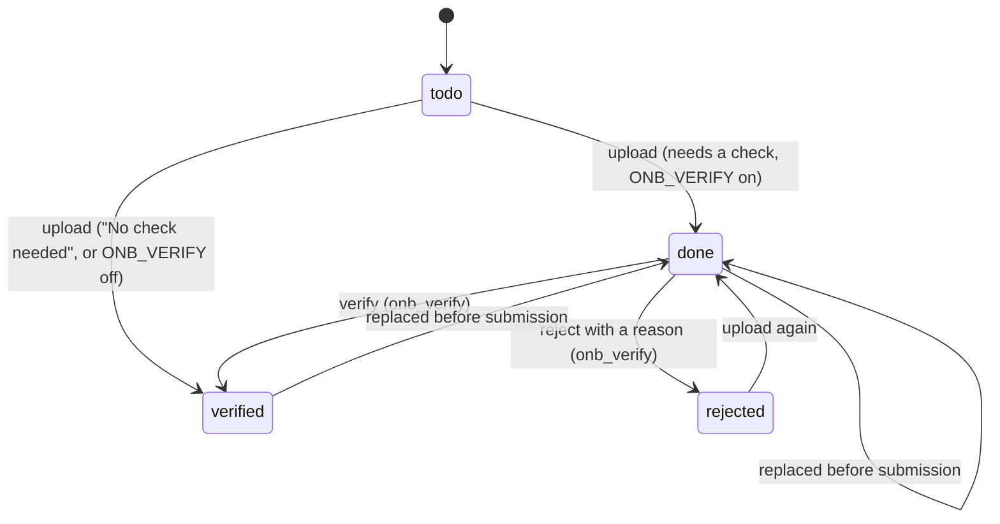

# QniConnect Workforce: rules and workflows

2026-10-29 · Status: draft for review

This document lists, feature by feature, every business rule the app enforces today and the workflow each feature follows. It is written for two readers: the developers who build the rules into the Node layer and Business Central "GB", and the testers who check them. Every rule is one checkable statement with its source and the test that covers it, so a tester can turn it into a pass/fail case.

Sources: the rules in `src/domain/*.ts`, the fake server in `src/mocks/*.ts` (which shows the refusal code, the HTTP status and the capability each operation needs), the contract in `src/contract/*.ts`, the generated operation list in [`docs/superpowers/handoff/backend-inputs.md`](../../../superpowers/handoff/backend-inputs.md) (124 `/api/v1` operations) and the Playwright specs in `e2e/`. Where the code and a comment or document disagree, this document states what the code does and lists the mismatch in section 25. Business Central is the only system of record: the Node layer applies these rules and Business Central stores the result. No rule here holds money: a pay code carries a multiplier or a unit count, never a rate.

Related: endpoints on GB in [`../backend/gb/13-gb-api-endpoints.md`](../backend/gb/13-gb-api-endpoints.md); fields in [`../backend/gb/12-gb-field-mapping.md`](../backend/gb/12-gb-field-mapping.md).

## Contents

1. How to read this document
2. Capabilities
3. Sign-in, session, viewing-as and registration
4. Access roles and exceptions
5. Tenant setup: modules, features and settings
6. Setup presets
7. Employees and lifecycle
8. Master data (sites, departments, cost centres, positions, projects)
9. Pay codes, pay grades and pay levels
10. Work patterns
11. Timesheets
12. Timesheet setup
13. Clocking
14. Approvals and chains
15. Delegations
16. Profile changes
17. Onboarding: the case and the new starter
18. Onboarding setup: steps, documents and policies
19. Onboarding templates
20. Notifications
21. Documents
22. Audit and field history
23. Home
24. Refusal code index
25. Gaps

## 1. How to read this document

### 1.1 A rule

Each feature section has a **Workflow** table (the states and allowed moves, or the operations, with who may do them and what else happens) and a **Rules** table:

| Column | Meaning |
|---|---|
| ID | `<FEATURE>-R<nn>`, for example `TS-R07`. Stable: a test names the rule it checks by this ID. |
| Rule | One sentence a tester can pass or fail: "When X, Y is refused with `code` (409)", or "When X, Y happens". |
| Code / status | The refusal `code` and HTTP status, or `—` for a rule that does not refuse. |
| Source | `file:line` where the rule is decided: the domain function and, where it maps the result to a status, the fake-server handler. |
| Tested by | The unit test (`file:line` of the `test(` line) and/or the e2e spec. **untested** means no test checks it. |

Paths are from the repo root. Paths to `src/mocks/` describe the fake server; the real backend must answer the same way.

### 1.2 The refusal shape

Every refusal, on every operation, has one body (`src/contract/common.ts:7-10`):

| Field | Always | Meaning |
|---|---|---|
| `code` | yes | Machine-readable reason. Tests assert on this, not on the message. |
| `message` | yes | What went wrong, in plain words, for the person. |
| `next` | yes | What the person can do about it. |
| `field` | no | The request field at fault (on 422, and on some 409s). Dotted for nested fields, for example `events.TS_SUBMITTED`. |
| `usedBy` | no | On an in-use refusal: `[{ kind, count, examples }]`, what still uses the record. |

A refused write changes nothing. The fake server restores its whole store when a handler refuses part-way (`src/mocks/serve.ts:63`, `src/mocks/serve.ts:77`), so a test can assert that a refused write left every record as it was.

A successful write answers `{ record, auditId }` (`src/contract/common.ts:15`). `auditId` is `null` when the write changed nothing (a no-op), and then no audit row is written and the version does not move.

### 1.3 Status codes

| Status | Meaning | Typical codes |
|---|---|---|
| 401 | Signed out: no valid token, or the account no longer exists. | `signed-out` |
| 403 | Not allowed: missing capability, out of scope, viewing as someone else, a new starter outside onboarding, or a feature switched off (some features answer 409 instead: see section 25). | `capability`, `scope`, `viewing-as`, `not-started`, `feature-off`, `module-off` |
| 404 | Not found, including another person's record that the caller may not know exists. | `not-found` |
| 409 | Refused by the state of the data: a lifecycle move not allowed, a record in use, a period locked. | per feature |
| 412 | The If-Match version is stale, or not a whole number. | `stale`, `version-unreadable` |
| 422 | Not valid: the request breaks a schema or a field rule. `field` names the part. | `invalid` and per-feature codes such as `TS_INVALID` |
| 428 | If-Match missing on a versioned write. | `version-required` |
| 500 | A fault in the server, not in the request. | `server-defect` |

The fake server checks in this order (`src/mocks/serve.ts:55-65`): session (401, then 403 `viewing-as` or `not-started`), capability (403), path and query (422), body (422), then the handler's own rules, which call the version check once they have found the record. So a caller without the capability gets 403 even when the body is also invalid.

### 1.4 If-Match, stale and version-required

Every record carries `version` (a whole number, 0 for a new record) and `updatedAt` (`src/contract/common.ts:4`). A write marked **If-Match** in the contract (`versioned: true`) must send the version it was based on in the `If-Match` header as a bare number such as `3`, with no quotes and no `W/` (`src/mocks/http.ts:72-81`):

| If-Match | Result |
|---|---|
| Missing or empty | 428 `version-required` |
| Not a whole number (`"3"`, `W/3`, `abc`) | 412 `version-unreadable` |
| A whole number other than the record's version | 412 `stale` |
| The record's version | The write goes ahead; a change bumps `version` by 1 and sets `updatedAt` (`src/mocks/http.ts:82-84`). |

Some writes are versioned on a parent record rather than the one they change: the tenant's version for module, flag, settings and preset changes; the onboarding case for a new starter's own steps; the onboarding config for its documents. Each section says which.

### 1.5 Capabilities and scope

What a person may do is a set of capability codes (section 2). Their set is their access role's template, plus the per-person grants, minus the per-person revocations; a revocation always wins (`src/domain/capabilities.ts:3-7`). A template change applies at once to every account on that role.

An operation's contract capability is checked first (403 `capability`, naming the capability's label: `src/mocks/auth.ts:115-119`). Some operations check a second capability inside the handler; their sections say so.

Scope is where a person may act:

| Scope | Who | Rule |
|---|---|---|
| own | everyone | Their own record, timesheet, profile, documents, notifications and onboarding. |
| site (team) | anyone without `master_data` | Employees at their own location only (`src/mocks/world.ts:64-74`). Outside it: 403 `scope`. |
| all | holders of `master_data` | Every location. |

Some features scope differently (approval chains by line manager or payroll layer, onboarding by `onb_cfg`); their sections say how.

### 1.6 Viewing as someone else

A holder of `perm_cfg` can view the app as another employee (section 3). While viewing as, the session has the viewed employee's capabilities and scope, and every write is refused with 403 `viewing-as`, except the two marked "allowed while viewing as" in the contract: ending the view and signing out (`src/mocks/auth.ts:107-108`). Reads are allowed. Audit rows written around a view name the real person and record `viewingAs` (`src/mocks/auth.ts:123-124`).

### 1.7 New starters

While the Onboarding module is on, an employee in state `candidate` or `preboard` sees only their onboarding. Every write by them is refused with 403 `not-started`, except the operations marked "allowed while onboarding": their own onboarding, reading their notifications and signing out (`src/mocks/auth.ts:38-43`, `src/mocks/auth.ts:109`).

### 1.8 Modules and features switched off

The tenant switches modules (Timesheet and its capture methods, Onboarding, Documents and so on) and features (flags such as Break tracking) on and off (section 5). Switching off keeps every record. An operation that belongs to something switched off is refused; the code and status differ by feature today (`feature-off` 403 for Documents, `feature-off` 409 for profile self-service, `module-off` 403 for Onboarding, `MODULE_OFF` 409 for the clock and the setup screens). Section 25 lists this as an inconsistency to settle in the backend.

## 2. Capabilities

The capability codes, their labels and groups, and the three access roles with their default templates are seed data (`src/mocks/seed/qnipay.json:913` capabilities, `src/mocks/seed/qnipay.json:859` access roles; `src/mocks/seed/social.json` holds the same sets). The defaults a role shows in the matrix are the seed's own list for that role (`src/mocks/access.ts:37-40`). A tenant can change any template (section 4), so the columns below are the starting point, not a rule. The only fixed rule is that `perm_cfg` is locked on Admin (`lockedFor: ["admin"]`).

"Contract" lists the operations whose contract capability is this code (section 1.5). "Handler" lists checks made inside an operation that has a different or no contract capability.

| Code | Group | Label | Contract (operations gated on it) | Handler (extra checks) | Employee | Manager | Admin |
|---|---|---|---|---|---|---|---|
| `own_home` | own | Own home, profile and documents | `GET /home`, `GET /documents/mine`, `GET /documents/:id`, `GET /profile`, `POST /profile-changes` | — | yes | yes | no |
| `own_ts` | own | Own timesheet | the six `/clock` operations | Reading or writing your own timesheet (`src/mocks/timesheets.ts:101`); Home's "record hours" link (`src/mocks/home.ts:81`) | yes | yes | no |
| `team_ts` | team | Team timesheets and approvals | `GET /approvals/delegations/mine` | Reading another employee's timesheet (`src/mocks/timesheets.ts:102`); the Line manager layer of the Timesheet chain (`src/domain/approvals.ts:70`); the approval queue when the caller holds no chain role (`src/mocks/timesheets.ts:276`) | no | yes | no |
| `profile_appr` | team | Approve profile changes | — | The manager stage of a profile change (`src/domain/selfService.ts:28`, `src/mocks/profile.ts:88-89`) | no | yes | no |
| `team_employees` | team | Team employees list | — | Listing employees at your own site when you lack `master_data` (`src/mocks/employees.ts:30`) | no | yes | no |
| `proxy` | team | Enter time on behalf of someone | — | Writing another employee's timesheet (`src/mocks/timesheets.ts:105`) | no | yes | no |
| `own_onb` | own | Complete my own onboarding | the six `/onboarding/me` operations | — | yes | yes | yes |
| `onb_track` | team | Track onboarding | invite, start, chase, portal invite | The tracker reads, unless the caller holds `onb_verify` (`src/mocks/onboarding.ts:63`) | no | yes | yes |
| `onb_verify` | team | Verify onboarding documents | verify and reject a document | Seeing a starter's files to check: own site, or every site with `onb_cfg` (`src/mocks/onboarding.ts:146`) | no | yes | yes |
| `onb_cfg` | cfg | Configure onboarding | onboarding config, documents, policies and templates (13 operations) | The tracker covers every site (`src/mocks/onboarding.ts:58`); a preset may change onboarding setup (`src/mocks/setup-presets.ts:48`) | no | no | yes |
| `emp_crud` | team | Add and edit employees | `POST /employees`, `PATCH /employees/:id`, `POST /employees/:id/transitions`, `GET /employees/next-code` | — | no | yes | yes |
| `master_data` | cfg | Master data | create, edit and remove sites, departments, cost centres, positions and projects; create, edit and remove pay codes; `PATCH /tenant/settings` (19 operations) | Scope over every site (`src/mocks/world.ts:65`); listing every employee (`src/mocks/employees.ts:30`); saving or applying a preset with structure (`src/mocks/setup-presets.ts:240`, `:271`, `:298`) | no | no | yes |
| `type_cfg` | cfg | Work patterns and configuration | create, edit and remove work patterns; `GET /work-patterns/library` | A preset may change work patterns (`src/mocks/setup-presets.ts:48`) | no | no | yes |
| `mod_cfg` | cfg | Module configuration | modules, flags, setup presets, timesheet setup, `GET /pay-codes` (12 operations) | — | no | no | yes |
| `framework` | cfg | Notification and approval framework | approval chains, delegations (all), notification matrix, `GET /audit` (8 operations) | A preset may change chains (`src/mocks/setup-presets.ts:47`) | no | no | yes |
| `perm_cfg` | cfg | Permissions and role configuration | capabilities, groups, access roles, users, exceptions, view-as (10 operations) | Giving an employee a non-employee access role (`src/mocks/employees.ts:38`); a preset may rename roles (`src/mocks/setup-presets.ts:47`). Locked on Admin. | no | no | yes (locked) |
| `bank_verify` | team | Verify bank detail changes | — | The payroll stage of a profile change (`src/domain/selfService.ts:28`, `src/domain/approvals.ts:71`) | no | no | yes |
| `pay_appr` | team | Approve timesheets for payroll | — | The Payroll layer of the Timesheet chain (`src/domain/approvals.ts:70`) | no | no | yes |

30 operations need only a signed-in session (shown as "(signed in)" in backend-inputs.md); their handlers apply scope or the checks above.

Things a tester should know about the seed defaults: Admin holds neither `own_home` nor `own_ts`, so a seeded admin is refused Home, Profile, Documents and the clock (403 `capability`); and every role holds `own_onb`, so whether someone sees the onboarding portal depends on their state and the Onboarding module, not their role (section 1.7).

Every capability-gated operation is checked by one generated test: a session without the capability gets 403, one with it gets through (`src/contract/capability.test.ts:39`).

## 3. Sign-in, session, viewing-as and registration

The Workforce session belongs to the signed-in Microsoft account. It opens the first time the account calls any endpoint, and while it lasts it can "view as" another employee in a read-only preview. Endpoints: `GET /session`, `DELETE /session`, `POST /session/view-as`, `DELETE /session/view-as`, `GET /session/view-as/employees`. This section also describes, once for the whole document, the shared gates every `/api/v1` endpoint passes through, and how the menu is gated. Sources: `src/mocks/{auth,http,serve,session,world}.ts`, `src/domain/{capabilities,nav}.ts`, `src/contract/{session,common,endpoints}.ts`.

### Workflow

```mermaid
stateDiagram-v2
    [*] --> SignedOut
    SignedOut --> Own: first request with a known account (audit "Signed in")
    Own --> ViewingAs: POST /session/view-as (perm_cfg; audit "View-as started")
    ViewingAs --> Own: DELETE /session/view-as (audit "View-as ended")
    ViewingAs --> Own: viewed account vanishes (falls back silently)
    Own --> SignedOut: DELETE /session (audit "Signed out")
    ViewingAs --> SignedOut: DELETE /session (audit "Signed out")
    Own --> SignedOut: account removed (next request 401)
```

| From | To | Who (capability) | Condition | Side effects |
|---|---|---|---|---|
| Signed out | Own session | any account the server knows | first request to any endpoint, with a token (or dev header) naming a known address | session record keyed by lower-case email; audit `Signed in` (entity `session`, after `{signedIn:true}`); saved at once |
| Own session | Viewing as | `perm_cfg` | target exists, is not you, has an account | session `viewingAs` set; audit `View-as started` (who has `viewingAs`); returns the session with `viewingAs` |
| Viewing as | Own session | signed in (allowed while viewing) | none | `viewingAs` cleared; audit `View-as ended` only if a view was on |
| Viewing as | Own session | — | the viewed employee's account disappears | session drops `viewingAs` and uses the real account's capabilities; no audit |
| Own / Viewing as | Signed out | signed in (allowed while viewing and while onboarding) | none | session record deleted (view-as with it); audit `Signed out` (before `{signedIn:true}`, after null); the client then signs out of Microsoft |
| Own / Viewing as | Signed out | — | account removed while the session is open | next request 401 `signed-out`; the client signs out |

Navigation gating (`src/domain/nav.ts:92-127`). This is UI only. The server column shows what stops a call made outside the menu.

| Menu entry (view) | Shown when | Server check on its data |
|---|---|---|
| My Work · Onboarding (`onb`) | `own_onb`, module ON on, and the user is still onboarding | `own_onb` on the onboarding endpoints |
| My Work · Home, Profile, Documents | `own_home` and not onboarding | `own_home` (writes also `not-started`) |
| My Work · My Calendar, Timesheet | `own_ts`, capture method A or B on, and not onboarding | `own_ts`; no module check, and starters' reads are allowed (see gaps) |
| My Team · Team Home | `team_ts` or `team_employees`, not onboarding | per endpoint |
| My Team · Approvals (`tteam`) | (`team_ts`, capture on) or (`pay_appr` without `team_ts`, capture on), not onboarding | layer and `team_ts` rules in the timesheet handlers; no module check |
| My Team · Employees (`temployees`) | `team_employees`, not onboarding | `master_data` or `team_employees`, plus site scope |
| My Team · Onboarding (`tonb`) | (`onb_track` or `onb_verify`) and ON on, not onboarding | `onb_track` / `onb_verify` |
| Setup · Business Central (`aoverview`, `aenv`, `aauth`, `asettings`) | `portalAdmin` (isAdmin from `/bc/portalUsers/verify`), never a capability | none in the fake `/bc` (see gaps) |
| Setup · Organisation, Calendar, Master data | `master_data` | `master_data` |
| Setup · Modules & features, Pay codes | `mod_cfg` | `mod_cfg` (pay-code writes need `master_data`) |
| Setup · Timesheet (`mts`) | `mod_cfg` and capture on | `mod_cfg` |
| Setup · Onboarding (`monb`) | `onb_cfg` and ON on | `onb_cfg` |
| Setup · Employees (`aemployees`) | `master_data` or `portalAdmin` | Workforce half: `master_data` / `emp_crud` |
| Setup · Work patterns | `type_cfg` | `type_cfg` |
| Setup · Permissions | `perm_cfg` | `perm_cfg` |
| Setup · Notifications, Approvals, Audit log | `framework` | `framework` |
| My Team and Setup groups | empty while onboarding | GETs not refused (see gaps) |

### Rules

| ID | Rule | Code / status | Source | Tested by |
|---|---|---|---|---|
| SES-R01 | The caller is identified by the `X-Dev-Account` header (dev picker), else by the email claim in the Bearer token (`preferred_username`, then `email`, then `upn`). The token is read without checking its signature, so the real backend must verify the Microsoft token itself. | — | `src/mocks/auth.ts:82-87`, `src/mocks/bc/serve.ts:41-48` | `src/mocks/session.test.ts:20`; `src/mocks/session.test.ts:33` |
| SES-R02 | When there is no address, an unreadable token, or an address with no account, the request is refused with `signed-out` (401). No session and no audit row are written. | `signed-out` 401 | `src/mocks/auth.ts:104` | `src/mocks/session.test.ts:43`; `src/mocks/session.test.ts:207` |
| SES-R03 | Accounts are looked up by lower-case email. The session record is keyed by lower-case email. | — | `src/mocks/auth.ts:25`, `src/mocks/auth.ts:29` | `src/mocks/session.test.ts:52` |
| SES-R04 | The first request from a known account to any endpoint (not only `GET /session`) opens its session and writes one audit row `Signed in` (entity `session`, entityId = email, before null, after `{signedIn:true}`). The token is never recorded. | — | `src/mocks/auth.ts:91-99` | `src/mocks/session.test.ts:197`; `e2e/audit.spec.ts:33` |
| SES-R05 | The `Signed in` row is saved before serve() snapshots the store. It therefore stays even when that first request is refused. | — | `src/mocks/auth.ts:97-98`, `src/mocks/serve.ts:55`, `src/mocks/serve.ts:63` | **untested** |
| SES-R06 | When the account behind an open session has been removed, every request is refused with `signed-out` (401), as for an invalid token. | `signed-out` 401 | `src/mocks/auth.ts:53` | `src/mocks/session.test.ts:60` |
| SES-R07 | `GET /session` returns the account (email, userType, employeeCode, name, roleName, roleDescription, locationName), the capabilities, `onboarding`, and `viewingAs` (employeeCode, name, userType, roleName) only while viewing. A renamed role shows its new name. | — | `src/mocks/auth.ts:63-67` | `src/mocks/session.test.ts:237`; `src/mocks/session.test.ts:257` |
| SES-R08 | An account's capabilities are its access role's template plus its grants minus its revocations. A revocation beats a grant of the same capability. The result is unique and sorted. | — | `src/domain/capabilities.ts:3-6`, `src/mocks/auth.ts:44` | `src/domain/capabilities.test.ts:3`; `src/domain/capabilities.test.ts:6` |
| SES-R09 | `session.onboarding` is true when the employee (the viewed one, while viewing) is `candidate` or `preboard` and module ON is on. Otherwise it is false. | — | `src/mocks/auth.ts:39-43`, `src/mocks/auth.ts:66` | `src/mocks/onboarding.test.ts:455` |
| SES-R10 | `DELETE /session` deletes the session record (view-as included) and writes `Signed out` (before `{signedIn:true}`, after null). It is allowed while viewing as someone and while onboarding. | — | `src/mocks/session.ts:19-22`, `src/contract/session.ts:31` | `src/mocks/session.test.ts:183`; `src/mocks/session.test.ts:213`; `src/mocks/onboarding.test.ts:462`; `e2e/audit.spec.ts:33` |
| SES-R11 | A 401 from any query or mutation makes the client sign out and show the server's refusal. A 5xx or a network failure does not sign out. | — | `src/api/query.ts:14-16` | `src/api/query.test.tsx:15`; `src/api/query.test.tsx:26`; `src/api/query.test.tsx:36`; `src/api/query.test.tsx:57` |
| SES-R12 | When an employee's work email changes, the account is re-keyed to the new address. An open session moves with it and keeps its view-as. | — | `src/mocks/employees.ts:139-144` | `src/mocks/session.test.ts:270` |
| SES-R13 | `POST /session/view-as` needs `perm_cfg`. Holding `framework` alone is refused with `capability` (403). | `capability` 403 | `src/contract/session.ts:32` | `src/mocks/session.test.ts:76`; `src/mocks/session.test.ts:131` |
| SES-R14 | When the employee code is unknown, view-as is refused with `invalid` (422), field `employeeCode`. | `invalid` 422 | `src/mocks/session.ts:29` | `src/mocks/session.test.ts:83` |
| SES-R15 | When the code is the caller's own, view-as is refused with `invalid` (422), field `employeeCode`, and nothing is recorded. | `invalid` 422 | `src/mocks/session.ts:30-31` | `src/mocks/session.test.ts:244` |
| SES-R16 | When the employee has no account, view-as is refused with `invalid` (422), field `employeeCode`. | `invalid` 422 | `src/mocks/session.ts:32` | `src/mocks/session.test.ts:90` |
| SES-R17 | A successful view-as stores `viewingAs` on the session and writes `View-as started` (who = the real account with `viewingAs` = target, before null, after `{viewingAs}`). It returns the new session. | — | `src/mocks/session.ts:33-38` | `src/mocks/session.test.ts:67`; `src/mocks/session.test.ts:110`; `e2e/account-menu.spec.ts:6` |
| SES-R18 | While viewing as someone, every capability check, the onboarding flag, `effectiveCode` (own-record checks, inbox, scope) and the nav use the viewed employee. `account` stays the real signed-in one. | — | `src/mocks/auth.ts:66`, `src/mocks/auth.ts:110`, `src/mocks/world.ts:31` | **untested** (capabilities while viewing) |
| SES-R19 | When the viewed employee's account disappears during a view, the session drops `viewingAs` and uses the real account's capabilities. | — | `src/mocks/auth.ts:62` | `src/mocks/session.test.ts:98` |
| SES-R20 | While viewing as someone, any non-GET request is refused with `viewing-as` (403) and the store is unchanged. The exception is an endpoint marked `allowedWhileViewing` (only `DELETE /session` and `DELETE /session/view-as`). Starting a second view-as is refused too. | `viewing-as` 403 | `src/mocks/auth.ts:107-108` | `src/mocks/session.test.ts:153`; `src/mocks/session.test.ts:163`; `src/mocks/session.test.ts:170`; `e2e/account-menu.spec.ts:37` |
| SES-R21 | `DELETE /session/view-as` returns the caller's own session. It writes `View-as ended` (who without `viewingAs`, before `{viewingAs}`, after null) only when a view was on. | — | `src/mocks/session.ts:57-62` | `src/mocks/session.test.ts:118` (the no-audit case is **untested**) |
| SES-R22 | `GET /session/view-as/employees` (`perm_cfg`) offers employees who have an account, are not the caller, and are not `leaver` or `archived`. It gives one per user type for managers and admins, one onboarding employee, and one per work pattern among the other employees. The first five in store order are returned. | — | `src/mocks/session.ts:44-55` | `src/mocks/session.test.ts:223`; `e2e/account-menu.spec.ts:28` |
| SES-R23 | `POST /session/view-as` accepts a `leaver` or `archived` employee who has an account, although the list never offers one. | — | `src/mocks/session.ts:28-32` | **untested** |
| SES-R24 | Every endpoint runs its checks in this order: session (401 `signed-out`, then 403 `viewing-as`, then 403 `not-started`), then the contract capability (403), then path params (422), the query (422), the body (422), and then the handler, which checks If-Match once it has found the record. A public endpoint skips the session. | see codes | `src/mocks/serve.ts:55-59` | `src/mocks/serve.test.ts:43`; `src/mocks/serve.test.ts:48`; `src/mocks/serve.test.ts:53`; `src/mocks/serve.test.ts:62`; `src/mocks/serve.test.ts:79` |
| SES-R25 | When the caller (not viewing as) is still onboarding (SES-R09), any non-GET request is refused with `not-started` (403). This happens before the capability is checked. The exception is an endpoint marked `allowedWhileOnboarding`: their own onboarding writes, `DELETE /session`, and notification read and read-all. | `not-started` 403 | `src/mocks/auth.ts:109`, `src/contract/endpoints.ts:19-22` | `src/mocks/onboarding.test.ts:462`; `src/mocks/onboarding.test.ts:473`; `src/mocks/onboarding.test.ts:81`; `e2e/permissions-5.spec.ts:27` |
| SES-R26 | When the session lacks the endpoint's contract capability, the request is refused with `capability` (403). The message names the capability's label from the store. | `capability` 403 | `src/mocks/auth.ts:115-119` | `src/contract/capability.test.ts:39`; `e2e/permissions-1c.spec.ts:20` |
| SES-R27 | When path params, the query or the body break their schema, the request is refused with `invalid` (422). `field` is the path of the first issue, and the message is in plain words. A schema's own message wins. A bad query value is refused, never clamped. | `invalid` 422 | `src/mocks/http.ts:28-55`, `src/mocks/http.ts:58-70` | `src/mocks/serve.test.ts:62`; `src/mocks/serve.test.ts:79`; `src/mocks/http.test.ts:25`; `src/mocks/audit.test.ts:53` |
| SES-R28 | When a versioned write has no `If-Match`, or an empty one, it is refused with `version-required` (428). | `version-required` 428 | `src/mocks/http.ts:78` | `src/mocks/serve.test.ts:103`; `src/mocks/http.test.ts:37` |
| SES-R29 | When `If-Match` is not a bare whole number (`"2"`, `W/"2"`, `2.0`), the write is refused with `version-unreadable` (412). | `version-unreadable` 412 | `src/mocks/http.ts:79` | `src/mocks/serve.test.ts:103` |
| SES-R30 | When `If-Match` differs from the record's version, the write is refused with `stale` (412). | `stale` 412 | `src/mocks/http.ts:80` | `src/mocks/http.test.ts:49`; `e2e/cross-tab.spec.ts:7` |
| SES-R31 | A saved change adds 1 to the record's version and sets `updatedAt` from the server clock. | — | `src/mocks/http.ts:82-84` | `src/mocks/http.test.ts:63` |
| SES-R32 | A refusal never half-applies. Before every non-GET handler the store is snapshotted, and on any refusal or fault it is restored, including audit rows, notifications and history written before the refusal. | — | `src/mocks/serve.ts:63`, `src/mocks/serve.ts:77` | `src/mocks/serve.test.ts:128`; `src/mocks/serve.test.ts:112` |
| SES-R33 | The answer is `server-defect` (500), naming the endpoint, in three cases: a handler throws something that is not a refusal, a versioned handler returns without checking the version, or (in dev and test) a response breaks its contract. | `server-defect` 500 | `src/mocks/serve.ts:66-67`, `src/mocks/serve.ts:68-74`, `src/mocks/serve.ts:83` | `src/mocks/serve.test.ts:112`; `src/mocks/serve.test.ts:141` |
| SES-R34 | Site scope: with `master_data` the caller reaches every site. Without it, they reach only their own site (the viewed employee's while viewing). A handler that checks scope refuses anything else with `scope` (403). | `scope` 403 | `src/mocks/world.ts:63-74` | `src/mocks/employees.test.ts:63` |
| SES-R35 | While onboarding, the menu shows only My Work · Onboarding (`own_onb` and ON on). My Team and Setup are empty. | — | `src/domain/nav.ts:96-104`, `src/domain/nav.ts:123-124` | `src/domain/nav.test.ts:64`; `src/domain/nav.test.ts:142`; `e2e/permissions-5.spec.ts:27` |
| SES-R36 | Timesheet and My Calendar need `own_ts` and capture method A or B. Approvals needs (`team_ts` and capture) or (`pay_appr` without `team_ts`, and capture). Switching the module off removes these entries, and switching it on brings them back. | — | `src/domain/nav.ts:94`, `src/domain/nav.ts:100-101`, `src/domain/nav.ts:109`, `src/domain/nav.ts:114` | `src/domain/nav.test.ts:38`; `src/domain/nav.test.ts:142`; `src/domain/nav.test.ts:151` |
| SES-R37 | The Business Central setup section is shown on `portalAdmin` alone, never on a capability. Setup · Employees is shown with `master_data` or `portalAdmin`. | — | `src/domain/nav.ts:53-58`, `src/domain/nav.ts:72` | `src/domain/nav.test.ts:236`; `src/domain/nav.test.ts:259`; `src/domain/nav.test.ts:268`; `src/domain/nav.test.ts:277` |
| SES-R38 | Module setup pages also need their module on: Timesheet setup needs `mod_cfg` and capture on, and Onboarding setup needs `onb_cfg` and ON on. | — | `src/domain/nav.ts:65-67` | `src/domain/nav.test.ts:122` |
| SES-R39 | Setup · Notifications, Approvals and Audit log need `framework`. Permissions needs `perm_cfg`. | — | `src/domain/nav.ts:79-85` | `src/domain/nav.test.ts:112`; `src/domain/nav.test.ts:222` |

### Registration

Covers the public four-step registration form (`POST /bc/portalRegistrations`) and the QniConnect portal-user calls made at sign-in (`POST /bc/portalUsers/verify`, `POST /session/init`, `POST /bc/portalUsers/:userId/updateStatus`). These go to the QniConnect API unchanged. Their refusals use the `{ message }` shape, not the Workforce refusal shape. Sources: `src/domain/registration.ts`, `src/mocks/bc/{registration,session,serve}.ts`, `src/mocks/auth-stub.ts`, `src/shell/SessionProvider.tsx`, `src/api/bc/account-setup.ts`.

#### Workflow

| From | To | Who (capability) | Condition | Side effects |
|---|---|---|---|---|
| Step 1 Company | Step 2 Business Central | anyone, signed out | company name and email filled | none (browser only) |
| Step 2 | Step 3 Billing | anyone | tenant ID, domain, environment, company name, number of employees filled | none |
| Step 3 | Step 4 Contact | anyone | billing chosen | none |
| Step 4 | Submitted | anyone (no token) | contact name and email filled, both agreements ticked | `POST /bc/portalRegistrations`; fake keeps a registration with status `Pending` |
| Step 4 | Step 4 with error | anyone | the backend refuses (for example, tenant already registered) | the backend's message is shown, without its correlation id |
| Microsoft sign-in | Portal user checked | signed-in Microsoft account | `POST /bc/portalUsers/verify` | not found: "not registered" message, then sign-out after 15 s |
| Portal user checked | Session initialised | — | user exists | `POST /session/init` (cookies, no token); a failure is logged and sign-in goes on, except a 401 |
| Environment selection | Access denied | — | re-verify gives `exists` false or `isActive` false, or the check fails | session cleaned up; access-denied card |
| `PendingFirstLogin` | `Active` | the user | first-login overlay, Continue | `POST /bc/portalUsers/:userId/updateStatus` with `Active` |

#### Rules

| ID | Rule | Code / status | Source | Tested by |
|---|---|---|---|---|
| REG-R01 | The form starts with every field empty, both agreements unticked, and billing annual. | — | `src/domain/registration.ts:16-21` | `src/domain/registration.test.ts:13` |
| REG-R02 | A step can be left only when its required fields are truthy. Step 1 needs companyName and companyEmail. Step 2 needs tenantId, domainName, bcEnvironment, bcCompanyName and numberOfEmployees. Step 3 needs paymentFrequency. Step 4 needs contactName, contactEmail and both agreements. | — | `src/domain/registration.ts:28-35`, `src/features/public/RegistrationPage.tsx:79` | `src/domain/registration.test.ts:22` |
| REG-R03 | Values are not trimmed and their format is not checked: spaces, `"0"`, `"-5"` and an invalid email all pass. | — | `src/domain/registration.ts:27-31` | `src/domain/registration.test.ts:40` |
| REG-R04 | The request carries exactly 17 keys. contactEmail falls back to companyEmail. numberOfEmployees is parsed as a whole number, and 1 when it is missing or unreadable. registrationSource is `Portal` and the contact language is `EN`. The VAT, company number and address keys are always blank. | — | `src/domain/registration.ts:46-61` | `src/domain/registration.test.ts:68`; `src/domain/registration.test.ts:80` |
| REG-R05 | Website, phones, domain, billing choice and the two agreements are never sent. | — | `src/domain/registration.ts:46-61` | `src/domain/registration.test.ts:91` |
| REG-R06 | Registration is sent with no token and Content-Type only. Any OK answer is success, and its body is never read. | — | `src/contract/bc/registration.ts:20-23` | `src/mocks/bc/session.test.ts:160` |
| REG-R07 | When the tenant ID (trimmed, any case) is already registered, the fake refuses with 409 and a message that ends in `CorrelationId: <uuid>`. Otherwise it keeps a new registration with status `Pending`. | 409 (message only) | `src/mocks/bc/registration.ts:14-22` | `src/mocks/bc/session.test.ts:160`; `e2e/public.spec.ts:55` |
| REG-R08 | The error shown comes from the refusal body. A JSON body gives its `error`, else its `message`, else the whole object as text. A body that is not JSON is its own message. A JSON value that is not an object gives `API Error: <status>`. Everything from `CorrelationId:` onwards is cut and the rest trimmed. With nothing usable, the message is "An error occurred during registration. Please try again." | — | `src/domain/registration.ts:65-96` | `src/domain/registration.test.ts:98`; `src/domain/registration.test.ts:104`; `src/domain/registration.test.ts:108`; `src/domain/registration.test.ts:111`; `src/domain/registration.test.ts:120`; `e2e/public.spec.ts:55` |
| REG-R09 | A `/bc` call that needs a token and has no Bearer is refused with 401 "Authorization has been denied for this request." A body, query or params that breaks its schema is refused with 400 `{message}`. | 401, 400 (message only) | `src/mocks/bc/serve.ts:61`, `src/mocks/bc/serve.ts:65-79` | `src/mocks/bc/session.test.ts:79` (400 **untested**) |
| REG-R10 | `POST /bc/portalUsers/verify` for an unknown user answers `exists: false, isActive: false`. For a known user it answers `exists: true`, with `isActive` = status is not `Inactive` (so `PendingFirstLogin` counts as active) and `userData` (id, email, name, status, isAdmin, registrationId, employeeNo, role). | — | `src/mocks/bc/session.ts:15-25` | `src/mocks/bc/session.test.ts:31`; `src/mocks/bc/session.test.ts:37`; `src/mocks/bc/session.test.ts:48` |
| REG-R11 | When verify says the user does not exist, the client shows "Your account is not registered in QniConnect. Please contact your administrator." and signs out after 15 seconds. | — | `src/shell/SessionProvider.tsx:293-297`, `src/shell/SessionProvider.tsx:98` | `src/shell/SessionProvider.test.tsx:106` |
| REG-R12 | At environment selection the client verifies again. When `exists` is false, `isActive` is false, or the check fails, it cleans up the session and shows the access-denied card. | — | `src/api/bc/account-setup.ts:39`, `src/api/bc/account-setup.ts:48-49`, `src/api/bc/account-setup.ts:56` | `src/features/account-setup/account-setup.test.tsx:118`; `src/features/account-setup/account-setup.test.tsx:137` |
| REG-R13 | `POST /session/init` takes no token. When it fails, sign-in goes on, unless the failure is a 401, which shows the auth error. | — | `src/mocks/bc/session.ts:28`, `src/shell/SessionProvider.tsx:315-321` | `src/mocks/bc/session.test.ts:85` (401 path **untested**) |
| REG-R14 | A `PendingFirstLogin` user sees the first-login overlay. Continue sets them `Active`, and an answer without `success` counts as a failure. | — | `src/shell/SessionProvider.tsx:308`, `src/api/bc/account-setup.ts:146-147` | `src/features/account-setup/account-setup.test.tsx:504`; `src/features/account-setup/account-setup.test.tsx:550`; `e2e/auth.spec.ts:23` |
| REG-R15 | The fake updateStatus refuses an unknown user id with 404. A status other than `Active`, `PendingFirstLogin` or `Inactive` is refused with 400. | 404, 400 (message only) | `src/mocks/bc/session.ts:33-34` | `src/mocks/bc/session.test.ts:116` (400 **untested**) |
| REG-R16 | The dev and test sign-in stub reads the account from sessionStorage. A malformed entry counts as no account. The stub issues unsigned JWTs carrying `preferred_username`, `email`, `oid` and `name`, and is never part of a production build. | — | `src/mocks/auth-stub.ts:24-40` | `src/mocks/auth-stub.test.ts:13`; `src/mocks/auth-stub.test.ts:18`; `src/mocks/auth-stub.test.ts:23`; `src/mocks/auth-stub.test.ts:30`; `src/mocks/auth-stub.test.ts:43` |

## 4. Access roles and exceptions

The permissions matrix: each access role (user type: Employee, Manager, Admin) has a template of capabilities, and each account can have per-person exceptions (a grant or a revocation, with a reason). Every operation here needs `perm_cfg`. Endpoints: `GET /capabilities`, `GET /capability-groups`, `GET /user-types`, `PUT /user-types/:id/capabilities/:capability`, `PATCH /user-types/:id`, `GET /users`, `POST /users/:email/exceptions`, `DELETE /users/:email/exceptions/:capability`. Sources: `src/mocks/access.ts`, `src/domain/capabilities.ts`, `src/domain/modules.ts:262-268`, `src/contract/access.ts`. Which access role an employee has is set on the employee record (section 7).

### Workflow

| Operation | Who | Condition | Side effects |
|---|---|---|---|
| Grant or remove a capability on a template (If-Match: the role) | `perm_cfg` | Not a locked cell; not your own way back (ACC-R04 to R06) | Role version +1; audit `Permission changed` (before/after of that capability). Applies at once to every account on the role. No-op: nothing written, `auditId` null. |
| Rename an access role (If-Match: the role) | `perm_cfg` | Name rules ACC-R09 to R11 | Role version +1; audit `Access roles renamed`. Capabilities unchanged. The session's `roleName` follows. |
| Add an exception (If-Match: the account) | `perm_cfg` | A reason; a real difference from the template | Account version +1; audit `Access exception added` with before/after grants and revocations and the reason. |
| Remove an exception (If-Match: the account) | `perm_cfg` | It is an exception now | Account version +1; audit `Access exception removed`. The template default applies again. |

### Rules

| ID | Rule | Code / status | Source | Tested by |
|---|---|---|---|---|
| ACC-R01 | A person's capabilities are their role's template plus their grants minus their revocations; when a capability is both granted and revoked, it is revoked. | — | `src/domain/capabilities.ts:3-7`, `src/mocks/auth.ts:44` | `src/domain/capabilities.test.ts:3`, `src/domain/capabilities.test.ts:6` |
| ACC-R02 | When a template change sets a capability to what the role already has, nothing is written and `auditId` is null. | — | `src/mocks/access.ts:64` | `src/mocks/access.test.ts:232` |
| ACC-R03 | When a template change grants or removes a capability, the role's version goes up by one and one `Permission changed` audit row records the capability before and after. | — | `src/mocks/access.ts:65-67` | `src/mocks/access.test.ts:60`; `e2e/access.spec.ts:4` |
| ACC-R04 | When the caller removes `perm_cfg` from their own access role, it is refused with `locked` (409), whoever else still holds it. | `locked` 409 | `src/mocks/access.ts:55-56` | `src/mocks/access.test.ts:77`, `src/mocks/access.test.ts:197` |
| ACC-R05 | When a capability is removed from a role listed in that capability's `lockedFor` (seed: `perm_cfg` on Admin), it is refused with `locked` (409). | `locked` 409 | `src/mocks/access.ts:57-58` | `e2e/access.spec.ts:27` (UI cell disabled only); server path **untested** (`src/mocks/access.test.ts:77` stops at ACC-R04 first) |
| ACC-R06 | When removing `perm_cfg` from a role would leave no account holding it, it is refused with `locked` (409). | `locked` 409 | `src/mocks/access.ts:59-62` | **untested** |
| ACC-R07 | When the role or capability in the path does not exist, it is refused with `not-found` (404). | `not-found` 404 | `src/mocks/access.ts:19`, `src/mocks/access.ts:49`, `src/mocks/access.ts:75` | **untested** |
| ACC-R08 | When an access-role write carries a stale version, it is refused with `stale` (412) and nothing changes. | `stale` 412 | `src/mocks/access.ts:51`, `src/mocks/access.ts:76` | `src/mocks/access.test.ts:70`; `e2e/permissions-1c.spec.ts:65` |
| ACC-R09 | When a role name is blank after trimming, it is refused with `invalid` (422, field `name`). | `invalid` 422 | `src/domain/modules.ts:264`, `src/mocks/access.ts:78` | `src/domain/modules.test.ts:158`, `src/mocks/tenant.test.ts:266` |
| ACC-R10 | When a role name is longer than 24 characters, it is refused with `invalid` (422, field `name`); 24 is accepted. | `invalid` 422 | `src/domain/modules.ts:265`, `src/mocks/access.ts:78` | `src/domain/modules.test.ts:158`, `src/mocks/tenant.test.ts:266` |
| ACC-R11 | When a role name matches another role's name ignoring case and surrounding spaces, it is refused with `NAME_TAKEN` (409, field `name`). | `NAME_TAKEN` 409 | `src/domain/modules.ts:266`, `src/mocks/access.ts:78` | `src/domain/modules.test.ts:158`, `src/mocks/tenant.test.ts:266` |
| ACC-R12 | When a role is renamed, the name is saved trimmed, its capabilities do not change, one `Access roles renamed` audit row is written, and the session's `roleName` shows the new name; renaming to the same name writes nothing (`auditId` null). | — | `src/mocks/access.ts:80-85` | `src/mocks/tenant.test.ts:258`; same-name no-op **untested** |
| ACC-R13 | When an exception is added without a reason (blank after trimming), it is refused with `invalid` (422, field `reason`). | `invalid` 422 | `src/contract/access.ts:17` | `src/mocks/access.test.ts:84`; `e2e/access.spec.ts:55` |
| ACC-R14 | When a grant names a capability the person's template already has, it is refused with `invalid` (422, field `capability`). | `invalid` 422 | `src/mocks/access.ts:100-101` | `src/mocks/access.test.ts:97` |
| ACC-R15 | When a revocation names a capability the person's template does not have, it is refused with `invalid` (422, field `capability`). | `invalid` 422 | `src/mocks/access.ts:102-103` | `src/mocks/access.test.ts:108` |
| ACC-R16 | When the caller revokes `perm_cfg` from their own account, it is refused with `locked` (409), whoever else still holds it. | `locked` 409 | `src/mocks/access.ts:104-105` | `src/mocks/access.test.ts:176` |
| ACC-R17 | When revoking or removing `perm_cfg` from an account would leave no account holding it, it is refused with `locked` (409). | `locked` 409 | `src/mocks/access.ts:106-109`, `src/mocks/access.ts:135-136` | **untested** |
| ACC-R18 | When the same grant or revocation is added again, nothing is written (no version bump, `auditId` null). | — | `src/mocks/access.ts:111-113` | `src/mocks/access.test.ts:119` |
| ACC-R19 | When an exception is added, a grant and a revocation of the same capability never coexist: a grant clears the revocation and a revocation clears the grant; the change is audited `Access exception added` with the reason, and other accounts on the role are unaffected. | — | `src/mocks/access.ts:114-121` | `src/mocks/access.test.ts:84` |
| ACC-R20 | When an exception is removed for a capability that is neither granted nor revoked for that person, it is refused with `invalid` (422, field `capability`). | `invalid` 422 | `src/mocks/access.ts:129-130` | `src/mocks/access.test.ts:147` |
| ACC-R21 | When the caller removes their own `perm_cfg` grant, it is refused with `locked` (409), whoever else still holds it. | `locked` 409 | `src/mocks/access.ts:132-133` | `src/mocks/access.test.ts:186` |
| ACC-R22 | When an exception is removed, the person falls back to the template default for that capability, the version goes up by one and one `Access exception removed` audit row is written. | — | `src/mocks/access.ts:137-143` | `src/mocks/access.test.ts:133` |
| ACC-R23 | When the account in the path does not exist, an exception write is refused with `not-found` (404). | `not-found` 404 | `src/mocks/access.ts:21-25` | **untested** |
| ACC-R24 | `GET /user-types` gives each role its current capabilities and `defaults`, the capabilities the tenant's seed gave it. | — | `src/mocks/access.ts:37-40` | **untested** |
| ACC-R25 | `GET /capability-groups` lists the groups in their `order`. | — | `src/mocks/access.ts:44` | **untested** |

## 5. Tenant setup: modules, features and settings

The tenant record holds the module switches (CORE QniConnect, TS Timesheet with its capture methods A manual entry, B clock and capability C sites, ON Onboarding), the feature flags with their extras, the organisation's date, time and calendar settings, and its company details. Endpoints: `GET /tenant` (any signed-in caller), `PATCH /tenant/modules/:code` and `PATCH /tenant/flags/:code` (`mod_cfg`, If-Match is the tenant's version), `PATCH /tenant/settings` (`master_data`, If-Match is the tenant's version). Sources: `src/domain/modules.ts` (catalogue, liveness, switch rules, refusals), `src/mocks/tenant.ts`, `src/contract/tenant.ts`. The flags catalogue is also in `src/mocks/seed/meta.json` and must match `FLAGS` (`src/domain/modules.test.ts:14`). `src/domain/usage.ts` is about deleting structure records that are in use and has no tenant rule. `src/domain/pricing.ts` names the TS and ON add-ons only for the public pricing and registration pages, and no tenant switch reads it.

### Workflow

Module on/off is a set of switches, not a state machine. The only remembered state is `restore.TS`: the capture methods to bring back when Timesheet is turned on again.

| Operation | Who | Condition | Side effects |
|---|---|---|---|
| `GET /tenant` | any signed-in caller | a tenant record exists | none |
| `PATCH /tenant/modules/:code` `{on}` | `mod_cfg` | code is CORE, TS, A, B, C or ON. CORE cannot go off. A, B and C need TS on | Tenant version bumps once. Audit `Module turned on` / `Module turned off` (entity `tenant`, entityId = code). TS off saves `restore.TS` and switches A, B and C off. TS on brings them back. C off takes `site` off every work pattern (each pattern's version bumps). Response `effect` gives `kept` counts, `capturesRestored`, `capturesRemembered`, `siteRemovedFrom` and `message`. No record is deleted |
| `PATCH /tenant/flags/:code` `{on?, weekGrid?, weekLayout?, breaksMax?, vehiclesMax?}` | `mod_cfg` | the feature's module is live. Extras need the feature on | Tenant version bumps. The timesheet config version also bumps when weekGrid or weekLayout changes. Audit `Feature changed` (entityId = flag code). Response `message` |
| `PATCH /tenant/settings` | `master_data` | valid values. weekStart can change only when no timesheet day is open | Tenant version bumps. Audit `Calendar settings changed` or `Organisation settings changed` (entityId `settings`) |

Refusals when something is switched off elsewhere in the API:

| Switched off | Endpoints that refuse | Code / status |
|---|---|---|
| Onboarding module (ON) | every `/onboarding/*` endpoint (23 in `src/mocks/onboarding.ts`, 4 in `src/mocks/onboarding-templates.ts`) | `module-off` 403 |
| Clock (TS or B off) | `POST /clock/in`, `/clock/break/start`, `/clock/break/end`, `/clock/out`, `/clock/:date/close` (`GET /clock/me` answers `live: false`) | `MODULE_OFF` 409 |
| Break tracking (BREAKS not live) | `POST /clock/break/start` | `FLAG_OFF` 409 |
| Document centre (DOCS) | `GET /documents/mine`, `GET /documents/:id` | `feature-off` 403 |
| Self-service profile changes (SELF_EDIT) | `POST /profile-changes` | `feature-off` 409 |
| An event's module or feature | `PATCH /notifications/matrix` for that event | `MODULE_OFF` 409 |
| Timesheet capture (TS, or both A and B, off) | `PUT /timesheets/:id/days/:date`, `POST …/days/:date/submit`, `POST …/weeks/:weekStart/submit`, `POST …/multiweek/submit` | `module-off` 403 |
| Weekly grid (WEEKLY) | `POST …/weeks/:weekStart/submit` | `feature-off` 403 |
| Multi-week submit (MULTIWEEK) | `POST …/multiweek/submit` | `feature-off` 403 |
| Break tracking (BREAKS off) | `PUT …/days/:date`, `POST …/days/:date/submit` when an entry carries a break pair the stored day does not already hold | `feature-off` 403 on `entries.{i}.breaks` |

### Rules

| ID | Rule | Code / status | Source | Tested by |
|---|---|---|---|---|
| TEN-R01 | When any signed-in caller reads `GET /tenant`, flags come back as booleans and `restore` defaults to `{}`. `extras.weekGrid` and `weekLayout` are read from the timesheet config, and `breaksMax` and `vehiclesMax` from the tenant, with defaults from `DEFAULT_EXTRAS`. | — | `src/mocks/tenant.ts:51`, `src/domain/modules.ts:141` | `src/mocks/tenant.test.ts:29`; `src/mocks/tenant.test.ts:46` |
| TEN-R02 | When the store holds no tenant record, every tenant read and write is refused with `not-found` (404). | `not-found` 404 | `src/mocks/tenant.ts:30` | **untested** |
| TEN-R03 | When the module code is not a module or capture method (CORE, TS, A, B, C, ON), the switch is refused with `not-found` (404). | `not-found` 404 | `src/domain/modules.ts:174`, `src/domain/modules.ts:145` | `src/domain/modules.test.ts:70`; `src/mocks/tenant.test.ts:104` |
| TEN-R04 | When CORE (QniConnect) is switched off, the request is refused with `LOCKED` (409) and nothing is written. | `LOCKED` 409 | `src/domain/modules.ts:175`, `src/domain/modules.ts:147` | `src/domain/modules.test.ts:65`; `src/mocks/tenant.test.ts:97` |
| TEN-R05 | When a module is switched to the state it already has (CORE on included), nothing is written, the version does not move, `auditId` is null and the message is "<name> is already on/off." | — | `src/domain/modules.ts:177`, `src/mocks/tenant.ts:95` | `src/domain/modules.test.ts:74`; `src/mocks/tenant.test.ts:107` |
| TEN-R06 | When A, B or C is switched while TS is off, the request is refused with `MODULE_OFF` (409). | `MODULE_OFF` 409 | `src/domain/modules.ts:176`, `src/domain/modules.ts:149` | `src/domain/modules.test.ts:99`; `src/mocks/tenant.test.ts:113` |
| TEN-R07 | When TS is turned off, the codes among A, B and C that were on are saved in `restore.TS` and returned as `capturesRemembered`, and TS, A, B and C are all switched off. | — | `src/domain/modules.ts:189`, `src/mocks/tenant.ts:101` | `src/domain/modules.test.ts:77`; `src/mocks/tenant.test.ts:113` |
| TEN-R08 | When TS is turned on, the remembered methods are switched on (A alone if none were remembered), `restore.TS` is cleared, and they are returned as `capturesRestored`. | — | `src/domain/modules.ts:181` | `src/domain/modules.test.ts:84`; `src/domain/modules.test.ts:91`; `src/mocks/tenant.test.ts:113` |
| TEN-R09 | Timesheet is live only while TS is on and A or B is on (C alone does not count). Onboarding is live while ON is on, and CORE is always live. | — | `src/domain/modules.ts:81` | `src/domain/modules.test.ts:32`; `src/domain/modules.test.ts:36` |
| TEN-R10 | When C (Sites) is turned off, `site` is removed from the field groups of every work pattern that had it, each changed pattern's version bumps, and their names come back in `effect.siteRemovedFrom` and on the audit row. Turning C on again does not put `site` back. | — | `src/mocks/tenant.ts:65`, `src/mocks/tenant.ts:98` | `src/mocks/tenant.test.ts:136` |
| TEN-R11 | When a module goes off, every record is kept and `effect.kept` counts them: TS or A gives timesheet days, B gives timesheet days and clock records, ON gives onboarding cases in progress, C gives nothing. | — | `src/mocks/tenant.ts:76`, `src/mocks/tenant.ts:99` | `src/mocks/tenant.test.ts:113`; `src/mocks/tenant.test.ts:146`; `src/mocks/tenant.test.ts:158` |
| TEN-R12 | When a module switch changes something, the tenant version bumps once and one audit row is written: act `Module turned on` / `Module turned off`, entity `tenant`, entityId = code. `before`/`after` hold every switch that changed, plus `detail`, and `kept`, `remembered` and `siteRemovedFrom` when they are not empty. | — | `src/mocks/tenant.ts:97`, `src/mocks/tenant.ts:104` | `src/mocks/tenant.test.ts:113`; `src/mocks/tenant.test.ts:136` |
| TEN-R13 | When the feature code is not in the catalogue, the request is refused with `not-found` (404). | `not-found` 404 | `src/domain/modules.ts:211`, `src/domain/modules.ts:146` | `src/domain/modules.test.ts:118` |
| TEN-R14 | When the module that owns a feature is not live (TEN-R09), changing the feature is refused with `MODULE_OFF` (409). A Timesheet feature with only Sites on is refused too. A CORE feature can always be changed. | `MODULE_OFF` 409 | `src/domain/modules.ts:212`, `src/domain/modules.ts:152` | `src/domain/modules.test.ts:112`; `src/domain/modules.test.ts:118`; `src/mocks/tenant.test.ts:167` |
| TEN-R15 | When the body sends an extra that the feature does not own, the request is refused with `invalid` (422), with `field` = that key. Only WEEKLY owns `weekGrid` and `weekLayout`, BREAKS owns `breaksMax`, and VEHICLE owns `vehiclesMax`. | `invalid` 422 | `src/domain/modules.ts:134`, `src/domain/modules.ts:215` | `src/domain/modules.test.ts:123`; `src/mocks/tenant.test.ts:192` |
| TEN-R16 | When extras are sent and the feature would be off after the request, the request is refused with `FLAG_OFF` (409). `on: true` with extras in the same body is accepted. | `FLAG_OFF` 409 | `src/domain/modules.ts:217`, `src/domain/modules.ts:154` | `src/domain/modules.test.ts:123`; `src/mocks/tenant.test.ts:192` |
| TEN-R17 | When `breaksMax` is not a whole number from 1 to 5, or `vehiclesMax` is not a whole number from 1 to 4, the request is refused with `invalid` (422) on that field. The value is never clamped. | `invalid` 422 | `src/domain/modules.ts:138`, `src/domain/modules.ts:219` | `src/domain/modules.test.ts:131`; `src/mocks/tenant.test.ts:192` |
| TEN-R18 | When `weekGrid` or `weekLayout` changes, it is saved on the timesheet config (whose version bumps), so Timesheet setup reads the same value. `breaksMax` and `vehiclesMax` are saved on the tenant. | — | `src/mocks/tenant.ts:124`, `src/mocks/tenant.ts:130` | `src/mocks/tenant.test.ts:182` |
| TEN-R19 | When neither `on` nor any extra differs from what is held, nothing is written, `auditId` is null and the message is "<label> is unchanged." | — | `src/mocks/tenant.ts:121`, `src/mocks/tenant.ts:123`, `src/domain/modules.ts:252` | **untested** |
| TEN-R20 | When a feature changes, one audit row `Feature changed` is written (entity `tenant`, entityId = flag code). `before`/`after` hold only what changed (`on` and/or each extra) plus `detail`. | — | `src/mocks/tenant.ts:132` | `src/mocks/tenant.test.ts:176`; `src/mocks/tenant.test.ts:182` |
| TEN-R21 | When `timezone` is not an IANA zone ID (for example `+05:45`), settings are refused with `invalid` (422), field `timezone`. | `invalid` 422 | `src/contract/tenant.ts:11` | `src/mocks/tenant.test.ts:218` |
| TEN-R22 | When `dateFormat` is not dd/mm/yyyy, yyyy-mm-dd or mm/dd/yyyy, or `clock` is not 24h or 12h, or `weekStart` is not Monday, Sunday or Saturday, settings are refused with `invalid` (422). | `invalid` 422 | `src/contract/tenant.ts:8`, `src/contract/tenant.ts:63` | **untested** (only accepted values: `src/mocks/tenant.test.ts:208`) |
| TEN-R23 | When `weekStart` changes while any timesheet day is `pend`, `back`, `resub` or `mgrok`, settings are refused with `week-start-in-use` (409), and the message gives the count. Sending the week start already held is not checked. | `week-start-in-use` 409 | `src/mocks/tenant.ts:40`, `src/mocks/tenant.ts:143` | `src/mocks/tenant.test.ts:229`; `src/mocks/tenant.test.ts:238`; `src/mocks/timesheet-chain.test.ts:230` |
| TEN-R24 | When `fullTimeWeeklyHours` is below 1 or above 80, settings are refused with `invalid` (422) on that field. | `invalid` 422 | `src/contract/tenant.ts:64` | `src/features/calendar/bank-holidays.test.tsx:61` |
| TEN-R25 | When `financialYear` is sent, its start and/or end are merged onto the held year. If the result starts after it ends, settings are refused with `invalid` (422), field `financialYear`. | `invalid` 422 | `src/mocks/tenant.ts:153` | **untested** (save only: `src/features/calendar/bank-holidays.test.tsx:51`) |
| TEN-R26 | When the financial year is saved, its label is set to the start year + "/" + the last two digits of the end year (for example 2026/27). | — | `src/mocks/tenant.ts:159` | **untested** on this endpoint (same formula on apply: `src/mocks/setup-presets.test.ts:201`) |
| TEN-R27 | When `bankHolidays` is sent, it replaces the whole stored list. | — | `src/mocks/tenant.ts:166`, `src/mocks/tenant.ts:187` | `src/features/calendar/bank-holidays.test.tsx:75` |
| TEN-R28 | When `bankHolidays` has more than 200 rows, two rows share a date, or a name is blank or longer than 80 characters after trimming, settings are refused with `invalid` (422). | `invalid` 422 | `src/contract/tenant.ts:20`, `src/contract/tenant.ts:67` | **untested** |
| TEN-R29 | When `name` is blank or longer than 80 characters after trimming, settings are refused with `invalid` (422) ("The organisation needs a name."). | `invalid` 422 | `src/contract/tenant.ts:62` | **untested** |
| TEN-R30 | `company` is a partial update of registration (up to 20), address (up to 200), country (United Kingdom, Ireland, Nepal), nmwCheck, bankHolidayRegion, payFrequency, weekEnding and firstPayDate. Any other key (a currency, for example) is refused with `invalid` (422). | `invalid` 422 | `src/contract/tenant.ts:69`, `src/mocks/tenant.ts:171` | `src/mocks/tenant.test.ts:246`; `src/features/organisation/organisation.test.tsx:45` |
| TEN-R31 | When no sent setting differs from what is held, nothing is written and `auditId` is null. | — | `src/mocks/tenant.ts:177` | **untested** |
| TEN-R32 | When settings change, one audit row is written (entity `tenant`, entityId `settings`). The act is `Calendar settings changed` if any of timezone, dateFormat, clock, weekStart, financialYear, bankHolidays or fullTimeWeeklyHours changed, otherwise `Organisation settings changed`. `before`/`after` hold only the changed keys, with company fields listed by their own key. | — | `src/mocks/tenant.ts:189` | `src/mocks/tenant.test.ts:208`; `src/mocks/tenant.test.ts:238`; `src/mocks/tenant.test.ts:246` |
| TEN-R33 | When the Onboarding module is off, every onboarding and onboarding-template endpoint is refused with `module-off` (403). | `module-off` 403 | `src/mocks/onboarding-cases.ts:37` | `src/mocks/onboarding.test.ts:544`; `src/mocks/onboarding-templates.test.ts:146` |
| TEN-R34 | When TS or B is off, every clock write (in, break start, break end, out, close) is refused with `MODULE_OFF` (409). | `MODULE_OFF` 409 | `src/mocks/clock.ts:48`, `src/mocks/clock.ts:90`, `src/domain/clock.ts:222` | `src/mocks/clock.test.ts:119`; `e2e/clock-2b.spec.ts:103` |
| TEN-R35 | When Break tracking (BREAKS) is not live, `POST /clock/break/start` is refused with `FLAG_OFF` (409). | `FLAG_OFF` 409 | `src/mocks/clock.ts:49`, `src/domain/clock.ts:139` | `src/domain/clock.test.ts:81`; `src/mocks/clock.test.ts:169` |
| TEN-R36 | When Document centre (DOCS) is off, `GET /documents/mine` and `GET /documents/:id` are refused with `feature-off` (403). | `feature-off` 403 | `src/mocks/home.ts:50`, `src/mocks/home.ts:86`, `src/mocks/home.ts:95` | `src/mocks/home.test.ts:68` |
| TEN-R37 | When Self-service profile changes (SELF_EDIT) is off, `POST /profile-changes` is refused with `feature-off` (409) and `GET /profile` reports `selfEdit: false`. Changes already proposed can still be decided. | `feature-off` 409 | `src/mocks/profile.ts:21`, `src/mocks/profile.ts:57` | `src/mocks/profile.test.ts:78` |
| TEN-R38 | When a notification event's module or feature is off, changing that event in `PATCH /notifications/matrix` is refused with `MODULE_OFF` (409), `field` `events.<code>`. | `MODULE_OFF` 409 | `src/domain/notifications.ts:69`, `src/domain/notifications.ts:180` | `src/domain/notifications.test.ts:138`; `src/mocks/notifications.test.ts:119` |
| TEN-R39 | An access role name must be non-blank after trimming, at most 24 characters, and unique ignoring case (`roleNameProblem`). Role renames use it (documented with access roles), and so do preset apply and import (PRE-R12, PRE-R35). | `invalid` 422 | `src/domain/modules.ts:262` | `src/domain/modules.test.ts:158`; `src/mocks/tenant.test.ts:266` |

## 6. Setup presets

A setup preset is a tenant's configuration kept as data, either shipped with the app (`qcic`, `mne`, `social`) or saved or imported here. Applying one sets configuration and adds structure whose codes are new. Endpoints, all `mod_cfg`: `GET /setup-presets`, `POST /setup-presets` (save), `GET /setup-presets/:key/plan`, `POST /setup-presets/:key/apply` (If-Match is the tenant's version), `GET /setup-presets/:key/export`, `POST /setup-presets/import`, `DELETE /setup-presets/:key` (If-Match is the saved preset's version). Sources: `src/domain/setup-presets.ts` (shipped presets, capture, file reading, apply plan, refusals), `src/mocks/setup-presets.ts` (store reads and writes, `carryOut`), `src/contract/setup-presets.ts`. `src/mocks/saved-data.ts` is `devOnly` (the fake server's own export and reset) and carries no production rule, so it is not covered here.

### Workflow

A saved preset has no states: it exists until it is removed.

| Operation | Who | Condition | Side effects |
|---|---|---|---|
| list | `mod_cfg` | — | none |
| plan | `mod_cfg` | key exists | none (read only) |
| apply | `mod_cfg`. Also `master_data` if the preset has structure rows. Each part is applied only with its own capability: `type_cfg` work patterns, `perm_cfg` role names, `framework` approval chains, `onb_cfg` onboarding, `master_data` date and time settings | key exists. Tenant version matches. No week-start change while timesheet days are open | Tenant version bumps and `tenant.preset` = key. Writes to timesheet config (labels, weekly grid), work patterns, user types, approval chains, the five structure collections and project tasks, onboarding config, policies, cases (asked to read again) and onboarding templates. One audit row `Setup preset applied`. Nothing is deleted |
| export | `mod_cfg` | key exists | none |
| import | `mod_cfg`, plus `master_data` for a structure preset | file is readable and valid. Name not taken | New `setupPresets` row (`source: imported`, version 1). Audit `Setup preset imported` |
| save | `mod_cfg`, plus `master_data` for scope `structure` | name valid and not taken | New `setupPresets` row (`source: saved`, version 1). Audit `Setup preset saved` |
| delete | `mod_cfg` | saved here (not shipped), saved version matches, not the preset in use | Row removed. Audit `Setup preset removed` |

### Rules

| ID | Rule | Code / status | Source | Tested by |
|---|---|---|---|---|
| PRE-R01 | `GET /setup-presets` lists the shipped presets first (qcic, mne, social), then the saved or imported ones in `savedAt` order, then by key. `inUse` is the tenant's `preset`, and shipped rows have `version: null`. | — | `src/mocks/setup-presets.ts:231`, `src/mocks/setup-presets.ts:67` | `src/mocks/setup-presets.test.ts:35` |
| PRE-R02 | When the key is neither shipped nor saved, plan, apply and export are refused with `not-found` (404). | `not-found` 404 | `src/mocks/setup-presets.ts:64`, `src/domain/setup-presets.ts:239` | `src/mocks/setup-presets.test.ts:135`; `src/mocks/setup-presets.test.ts:241` |
| PRE-R03 | `GET .../plan` writes nothing and is worked out with the caller's own capabilities, so it shows exactly what that caller's apply would do. | — | `src/mocks/setup-presets.ts:262`, `src/mocks/setup-presets.ts:47` | `src/mocks/setup-presets.test.ts:135` |
| PRE-R04 | When the preset has scope `structure` and at least one structure row, apply also needs `master_data`. Without it the whole apply is refused with `capability` (403). | `capability` 403 | `src/mocks/setup-presets.ts:73`, `src/mocks/setup-presets.ts:271` | `src/mocks/setup-presets.test.ts:61` |
| PRE-R05 | Module switches go through the module rules (TEN-R03 to TEN-R11) in this order: Onboarding, then TS, then A, B and C while TS is on. A switch the preset does not name is left as it is. | — | `src/domain/setup-presets.ts:490` | `src/domain/setup-presets.test.ts:152` |
| PRE-R06 | Features are switched through `switchFlag` against the modules the apply leaves on. A feature whose module ends up not live stays as it is and is listed under `leftAlone`. | — | `src/domain/setup-presets.ts:539`, `src/domain/setup-presets.ts:549` | `src/domain/setup-presets.test.ts:145` |
| PRE-R07 | Extras are applied through `switchFlag`. One that is refused stays as it is and is listed under `leftAlone` with the refusal message. | — | `src/domain/setup-presets.ts:550`, `src/domain/setup-presets.ts:559` | `src/domain/setup-presets.test.ts:113` (applied case); refused case **untested** |
| PRE-R08 | A label is set only for a field this tenant has. Labels for other fields are listed as not used. Changed labels are written to the timesheet config's field defaults. | — | `src/domain/setup-presets.ts:569`, `src/mocks/setup-presets.ts:142` | `src/domain/setup-presets.test.ts:113`; `src/mocks/setup-presets.test.ts:173`; unknown fields **untested** |
| PRE-R09 | A work pattern with a new code is added. One with a held code is updated where name, employmentType, mode, uom or fieldGroups differ. None is removed, and held patterns the preset lacks are listed as staying with their employees. | — | `src/domain/setup-presets.ts:581`, `src/domain/setup-presets.ts:602`, `src/mocks/setup-presets.ts:151` | `src/domain/setup-presets.test.ts:113`; `src/domain/setup-presets.test.ts:123` |
| PRE-R10 | When the apply leaves Sites (C) off, `site` is dropped from every added or updated work pattern, and held patterns lose it as in TEN-R10. | — | `src/domain/setup-presets.ts:582`, `src/mocks/setup-presets.ts:129` | `src/domain/setup-presets.test.ts:161` |
| PRE-R11 | When the caller lacks `type_cfg`, no work pattern is added or changed and the plan says "Work patterns stay as they are. Changing them needs Work patterns and configuration." | — | `src/domain/setup-presets.ts:597` | `src/domain/setup-presets.test.ts:166`; `src/mocks/setup-presets.test.ts:79` |
| PRE-R12 | Role names change only when the caller has `perm_cfg` and the three names pass `roleNameProblem` together. Otherwise they stay and the plan gives the reason. | — | `src/domain/setup-presets.ts:610`, `src/domain/setup-presets.ts:421` | `src/domain/setup-presets.test.ts:174`; `src/mocks/setup-presets.test.ts:70` |
| PRE-R13 | Each module's approval chain that differs from the tenant's is set whole, but only when the caller has `framework`, the chain passes `chainProblem`, and no item waiting part-way along it would be stranded. Otherwise it stays and the plan says why. Chains the preset lacks stay, chains for unknown modules are not used, and an older file's blank posting step is read as the posting step. | — | `src/domain/setup-presets.ts:689`, `src/domain/setup-presets.ts:692`, `src/mocks/setup-presets.ts:50` | `src/domain/setup-presets.test.ts:261`; `src/domain/setup-presets.test.ts:271`; `src/domain/setup-presets.test.ts:279`; `src/domain/setup-presets.test.ts:291` |
| PRE-R14 | When the caller lacks `onb_cfg`, the whole onboarding part is left alone with one line: "Onboarding setup stays as it is. Changing it needs Configure onboarding." | — | `src/domain/setup-presets.ts:826` | `src/domain/setup-presets.test.ts:392`; `src/mocks/setup-presets.test.ts:356` |
| PRE-R15 | Onboarding steps and documents are matched by id. A fixed step stays on, a step whose features are off stays as it is, and unknown ids are listed as not used. | — | `src/domain/setup-presets.ts:735`, `src/domain/setup-presets.ts:737`, `src/mocks/setup-presets.ts:182` | `src/domain/setup-presets.test.ts:333` |
| PRE-R16 | A custom document from the preset that the tenant lacks is added, unless its name clashes with a held one. In that case it is not added and the plan says why. | — | `src/domain/setup-presets.ts:753` | `src/domain/setup-presets.test.ts:528`; `src/domain/setup-presets.test.ts:538`; `src/mocks/setup-presets.test.ts:156` |
| PRE-R17 | Policies are matched by id. New wording (summary or body) takes a new version, and employees still onboarding whose template asks the policy and who acknowledged it are asked to read it again. A new name alone keeps the version and the acknowledgements. A name clash leaves the policy as it is. A policy the tenant lacks is added without a document. The tenant's other policies stay. | — | `src/domain/setup-presets.ts:782`, `src/domain/setup-presets.ts:786`, `src/domain/setup-presets.ts:798`, `src/mocks/setup-presets.ts:193` | `src/domain/setup-presets.test.ts:348`; `src/domain/setup-presets.test.ts:362`; `src/domain/setup-presets.test.ts:374`; `src/domain/setup-presets.test.ts:382`; `src/mocks/setup-presets.test.ts:439` |
| PRE-R18 | The Default onboarding template's policies: the file's list (by name) decides for the policies the file carries, and held policies it lacks stay asked. With no list in the file, the policies the apply adds are appended. | — | `src/domain/setup-presets.ts:811`, `src/domain/setup-presets.ts:822` | `src/domain/setup-presets.test.ts:494`; `src/domain/setup-presets.test.ts:500`; `src/domain/setup-presets.test.ts:504`; `src/mocks/setup-presets.test.ts:428` |
| PRE-R19 | Onboarding templates are matched by name, ignoring case, and one named Default is not used. Position codes the tenant does not have are skipped. A position held by another template moves to this one. A template identical to the held one makes no line, so applying twice creates nothing new. | — | `src/domain/setup-presets.ts:851`, `src/domain/setup-presets.ts:861`, `src/domain/setup-presets.ts:868`, `src/domain/setup-presets.ts:891` | `src/domain/setup-presets.test.ts:439`; `src/domain/setup-presets.test.ts:461`; `src/domain/setup-presets.test.ts:476`; `src/mocks/setup-presets.test.ts:408`; `src/mocks/setup-presets.test.ts:417` |
| PRE-R20 | timezone, dateFormat, clock, weekStart, fullTimeWeeklyHours and financialYear from the preset are set only when the caller has `master_data`. Otherwise the plan says "Date, time and calendar stay as they are. Changing them needs Master data." | — | `src/domain/setup-presets.ts:640` | `src/domain/setup-presets.test.ts:192`; `src/mocks/permissions-8.test.ts:68`; `src/mocks/setup-presets.test.ts:201` |
| PRE-R21 | When the apply would change the week start while timesheet days are open, it is refused with `week-start-in-use` (409), the same rule as TEN-R23, and nothing is written. | `week-start-in-use` 409 | `src/mocks/setup-presets.ts:273` | `src/mocks/setup-presets.test.ts:216` |
| PRE-R22 | When the apply sets a financial year, its label is worked out as in TEN-R26. | — | `src/mocks/setup-presets.ts:215` | `src/mocks/setup-presets.test.ts:201` |
| PRE-R23 | Structure rows whose code is new (ignoring case) are added in the order departments, cost centres, locations, positions, projects. Projects come with their tasks and a blank budget. Rows with held codes stay exactly as they are and are listed. | — | `src/domain/setup-presets.ts:645`, `src/domain/setup-presets.ts:651`, `src/mocks/setup-presets.ts:163` | `src/domain/setup-presets.test.ts:123` |
| PRE-R24 | When an added location's department or cost centre, or an added project's cost centre or location, is neither held nor added earlier in the same apply, that field is blanked and the added line says so. | — | `src/domain/setup-presets.ts:654` | `src/domain/setup-presets.test.ts:138` |
| PRE-R25 | An apply never changes an employee, the organisation's name or its company details, and the plan always says so under `leftAlone`. | — | `src/domain/setup-presets.ts:667`, `src/domain/setup-presets.ts:668` | `src/domain/setup-presets.test.ts:123`; `e2e/admin-1c.spec.ts:12` |
| PRE-R26 | After an apply, `tenant.preset` is the applied key. | — | `src/mocks/setup-presets.ts:220` | `src/mocks/setup-presets.test.ts:226`; `e2e/admin-1c.spec.ts:12` |
| PRE-R27 | When the plan has no changes and nothing added, and the tenant already runs on that key, nothing is written: `auditId` is null and the message is "<name> applied. Nothing needed to change. Nothing was deleted." | — | `src/mocks/setup-presets.ts:276`, `src/domain/setup-presets.ts:900` | `src/mocks/setup-presets.test.ts:226`; `src/domain/setup-presets.test.ts:185` |
| PRE-R28 | Any other apply writes exactly one audit row: `Setup preset applied`, entity `setupPreset`, entityId = key, `before {preset}`, `after {preset, name, detail, changed, added, leftAlone}`. The message is "<name> applied. N changes, M added. Nothing was deleted." | — | `src/mocks/setup-presets.ts:275`, `src/mocks/setup-presets.ts:278` | `src/mocks/setup-presets.test.ts:173`; `e2e/admin-1c.spec.ts:12` |
| PRE-R29 | Export returns `{kind: 'qnipay.setup-preset', v: 1, key, preset}` for a shipped or saved preset. | — | `src/mocks/setup-presets.ts:285`, `src/domain/setup-presets.ts:322` | `src/mocks/setup-presets.test.ts:251`; `src/domain/setup-presets.test.ts:233` |
| PRE-R30 | When the imported text is not JSON, the import is refused with `UNREADABLE` (422). | `UNREADABLE` 422 | `src/domain/setup-presets.ts:367`, `src/domain/setup-presets.ts:237` | `src/domain/setup-presets.test.ts:239`; `src/mocks/setup-presets.test.ts:274` |
| PRE-R31 | When the JSON's `kind` is not `qnipay.setup-preset` (holding `preset`) or the older `qnipay.template` (holding `template`), or that value is not an object, the import is refused with `NOT_A_PRESET` (422). | `NOT_A_PRESET` 422 | `src/domain/setup-presets.ts:369`, `src/domain/setup-presets.ts:235` | `src/domain/setup-presets.test.ts:239`; `src/mocks/setup-presets.test.ts:274` |
| PRE-R32 | Keys a preset may not hold (money among them: company, payCodes, rules, allowances, rates) are dropped and returned, sorted, in `ignored` and on the audit row. `structure` is dropped and listed when the scope is not `structure`, and a policy's file is dropped and listed. | — | `src/domain/setup-presets.ts:328`, `src/domain/setup-presets.ts:411`, `src/mocks/setup-presets.ts:306` | `src/domain/setup-presets.test.ts:246`; `src/domain/setup-presets.test.ts:401`; `src/mocks/setup-presets.test.ts:274` |
| PRE-R33 | Older key names (`employeeTypes`, `category`, `capabilities`, `jobProfiles`, `contracts`) are read under their new names and not listed as ignored. | — | `src/domain/setup-presets.ts:346` | `src/domain/setup-presets.test.ts:547` |
| PRE-R34 | When what is left fails the preset schema, the import is refused with `NOT_A_PRESET` (422), and `next` names the part that cannot be used. | `NOT_A_PRESET` 422 | `src/mocks/setup-presets.ts:290`, `src/contract/setup-presets.ts:57` | `src/mocks/setup-presets.test.ts:274` |
| PRE-R35 | When the file's role names fail `roleNameProblem` (TEN-R39), the import is refused with `NOT_A_PRESET` (422): "Its role names cannot be used. …" | `NOT_A_PRESET` 422 | `src/mocks/setup-presets.ts:296` | **untested** |
| PRE-R36 | When an imported preset has structure rows and the caller lacks `master_data`, the import is refused with `capability` (403). | `capability` 403 | `src/mocks/setup-presets.ts:298` | **untested** |
| PRE-R37 | When the import text is longer than 2,000,000 characters, it is refused with `invalid` (422). | `invalid` 422 | `src/contract/setup-presets.ts:101` | **untested** |
| PRE-R38 | When a save or import name is blank after trimming or longer than 80 characters, it is refused with `invalid` (422), field `name`. | `invalid` 422 | `src/domain/setup-presets.ts:256`, `src/domain/setup-presets.ts:257` | `src/domain/setup-presets.test.ts:212`; `src/mocks/setup-presets.test.ts:93` |
| PRE-R39 | When a save or import name matches a shipped preset's name or key (ignoring case) or gives the same key, or matches a preset saved here, it is refused with `NAME_TAKEN` (409), field `name`, and nothing is replaced. | `NAME_TAKEN` 409 | `src/domain/setup-presets.ts:259`, `src/domain/setup-presets.ts:261` | `src/domain/setup-presets.test.ts:212`; `src/mocks/setup-presets.test.ts:93`; `src/mocks/setup-presets.test.ts:122`; `src/mocks/setup-presets.test.ts:263` |
| PRE-R40 | A saved or imported preset's key is `tpl_` + the name in lower case, with each run of other characters as `_` and no leading or trailing `_`. | — | `src/domain/setup-presets.ts:247` | `src/domain/setup-presets.test.ts:212` |
| PRE-R41 | When saving with scope `structure`, the caller also needs `master_data`. Without it the save is refused with `capability` (403), before the name is checked. | `capability` 403 | `src/mocks/setup-presets.ts:240` | `src/mocks/setup-presets.test.ts:61`; `e2e/permissions-1c.spec.ts:47` |
| PRE-R42 | A save captures every module switch, every feature, the extras, labels that differ from the field's default, work patterns, role names, every module's approval chain, the onboarding setup (no files, no progress) and the date and time settings (not bank holidays). The five structure kinds, with project tasks, are captured only for scope `structure`. Employees and money are never captured. | — | `src/domain/setup-presets.ts:303`, `src/mocks/setup-presets.ts:244` | `src/domain/setup-presets.test.ts:88`; `src/domain/setup-presets.test.ts:103`; `src/mocks/setup-presets.test.ts:101`; `src/mocks/setup-presets.test.ts:122` |
| PRE-R43 | A blank description is saved as "Saved from <organisation name>". The row holds `source: saved`, `savedBy` (the caller's name), `from` (the organisation name) and version 1. | — | `src/mocks/setup-presets.ts:244`, `src/mocks/setup-presets.ts:255` | `src/mocks/setup-presets.test.ts:101`; `e2e/admin-1c.spec.ts:12` |
| PRE-R44 | Save writes one audit row `Setup preset saved` (entity `setupPreset`, after `{name, scope, from}`). Import writes `Setup preset imported` with `ignored` when not empty, and its row has `source: imported` and `from: ''`. | — | `src/mocks/setup-presets.ts:257`, `src/mocks/setup-presets.ts:303` | `src/mocks/setup-presets.test.ts:101`; `src/mocks/setup-presets.test.ts:251` |
| PRE-R45 | When the key is a shipped preset, delete is refused with `SHIPPED` (409) before the version is checked. | `SHIPPED` 409 | `src/mocks/setup-presets.ts:313`, `src/domain/setup-presets.ts:267` | `src/domain/setup-presets.test.ts:222`; `src/mocks/setup-presets.test.ts:286` |
| PRE-R46 | When no saved preset has the key, delete is refused with `not-found` (404). | `not-found` 404 | `src/mocks/setup-presets.ts:313` | `src/mocks/setup-presets.test.ts:286` |
| PRE-R47 | When the key is the preset the tenant runs on, delete is refused with `IN_USE` (409), after the saved preset's version is checked. | `IN_USE` 409 | `src/mocks/setup-presets.ts:314`, `src/domain/setup-presets.ts:269` | `src/domain/setup-presets.test.ts:222`; `src/mocks/setup-presets.test.ts:286` |
| PRE-R48 | Delete removes the row and writes one audit row `Setup preset removed` (`before {name, scope}`, `after` null). | — | `src/mocks/setup-presets.ts:317` | `src/mocks/setup-presets.test.ts:251` |

## 7. Employees and lifecycle

There is one workforce record per employee. It is created, edited, read and moved through a fixed set of states, and creating it opens a sign-in account keyed by the work email. Endpoints: `GET /employees`, `GET /employees/next-code`, `GET /employees/:id`, `GET /employees/:id/history`, `POST /employees`, `PATCH /employees/:id`, `POST /employees/:id/transitions`. Sources: `src/domain/{lifecycle,employees,history,codes,manager,people-access}.ts`, `src/mocks/{employees,transitions,world,onboarding-cases}.ts`, `src/contract/employees.ts`. Setup · Employees joins these records to Business Central portal logins (`/bc/portalUsers`, `src/mocks/bc/portal-users.ts`) in the browser.

### Workflow

| From | To | Who (capability) | Condition | Side effects |
|---|---|---|---|---|
| (none) | candidate, preboard or active | `emp_crud`; also `perm_cfg` if the access role is not `employee` | The create checks pass (EMP-R01 to EMP-R12) | Record at version 1, an account keyed by the email, 1 history row (`created`, state), audit `Employee created`, and an empty onboarding case for candidate or preboard |
| candidate | preboard | `emp_crud`, site in scope | A reason is given | An onboarding case is created if there is none. 1 history row; audit `Employee preboarding` |
| candidate | archived | `emp_crud` | A reason is given | 1 history row; audit `Employee archived` |
| preboard | active | `emp_crud` | A reason is given. With Onboarding on, nothing blocks the start (`NOT_READY`, owned by Onboarding) | The case records its start. 1 history row; audit `Employee active` |
| preboard | archived | `emp_crud` | A reason is given | 1 history row; audit `Employee archived` |
| active | suspended / onleave | `emp_crud` | A reason is given | 1 history row; audit `Employee suspended` / `Employee on long leave` |
| active, suspended, onleave | leaver | `emp_crud` | A reason is given | `end` is set to today if blank: 2 history rows (state, end), or 1 if `end` was already set. Audit `Employee leaver` |
| suspended, onleave | active | `emp_crud` | A reason is given. The onboarding gate applies only if an onboarding case never recorded a start | 1 history row; audit `Employee active` |
| leaver | archived | `emp_crud` | A reason is given | 1 history row; audit `Employee archived` |
| leaver | active | `emp_crud` | A reason is given | `end` is kept (not cleared). 1 history row; audit `Employee active` |
| archived | active | `emp_crud` | A reason is given. A starter whose case never recorded a start is still gated (`NOT_READY`) | The case start is recorded if unstarted. 1 history row; audit `Employee active` |

No transition raises a notification.



| Operation | Who | Condition | Side effects |
|---|---|---|---|
| `GET /employees` | `master_data` (every site) or `team_employees` (own site) | — | — |
| `GET /employees/:id`, `/history` | Yourself always; anyone else needs the list right and the site in scope | — | — |
| `GET /employees/next-code` | `emp_crud` | — | — |
| `PATCH /employees/:id` | `emp_crud`, with the current site and any new site in scope; `perm_cfg` for a role change or to re-key a non-employee account | If-Match | Version +1; 1 history row (`edited`) per changed field; audit `Employee record edited` (before/after of the changed fields); the account is re-keyed or created; nothing is written when nothing changed |

### Rules

| ID | Rule | Code / status | Source | Tested by |
|---|---|---|---|---|
| EMP-R01 | When the first name or the last name is blank on create, the create is refused on `firstName` / `lastName`. | `invalid` 422 | `src/domain/employees.ts:71`, `src/domain/employees.ts:72` | `src/domain/employees.test.ts:18` |
| EMP-R02 | When any name part (first, middle, last, known-as) is over 30 characters after trimming, the save is refused on that part. | `invalid` 422 | `src/domain/employees.ts:16` | `src/domain/employees.test.ts:18` |
| EMP-R03 | On create, the employee ID is trimmed and upper-cased. It must then match `^[A-Z][A-Z0-9_-]{1,15}$` (a letter first, 2 to 16 characters), or the create is refused on `code`. The message shows an example ID taken from this roster. | `invalid` 422 | `src/mocks/employees.ts:84`, `src/domain/codes.ts:31`, `src/domain/employees.ts:75` | `src/domain/codes.test.ts:26`; `src/domain/employees.test.ts:29` |
| EMP-R04 | When the employee ID is already in use (case-insensitive), the create is refused on `code` and nothing is written. | `invalid` 422 | `src/domain/codes.ts:32` | `src/domain/codes.test.ts:31`; `src/mocks/employees.test.ts:116` |
| EMP-R05 | On create, the work email is required, must look like an email, and must not be another employee's email (case-insensitive), or the create is refused on `email`. It is stored lower-cased. | `invalid` 422 | `src/domain/employees.ts:41`, `src/domain/employees.ts:42`, `src/domain/employees.ts:44`, `src/mocks/employees.ts:84` | `src/domain/employees.test.ts:35`, `:38`, `:41` |
| EMP-R06 | When contracted or maximum hours are outside 0 to 80, or contracted exceeds a maximum above 0, the save is refused on that field. A maximum of 0 means no maximum. | `invalid` 422 | `src/domain/employees.ts:48`, `:49`, `:51` | `src/domain/employees.test.ts:45`, `:49`, `:52` |
| EMP-R07 | When the site or work pattern is blank on create, or a given site, work pattern, department, position, pay grade or pay level is not an existing code, the save is refused on that field. | `invalid` 422 | `src/domain/employees.ts:79`, `:80`, `:62` | `src/domain/employees.test.ts:55`, `:61`, `:24` |
| EMP-R08 | When the line manager looks like an employee ID but names no employee, the save is refused on `manager`. Any other text is kept as the name of an outside manager, and a blank is allowed. | `invalid` 422 | `src/domain/employees.ts:66` | `src/domain/employees.test.ts:70`, `:74`, `:78` |
| EMP-R09 | The create checks run in a fixed order and only the first failure is returned: first name, last name, name lengths, ID, email, hours, site, work pattern, references. | `invalid` 422 | `src/domain/employees.ts:70` | **untested** (each check is tested alone, `src/domain/employees.test.ts:18`) |
| EMP-R10 | When the starting state is not candidate, preboard or active, the create is refused on `state`. | `invalid` 422 | `src/contract/employees.ts:27` | `src/mocks/employees.test.ts:124` |
| EMP-R11 | When a create gives an access role other than `employee`, the caller also needs `perm_cfg`. Otherwise it is refused and no account appears. This runs after the field checks. | `capability` 403 | `src/mocks/employees.ts:88` | `src/mocks/employees.test.ts:129`; `e2e/manager-1b.spec.ts:11` |
| EMP-R12 | Without `master_data`, the new record's site on create, and on edit both the current site and any new site, must be the caller's own site, or the request is refused. | `scope` 403 | `src/mocks/employees.ts:89`, `:106`, `:115` | `src/mocks/employees.test.ts:137`, `:257`, `:287` |
| EMP-R13 | When a create succeeds, the record is stored at version 1. `name` is the known-as name (or first and middle names) plus the last name. `resource` is trimmed and upper-cased. Address, emergency contact, bank and `end` start blank. | — | `src/mocks/employees.ts:84`, `:91`, `src/domain/employees.ts:11` | `src/mocks/employees.test.ts:103`; `src/domain/employees.test.ts:116` |
| EMP-R14 | When a create succeeds, an account keyed by the work email is created with the chosen access role. One history row is written (`created`, field `state`, '' → starting state, reason "Record created"). One audit row `Employee created` carries code, name, work pattern, site, contracted hours, state, account, access role and any onboarding case id. | — | `src/mocks/employees.ts:94`, `:98`, `:99` | `src/mocks/employees.test.ts:103`; `e2e/admin-1b.spec.ts:16` |
| EMP-R15 | When a record is created as candidate or preboard, an empty onboarding case is created. When it is created as active, none is. | — | `src/mocks/employees.ts:96`, `src/mocks/onboarding-cases.ts:84` | `src/mocks/onboarding.test.ts:412` |
| EMP-R16 | `next-code` returns the number after the highest trailing number in use, with that ID's prefix (upper-cased) and zero-padded width, skipping any taken ID. IDs with no trailing number are ignored, and an empty roster gives `EMP001`. | — | `src/domain/codes.ts:14` | `src/domain/codes.test.ts:6`, `:9`, `:12`, `:15`, `:18`; `src/mocks/employees.test.ts:92`; `e2e/admin-1b.spec.ts:153` |
| EMP-R17 | The list needs `master_data` (every site) or `team_employees` (the caller's own site only). Without either it is refused. | `capability` 403 | `src/mocks/employees.ts:30`, `:64` | `src/mocks/employees.test.ts:46`, `:51` |
| EMP-R18 | The list's `state` filter defaults to `here`, which leaves out leaver and archived. `all` returns every state, a state name returns that state, and any other value is refused. | `invalid` 422 | `src/mocks/employees.ts:61`, `:65`, `src/domain/lifecycle.ts:34`, `src/contract/employees.ts:52` | `src/mocks/employees.test.ts:18`, `:26`; `src/domain/lifecycle.test.ts:71`; `e2e/admin-1b.spec.ts:52` |
| EMP-R19 | The list's `q` matches name, employee ID or position name (case-insensitive substring), and the list is sorted by name. | — | `src/mocks/employees.ts:67`, `:68` | `src/mocks/employees.test.ts:33`, `:38` |
| EMP-R20 | One record and its history can always be read by the employee themself. Anyone else needs the list right (EMP-R17) and the record's site in scope, or is refused. | `scope` 403 | `src/mocks/employees.ts:32`, `:35` | `src/mocks/employees.test.ts:63`, `:70` |
| EMP-R21 | Every employee response masks the bank account. `userType` is the account's role, or null when there is no account. | — | `src/mocks/world.ts:33` | `src/mocks/employees.test.ts:56` |
| EMP-R22 | History is listed newest first, with ties broken by id. | — | `src/mocks/employees.ts:80` | `src/mocks/employees.test.ts:75` |
| EMP-R23 | When a PATCH carries `code` or `state`, it is refused on that field. The ID never changes, and the state changes only through a transition. | `invalid` 422 | `src/contract/employees.ts:35`, `:36` | `src/mocks/employees.test.ts:195`, `:202` |
| EMP-R24 | On edit, a sent first name cannot be blank, and a sent last name cannot be blank if the record had one (a Business Central record without a last name stays editable). A sent site or work pattern cannot be blank, and sent references must exist. | `invalid` 422 | `src/domain/employees.ts:88`, `:90`, `:99`, `:100` | `src/domain/employees.test.ts:85`, `:106` |
| EMP-R25 | On edit, the email rules (EMP-R05) run only when the email actually changes (case-insensitive). The employee's own record never counts as a clash. | `invalid` 422 | `src/domain/employees.ts:93` | `src/domain/employees.test.ts:89`, `:92`, `:95`, `:100`; `src/mocks/employees.test.ts:209` |
| EMP-R26 | On edit, the hours rule (EMP-R06) is checked on the merged record (stored values plus patch). | `invalid` 422 | `src/domain/employees.ts:97` | `src/domain/employees.test.ts:103` |
| EMP-R27 | When an edit changes nothing, nothing is written: no version bump, history or audit, and the response has `changed: []` and `auditId: null`. | — | `src/mocks/employees.ts:132` | `src/mocks/employees.test.ts:173` |
| EMP-R28 | When an edit changes fields, the version goes up by 1 and `name` is rebuilt if any name part was sent. One history row (`edited`, before → after as text) is written per changed field, plus one audit row `Employee record edited` with the before and after of the changed fields only. The response lists `changed`. | — | `src/mocks/employees.ts:130`, `:134`, `:149`, `:150`, `src/domain/history.ts:21` | `src/mocks/employees.test.ts:163`, `:180`, `:75`; `src/domain/history.test.ts:3`; `e2e/admin-1b.spec.ts:16` |
| EMP-R29 | When a PATCH sends a `userType` different from the account's (or any `userType` when there is no account), the caller needs `perm_cfg`. | `capability` 403 | `src/mocks/employees.ts:117`, `:119` | `src/mocks/employees.test.ts:222` |
| EMP-R30 | When a role change targets a record with no account, it is refused on `userType` ("Give them a work email first"). | `invalid` 422 | `src/mocks/employees.ts:120` | **untested** |
| EMP-R31 | When the caller changes their own access role, it is refused and nothing is written. | `locked` 409 | `src/mocks/employees.ts:47` | `src/mocks/employees.test.ts:279` |
| EMP-R32 | When a role change would leave no account holding `perm_cfg`, it is refused. | `locked` 409 | `src/mocks/employees.ts:52` | **untested** |
| EMP-R33 | When a role change succeeds, the account's `userType` changes (account version +1), and a history and audit entry for `userType` is added to the edit. | — | `src/mocks/employees.ts:131`, `:147` | `src/mocks/employees.test.ts:271` |
| EMP-R34 | Changing the work email of an account whose role is not `employee` needs `perm_cfg`, because the email is the sign-in identity. | `capability` 403 | `src/mocks/employees.ts:127`, `:128` | `src/mocks/employees.test.ts:234` |
| EMP-R35 | When the work email changes and the record has an account, the account is re-keyed to the new address (account version +1), and an open session under the old address moves with it. | — | `src/mocks/employees.ts:139` | `src/mocks/employees.test.ts:216`, `:247` |
| EMP-R36 | When an email is set on a record with no account, an `employee` account is created for it, unless an account with that address already exists. | — | `src/mocks/employees.ts:145` | **untested** |
| EMP-R37 | A transition is refused on `to` when `to` is blank or not one of the seven states, and on `reason` when the reason is blank after trimming. | `invalid` 422 | `src/mocks/transitions.ts:16`, `:17`, `:19` | `src/mocks/transitions.test.ts:56`, `:61`, `:66` |
| EMP-R38 | When the move is not in the lifecycle table, it is refused with "A(n) X record cannot become Y." and `next` naming the states it can move to. | `transition` 409 | `src/domain/lifecycle.ts:45`, `src/mocks/transitions.ts:21` | `src/domain/lifecycle.test.ts:23`, `:54`; `src/mocks/transitions.test.ts:35`; `e2e/admin-1b.spec.ts:52` |
| EMP-R39 | With Onboarding on, a move to active is refused with `NOT_READY` while start blockers remain, if the employee is candidate or preboard or has an onboarding case that never recorded a start. The blockers are owned by Onboarding (`activationProblem`). | `NOT_READY` 409 | `src/mocks/onboarding-cases.ts:101`, `src/domain/onboarding.ts:622`, `src/mocks/transitions.ts:24` | `src/mocks/onboarding.test.ts:308`, `:315`; `e2e/permissions-5.spec.ts:72` |
| EMP-R40 | With Onboarding off, only the lifecycle table decides a move to active. | — | `src/mocks/onboarding-cases.ts:102` | `src/mocks/transitions.test.ts:35` |
| EMP-R41 | When a record moves to leaver with a blank `end`, `end` is set to today's date in the tenant's timezone. An existing `end` is kept. | — | `src/mocks/transitions.ts:26`, `src/mocks/world.ts:26` | `src/mocks/transitions.test.ts:21`, `:73` |
| EMP-R42 | When a leaver moves back to active, `end` is not cleared. | — | `src/mocks/transitions.ts:26` | **untested** |
| EMP-R43 | When a transition succeeds, the version goes up by 1. History rows are written (`transition`) for `state`, and for `end` when it changed, each carrying the reason. One audit row is written with act `Employee <new state label lower-cased>`, before `{state}`, after `{state, end?, onboardingCase?}` and the reason. | — | `src/mocks/transitions.ts:27`, `:33`, `:37` | `src/mocks/transitions.test.ts:21` |
| EMP-R44 | When a record moves into candidate or preboard, an empty onboarding case is created if none exists, and an existing case is kept. When it moves to active, an unstarted case records its start, once. | — | `src/mocks/transitions.ts:30`, `:31`, `src/mocks/onboarding-cases.ts:83`, `:107` | `src/mocks/onboarding.test.ts:420`, `:325`, `:350` |
| EMP-R45 | Setup · Employees joins a Workforce record to the first portal user whose `employeeNo` equals the record's `code` exactly (case and spaces count). A blank number matches nobody, and every unmatched record or portal user stays as its own row. | — | `src/domain/people-access.ts:39` | `src/domain/people-access.test.ts:16`, `:31`, `:39`, `:43`; `e2e/people-access.spec.ts:27` |
| EMP-R46 | A portal user who is an administrator has no row actions (no activate, deactivate or edit). | — (UI only) | `src/domain/people-access.ts:87` | `src/domain/people-access.test.ts:80` |
| EMP-R47 | The portal-login form sanitises before it checks: the name is trimmed and its tags are stripped, and the email is trimmed and lower-cased. It then needs a name and an email, a valid email, and a name of 100 characters or fewer. Ticking administrator sets the role to Admin. | — (UI only) | `src/domain/people-access.ts:116`, `:122`, `:112` | `src/domain/people-access.test.ts:99`, `:116`, `:94` |
| EMP-R48 | Business Central refuses a portal user whose email another portal user already has, on create or edit. A new portal user starts as `PendingFirstLogin`, with `employeeNo` taken from Business Central's employee matched by email. | BC message, 409 | `src/mocks/bc/portal-users.ts:28`, `:42`, `:30` | `src/api/bc/portal-users.wire.test.ts:134` (client side only) |

## 8. Master data (sites, departments, cost centres, positions, projects)

Five coded lists share one API shape: `GET|POST /locations|departments|cost-centres|positions|projects` and `PATCH|DELETE /<kind>/:id`. Lists need only a session; writes need `master_data`. Sources: `src/mocks/dimensions.ts`, `src/contract/dimensions.ts`, `src/domain/codes.ts`, `src/domain/usage.ts`.

### Workflow

| Operation | Who | Condition | Side effects |
|---|---|---|---|
| List | Signed in | — | — (each row carries `inUse`; a project also lists its task names) |
| Create | `master_data` | The code is valid and unique, a name is given, and references exist | Record `<prefix>_<CODE>` at version 1; audit `<Label> created` with the whole record |
| Edit | `master_data` | If-Match; no code change; any sent name is not blank; references exist | Version +1; audit `<Label> edited` with the before/after of changed fields; nothing is written when nothing changed |
| Delete | `master_data` | If-Match; nothing uses it | Record removed; audit `<Label> removed` with the before record |

### Rules

| ID | Rule | Code / status | Source | Tested by |
|---|---|---|---|---|
| MD-R01 | The code is trimmed and upper-cased. When it is then empty, the create is refused on `code` ("Code is required."). | `invalid` 422 | `src/domain/codes.ts:8`, `:38`, `src/mocks/dimensions.ts:58` | `src/domain/codes.test.ts:42`; `src/mocks/dimensions.test.ts:39` |
| MD-R02 | When the code does not match `^[A-Z0-9][A-Z0-9_.-]{0,19}$` (1 to 20 characters, no spaces), the create is refused on `code`. | `invalid` 422 | `src/domain/codes.ts:39` | `src/domain/codes.test.ts:49`, `:52` |
| MD-R03 | When the code already exists in that list (case-insensitive), the create is refused on `code` and nothing is written. | `invalid` 422 | `src/domain/codes.ts:40` | `src/domain/codes.test.ts:45`; `src/mocks/dimensions.test.ts:47` |
| MD-R04 | When the name is blank after trimming, on create or when sent on edit, the save is refused on `name` ("<Label> name is required."). | `invalid` 422 | `src/mocks/dimensions.ts:47`, `:59`, `:75` | `src/mocks/dimensions.test.ts:56` |
| MD-R05 | When a site's `department` or `costCentre`, or a project's `costCentre` or `location`, is given but is not an existing code, the save is refused on that field. | `invalid` 422 | `src/mocks/dimensions.ts:19`, `:24`, `:42` | `src/mocks/dimensions.test.ts:126` (site department only; project refs **untested**) |
| MD-R06 | A site's and a department's `manager`, and a project's client, status, dates, budget hours and billable flag, are stored as sent, unchecked. | — | `src/mocks/dimensions.ts:39` | **untested** |
| MD-R07 | When a PATCH carries a code different from the stored one (case-insensitive), it is refused on `code`. The same code is accepted and not written. | `invalid` 422 | `src/domain/codes.ts:55`, `src/mocks/dimensions.ts:69`, `:72` | `src/domain/codes.test.ts:70`, `:74`; `src/mocks/dimensions.test.ts:78` |
| MD-R08 | When a create succeeds, the record is stored as `<prefix>_<CODE>` at version 1 with the name trimmed, and one audit row `<Label> created` is written. | — | `src/mocks/dimensions.ts:61`, `:63` | `src/mocks/dimensions.test.ts:39`; `e2e/admin-1b.spec.ts:71` |
| MD-R09 | When an edit changes nothing, nothing is written (`auditId: null`). Otherwise the version goes up by 1 and one audit row `<Label> edited` carries the before and after of the changed fields only. The response lists `changed`. | — | `src/mocks/dimensions.ts:77`, `:78`, `:81` | `src/mocks/dimensions.test.ts:68` |
| MD-R10 | When anything uses the entry, delete is refused. The response carries `usedBy` (kind, count, up to 3 examples "Name (CODE)"), the message "<CODE> is used by …" and the next step "Move those first…". | `in-use` 409 | `src/mocks/dimensions.ts:89`, `src/domain/usage.ts:16`, `:42` | `src/domain/usage.test.ts:18`, `:41`; `src/mocks/dimensions.test.ts:101`; `e2e/admin-1b.spec.ts:71` |
| MD-R11 | What counts as use: a site is used by employees and projects at it; a department by sites and employees; a cost centre by sites and projects; a position by employees and by onboarding templates that list it (named by the template). A project is never in use. | — | `src/domain/usage.ts:21`, `:22`, `:23`, `:24`, `:30` | `src/domain/usage.test.ts:18`, `:24`, `:27`, `:30`, `:49`; `src/mocks/dimensions.test.ts:131`, `:137` |
| MD-R12 | Employees in every state count as use, including leavers and archived. | — | `src/domain/usage.ts:21` | `src/domain/usage.test.ts:34` |
| MD-R13 | When delete succeeds, the record is removed and one audit row `<Label> removed` carries the before record. | — | `src/mocks/dimensions.ts:90`, `:91` | `src/mocks/dimensions.test.ts:90` |
| MD-R14 | The list returns every entry sorted by code, each with `inUse` (total uses). Projects also return their task names. | — | `src/mocks/dimensions.ts:52`, `:53`, `:54` | `src/mocks/dimensions.test.ts:31` |

## 9. Pay codes, pay grades and pay levels

Base pay codes map Workforce time to one Business Central pay element each. Allowance codes are listed here read only. Pay grades and levels are Business Central's lists, also read only. A value is a multiplier or a unit count, never money. Endpoints: `GET /pay-codes` (`mod_cfg`), `POST /pay-codes`, `PATCH|DELETE /pay-codes/:id` (`master_data`), `GET /pay-grades`, `GET /pay-levels` (signed in). Sources: `src/domain/pay-codes.ts`, `src/mocks/pay-codes.ts`, `src/contract/pay-codes.ts`, `src/mocks/pay-grades.ts`, `src/contract/pay-grades.ts`.

### Workflow

| Operation | Who | Condition | Side effects |
|---|---|---|---|
| List pay codes | `mod_cfg` | — | — |
| Create | `master_data` | PC-R01 to PC-R09 pass | Record `pc_<CODE>` at version 1; audit `Pay code created` with every field; the code is offered at once in timesheet setup and capture |
| Edit | `master_data` | If-Match; same code; re-checked as on create | Version +1; audit `Pay code edited` (diff); nothing is written when nothing changed |
| Delete | `master_data` | If-Match; not in use | Removed; audit `Pay code removed` |
| List pay grades / levels | Signed in | — | — (read only) |

### Rules

| ID | Rule | Code / status | Source | Tested by |
|---|---|---|---|---|
| PC-R01 | The code is trimmed and upper-cased, and its inner spaces become dashes. When it is then empty, the create is refused on `code`. | `invalid` 422 | `src/domain/pay-codes.ts:22`, `:41` | `src/domain/pay-codes.test.ts:13`, `:19`; `src/mocks/pay-codes.test.ts:57` |
| PC-R02 | When the code does not match `^[A-Z][A-Z0-9_-]{1,11}$` (a letter first, 2 to 12 characters), the create is refused on `code`. | `invalid` 422 | `src/domain/pay-codes.ts:42` | `src/domain/pay-codes.test.ts:13`; `src/mocks/pay-codes.test.ts:57` |
| PC-R03 | When the name (`label`) is blank, the save is refused on `label`. | `invalid` 422 | `src/domain/pay-codes.ts:44` | `src/domain/pay-codes.test.ts:23` |
| PC-R04 | The element is trimmed and upper-cased. When it is blank, or does not match `^[A-Z0-9][A-Z0-9_.-]{0,19}$`, the save is refused on `element`. | `invalid` 422 | `src/domain/pay-codes.ts:45`, `:46` | `src/domain/pay-codes.test.ts:23` |
| PC-R05 | When the code already exists as a base pay code or an allowance code (case-insensitive), the create is refused on `code`. This is checked before the element clash and the value. | `invalid` 422 | `src/domain/pay-codes.ts:47` | `src/domain/pay-codes.test.ts:28`; `src/mocks/pay-codes.test.ts:57` |
| PC-R06 | When the element is already mapped to another base pay code, the save is refused on `element` ("One element, one code"). A code keeps its own element. | `invalid` 422 | `src/domain/pay-codes.ts:49` | `src/domain/pay-codes.test.ts:32`; `src/mocks/pay-codes.test.ts:57` |
| PC-R07 | When the basis is multiplier, hours or days, a value is required. It must match `^\d{1,2}(\.\d{1,2})?$` and be above 0, or the save is refused on `value`. | `invalid` 422 | `src/domain/pay-codes.ts:53`, `:54` | `src/domain/pay-codes.test.ts:36`; `src/mocks/pay-codes.test.ts:57` |
| PC-R08 | When the basis is flat or units and a value is given, the save is refused on `value`. The amount for a flat code is set in Business Central. | `invalid` 422 | `src/domain/pay-codes.ts:56` | `src/domain/pay-codes.test.ts:36`; `src/mocks/pay-codes.test.ts:57` |
| PC-R09 | The body is strict: an unknown field (an amount or a rate) is refused. `value` is blank or at most 5 characters of the number pattern, so a currency sign is refused. `code` and `element` are at most 40 characters and `label` at most 80. | `invalid` 422 | `src/contract/pay-codes.ts:20`, `:50` | `src/mocks/pay-codes.test.ts:72`; `e2e/payroll-6.spec.ts:11` |
| PC-R10 | When a create succeeds, the code and element are stored upper-cased and the label and value trimmed, as `pc_<CODE>` at version 1. One audit row `Pay code created` carries every field, and the code is offered at once by timesheet setup and week capture. | — | `src/mocks/pay-codes.ts:59`, `:60`, `:62`, `src/domain/pay-codes.ts:65` | `src/mocks/pay-codes.test.ts:45`; `e2e/payroll-6.spec.ts:11` |
| PC-R11 | When an edit sends a code that differs from the stored one after normalising, it is refused on `code`. An edit is otherwise checked as a create, without the format and uniqueness checks. | `invalid` 422 | `src/mocks/pay-codes.ts:70`, `:73`, `src/domain/pay-codes.ts:40` | `src/mocks/pay-codes.test.ts:99`; `src/domain/pay-codes.test.ts:46` |
| PC-R12 | When an edit changes nothing, nothing is written (`auditId: null`). Otherwise the version goes up by 1 and one audit row `Pay code edited` carries the before and after of the changed fields among label, basis, value, element and workType. | — | `src/mocks/pay-codes.ts:76`, `:78`, `:80`, `src/domain/pay-codes.ts:71` | `src/mocks/pay-codes.test.ts:89`; `src/domain/pay-codes.test.ts:55` |
| PC-R13 | Delete is refused with `usedBy` in three cases: a work pattern claims the code (its timesheet type's allowances or rule codes, `STD` by every hourly pattern, `DAY_RATE` by every daily pattern); a capture field posts it; or any timesheet day has it as its work type. | `in-use` 409 | `src/domain/pay-codes.ts:87`, `:94`, `src/mocks/pay-codes.ts:89` | `src/domain/pay-codes.test.ts:69`, `:75`; `src/mocks/pay-codes.test.ts:116`; `e2e/payroll-6.spec.ts:11` |
| PC-R14 | The in-use message is "<CODE> is used by N work patterns, M capture fields and K timesheet days.", with the next step "Remove those references first…". | `in-use` 409 | `src/domain/pay-codes.ts:113` | `src/domain/pay-codes.test.ts:75` |
| PC-R15 | When delete succeeds, the record is removed and one audit row `Pay code removed` carries its prior fields. | — | `src/mocks/pay-codes.ts:90`, `:91` | `src/mocks/pay-codes.test.ts:125` |
| PC-R16 | The list returns every base code with `claimedBy` and `usedBy`, then the allowance codes read only. Each allowance shows its element: the base code's element, else the allowance's own, else `PE-<prefix>`. | — | `src/mocks/pay-codes.ts:48`, `:50`, `src/domain/timesheet.ts:353` | `src/mocks/pay-codes.test.ts:27` |
| PC-R17 | Pay grades are listed read only as code and name, sorted by code. | — | `src/mocks/pay-grades.ts:8` | **untested** |
| PC-R18 | Pay levels are listed read only as code, name and rank, sorted by rank and then code, never with a salary. | — | `src/mocks/pay-grades.ts:10` | **untested** |

## 10. Work patterns

A work pattern is the type an employee holds. It decides their entry mode (form, grid or clock), their pay basis (hour or day) and their capture field groups. Endpoints: `GET /work-patterns` (signed in), `GET /work-patterns/library`, `POST /work-patterns`, `PATCH|DELETE /work-patterns/:id` (all `type_cfg`). Sources: `src/mocks/work-patterns.ts`, `src/contract/work-patterns.ts`, `src/domain/codes.ts`, `src/domain/usage.ts`. `src/domain/admin.ts` holds Business Central admin rules (dashboard, environments, authorization, settings), not work-pattern rules.

### Workflow

| Operation | Who | Condition | Side effects |
|---|---|---|---|
| List | Signed in | — | — (each row carries `inUse`) |
| Library | `type_cfg` | — | — |
| Create | `type_cfg` | A name is given; the code is valid and unique | Record `typ_<code>` at version 1; audit `Work pattern created` with `startedFrom` |
| Edit | `type_cfg` | If-Match; no `code`; any sent name is not blank | Version +1; audit `Work pattern edited` (diff); nothing is written when nothing changed |
| Delete | `type_cfg` | If-Match; nobody holds it; it is not the last pattern | Removed; audit `Work pattern removed` |

### Rules

| ID | Rule | Code / status | Source | Tested by |
|---|---|---|---|---|
| WP-R01 | When the name is blank after trimming, on create or when sent on edit, the save is refused on `name`. | `invalid` 422 | `src/mocks/work-patterns.ts:34`, `:47` | `src/mocks/work-patterns.test.ts:41` |
| WP-R02 | The code is trimmed, never re-cased. When it does not match `^[a-z][a-z0-9_]{1,31}$`, the create is refused on `code`. | `invalid` 422 | `src/mocks/work-patterns.ts:33`, `src/domain/codes.ts:46` | `src/domain/codes.test.ts:59`; `src/mocks/work-patterns.test.ts:48` |
| WP-R03 | When the code already exists (exact match), the create is refused on `code`. | `invalid` 422 | `src/domain/codes.ts:47` | `src/domain/codes.test.ts:64`; `src/mocks/work-patterns.test.ts:48` |
| WP-R04 | When the employment type is not one of Contracted, Bank, Agency or Salaried, the save is refused, and the same holds for a mode other than form, grid or clock, a pay basis other than hour or day, or a field group other than vehicle, site, project or shift. | `invalid` 422 | `src/contract/work-patterns.ts:7`, `:8`, `:9`, `:10` | **untested** |
| WP-R05 | When a create succeeds, the record is stored as `typ_<code>` at version 1 with the name trimmed. One audit row `Work pattern created` carries its fields and `startedFrom`. | — | `src/mocks/work-patterns.ts:37`, `:39` | `src/mocks/work-patterns.test.ts:34`; `e2e/admin-1b.spec.ts:105` |
| WP-R06 | When a PATCH carries `code`, it is refused on `code`. | `invalid` 422 | `src/contract/work-patterns.ts:21` | `src/mocks/work-patterns.test.ts:58` |
| WP-R07 | When an edit changes nothing, nothing is written (`auditId: null`). Otherwise the version goes up by 1 and one audit row `Work pattern edited` carries the changed fields among name, employmentType, mode, uom and fieldGroups. | — | `src/mocks/work-patterns.ts:50`, `:51`, `:54` | `src/mocks/work-patterns.test.ts:58` |
| WP-R08 | A pattern employees hold can be edited, and their records are not touched. Changing `uom` changes whether the pattern claims `STD` (hour) or `DAY_RATE` (day) on Pay codes. | — | `src/mocks/work-patterns.ts:52`, `src/domain/pay-codes.ts:87` | **untested** |
| WP-R09 | When any employee in any state holds the pattern, delete is refused with `usedBy` naming the employees. Nobody is moved to another pattern. | `in-use` 409 | `src/mocks/work-patterns.ts:62`, `:63`, `src/domain/usage.ts:29` | `src/mocks/work-patterns.test.ts:81`; `e2e/admin-1b.spec.ts:105` |
| WP-R10 | When the pattern is the tenant's only one, delete is refused. This is checked after the in-use check. | `last-type` 409 | `src/mocks/work-patterns.ts:64` | `src/mocks/work-patterns.test.ts:88` |
| WP-R11 | When delete succeeds, the record is removed and one audit row `Work pattern removed` carries the before fields. | — | `src/mocks/work-patterns.ts:66`, `:67` | `src/mocks/work-patterns.test.ts:72` |
| WP-R12 | The list returns every pattern sorted by name, each with `inUse` (the count of employees holding it). | — | `src/mocks/work-patterns.ts:29`, `:30` | `src/mocks/work-patterns.test.ts:24` |
| WP-R13 | The library returns the seed's archetypes and the four field groups. | — | `src/mocks/work-patterns.ts:26` | `src/mocks/work-patterns.test.ts:28` |

## 11. Timesheets

One record per employee per day, each with its own state and version. The week endpoints group days but never own them. Endpoints: `GET /timesheets/:employeeId/weeks/:weekStart`, `PUT /timesheets/:employeeId/days/:date`, `POST /timesheets/:employeeId/days/:date/submit`, `POST /timesheets/:employeeId/weeks/:weekStart/submit`, `POST /timesheets/:employeeId/multiweek/submit`. Main sources: `src/mocks/timesheets.ts`, `src/domain/timesheet.ts`, `src/domain/time.ts`, `src/contract/timesheets.ts`.

### Workflow

`none` is not a stored state. The week read uses it for a date that has no record yet.

| From | To | Who (capability) | Condition | Side effects |
|---|---|---|---|---|
| none / draft | draft | own: `own_ts`; someone else: `team_ts` + scope + `proxy` | `PUT …/days/:date`, no capture error, period open, no clock running | Version +1. No history row. Audit row `Timesheet draft saved` (`Proxy timesheet saved` for a proxy). No notification. |
| back | back | as above | `PUT …/days/:date`: fixes a sent-back day without sending it | Entries replaced, state stays `back`. Version +1. Same audit row as a draft save. |
| none / draft | pend | as above | Day submit, week submit (day has time and was sent), or earlier-weeks submit (stored draft with time) | History row draft→pend (reason `Submitted on their behalf` for a proxy). `submittedAt` = now. Audit row `Timesheet awaiting approval` / `Proxy timesheet submitted` / `Timesheet week submitted` / `Timesheet weeks submitted`. `ts_submitted` goes to the deciders of the current chain layer. |
| back | resub | as above | Day submit, or week submit where the day was sent with new entries | History row back→resub with reason `Corrected and resubmitted`. Audit row `Timesheet resubmitted` (day) or the week's row. `ts_submitted` is sent. |
| none / draft | draft | own (`own_ts`) | Clock out, or closing a forgotten clock (see the Clock section) | `captureSource` = `clock`, and the draft goes through the same day save path. |
| pend / resub | mgrok | chain layer holder | Approved while a later chain layer still applies. See section 13. | History row with `layer`. |
| pend / resub / mgrok | ok | chain layer holder | Approved at the last layer. See section 13. | `ts_approved` goes to the employee. |
| pend / resub / mgrok | back | chain layer holder | Returned, with a reason when `returnReasonRequired` is on. See section 13. | `returnReason` is set. `ts_returned` goes to the employee. |
| ok | — | nobody | Final. Save and submit refuse it with `ALREADY_SUBMITTED`. | — |



### Rules

| ID | Rule | Code / status | Source | Tested by |
|---|---|---|---|---|
| TS-R01 | When the `employeeId` is the caller's own employee, every timesheet endpoint needs `own_ts`. Without it, the request is refused with `capability` (403). | `capability` 403 | `src/mocks/timesheets.ts:101` | `src/mocks/permissions-8.test.ts:55` |
| TS-R02 | When the `employeeId` is someone else, reading their week needs `team_ts` and the employee inside the caller's scope. `proxy` is not needed to read. Otherwise the read is refused with `capability` or `scope` (403). | `capability` 403, `scope` 403 | `src/mocks/timesheets.ts:102-104` | `src/mocks/timesheets.test.ts:57`, `src/mocks/timesheets.test.ts:74` |
| TS-R03 | When the caller writes someone else's day, week or earlier weeks (proxy entry), they need `team_ts` and `proxy`, and the employee must be in scope. Scope means any employee the caller looks after, not only their direct reports. Otherwise the write is refused with `capability` or `scope` (403). | `capability` 403, `scope` 403 | `src/mocks/timesheets.ts:102-105` | `src/mocks/timesheets.test.ts:258` (scope; no `team_ts`); `e2e/manager-2.spec.ts:76`. The `proxy` check itself is **untested**. |
| TS-R04 | When a proxy writes a day, the record keeps the target's `employeeCode` with `captureSource` = `proxy` and `enteredBy` = the writer's employee code. On submit, the history reason is `Submitted on their behalf` and the audit act starts `Proxy timesheet …`, with the detail "entered on their behalf". | — | `src/mocks/timesheets.ts:210`, `src/mocks/timesheets.ts:462-465`, `src/mocks/timesheets.ts:444-446`, `src/mocks/timesheets.ts:507-510` | `src/mocks/timesheets.test.ts:236`, `src/mocks/timesheets.test.ts:246`; `e2e/manager-2.spec.ts:46` |
| TS-R05 | When a proxy enters time, the capture setup and every capture rule are the target employee's (work pattern, fields, allowances), never the writer's. | — | `src/mocks/timesheets.ts:316-325`, `src/mocks/timesheets.ts:145` | `src/mocks/timesheets.test.ts:67`, `src/mocks/timesheets.test.ts:254` |
| TS-R06 | When a day is saved, its entries (times trimmed), allowances, non-working reason, derived `workType`, warnings, `captureSource` and `enteredBy` are written and the version goes up by 1. The state does not change: a new day becomes `draft` and a `back` day stays `back`. No history row is added. | — | `src/mocks/timesheets.ts:195-196`, `src/mocks/timesheets.ts:203-211`, `src/mocks/timesheets.ts:217-220` | `src/mocks/timesheets.test.ts:95` |
| TS-R07 | When a day is saved, exactly one audit row is written: `Timesheet draft saved`, or `Proxy timesheet saved` with `enteredFor`. Before = previous minutes; after = state and minutes. No notification is raised. | — | `src/mocks/timesheets.ts:444-446` | `src/mocks/timesheets.test.ts:95`; `e2e/employee-2.spec.ts:11` |
| TS-R08 | When the day is `pend`, `resub`, `mgrok` or `ok`, a save is refused with `ALREADY_SUBMITTED` (409), before the version is checked. The message is "You already have an entry for {date}. It is {state}." | `ALREADY_SUBMITTED` 409 | `src/mocks/timesheets.ts:230`, `src/mocks/timesheets.ts:191-192`, `src/domain/timesheet.ts:519-520` | `src/mocks/timesheets.test.ts:164`; `src/domain/timesheet.test.ts:479` |
| TS-R09 | When the employee's clock on that date is running or on a break, a day save or day submit is refused with `CLOCK_RUNNING` (409). For a proxy the next step is "Ask them to clock out first." | `CLOCK_RUNNING` 409 | `src/mocks/timesheets.ts:441`, `src/mocks/timesheets.ts:456`, `src/domain/clock.ts:217` | `src/mocks/clock.test.ts:264` |
| TS-R10 | When there is no record for the date, the If-Match for a day save or submit is 0. Otherwise it is the record's version. Any other value is refused as stale (412). | `stale` 412 | `src/mocks/timesheets.ts:196`, `src/mocks/timesheets.ts:442`, `src/mocks/timesheets.ts:458` | `src/mocks/timesheets.test.ts:157` |
| TS-R11 | When the day check finds any error, the whole save or submit is refused with `TS_INVALID` (422) and nothing is written. `field` is the first error's path (`date`, `entries`, `entries.{i}.{field}`, `allowances`) and the message is that error's message. | `TS_INVALID` 422 | `src/mocks/timesheets.ts:185-189`, `src/mocks/timesheets.ts:233-236`, `src/mocks/timesheets.ts:459-460` | `src/mocks/timesheets.test.ts:119`; `e2e/admin-2.spec.ts:12` |
| TS-R12 | When the check finds only warnings, the save or submit goes ahead. The warnings come back in `warnings` and are stored on the record. | — | `src/mocks/timesheets.ts:161`, `src/mocks/timesheets.ts:210`, `src/mocks/timesheets.ts:447` | `src/mocks/timesheets.test.ts:104` |
| TS-R13 | When the date's pay period is closed, a day save or submit is refused with `PERIOD_LOCKED` (409), `field` = `date`. The message is the lock note and the next step is "Ask {manager} to raise an amendment." This wins over every other error on the day. | `PERIOD_LOCKED` 409 | `src/mocks/timesheets.ts:181-183`, `src/mocks/timesheets.ts:186`, `src/domain/timesheet.ts:159-160` | `src/mocks/timesheets.test.ts:150`, `src/mocks/timesheets.test.ts:227`; `e2e/employee-2.spec.ts:11` (buttons disabled) |
| TS-R14 | A pay period is closed when `enforceLock` is on, the period starts before the current period, and the cut-off has passed in tenant time. The cut-off is the first `cutoff` weekday on or after the period's last day, at the `cutoff` time. The current period and future periods are never closed. | — | `src/domain/timesheet.ts:106-111`, `src/domain/timesheet.ts:115-120` | `src/domain/timesheet.test.ts:107`, `src/domain/timesheet.test.ts:119`, `src/domain/timesheet.test.ts:122`, `src/domain/timesheet.test.ts:126`, `src/domain/timesheet.test.ts:130` |
| TS-R15 | When `blockFuture` is on and the date is after today in tenant time, a day save or submit is refused with `TS_INVALID` (422), `field` = `date`. | `TS_INVALID` 422 | `src/domain/timesheet.ts:157-158`, `src/mocks/timesheets.ts:148` | `src/domain/timesheet.test.ts:153`, `src/domain/timesheet.test.ts:157`; `src/mocks/timesheets.test.ts:110`, `src/mocks/timesheets.test.ts:227`, `src/mocks/timesheets.test.ts:254` |
| TS-R16 | When a day has no entries and no non-working reason, it is refused with `TS_INVALID` (422), `field` = `entries`. | `TS_INVALID` 422 | `src/mocks/timesheets.ts:149-150` | **untested** |
| TS-R17 | When a day has no entries and a non-working reason, it saves with 0 minutes. The reason is stored trimmed. | — | `src/mocks/timesheets.ts:149`, `src/mocks/timesheets.ts:209` | `src/mocks/timesheets.test.ts:169` |
| TS-R18 | When an entry has no start, no finish and no `hours`, it is refused with `TS_INVALID` (422) on `entries.{i}.start`. An entry with no times but with `hours` is an hours-only entry: its minutes are hours × 60 and the time checks are skipped. | `TS_INVALID` 422 | `src/mocks/timesheets.ts:156-158`, `src/domain/timesheet.ts:401` | `src/domain/timesheet.test.ts:323` (minutes); the refusal is **untested** |
| TS-R19 | When a start or finish is not a 24-hour `HH:MM` time (00:00 to 23:59), or only one of the two is given, it is refused with `TS_INVALID` (422) on that field. | `TS_INVALID` 422 | `src/domain/time.ts:55-60`, `src/domain/timesheet.ts:162-165` | `src/domain/timesheet.test.ts:74`, `src/domain/timesheet.test.ts:164`, `src/domain/timesheet.test.ts:168` |
| TS-R20 | When the finish is at or before the start, the entry counts as crossing midnight and carries a warning. The span counted is the real time that passed in the tenant zone, so on a clock-change night it is an hour more or less. | — | `src/domain/timesheet.ts:168-174`, `src/domain/time.ts:177-181`, `src/domain/timesheet.ts:405` | `src/domain/timesheet.test.ts:207`, `src/domain/timesheet.test.ts:518`, `src/domain/timesheet.test.ts:522` |
| TS-R21 | When a break has only one end, starts and ends at the same time, or falls outside the shift, it is refused with `TS_INVALID` (422) on `entries.{i}.breaks.{j}`. A break after midnight on a night shift counts against that shift. | `TS_INVALID` 422 | `src/domain/timesheet.ts:131-141`, `src/domain/timesheet.ts:180-185` | `src/domain/timesheet.test.ts:175`, `src/domain/timesheet.test.ts:179`, `src/domain/timesheet.test.ts:182`, `src/domain/timesheet.test.ts:212` |
| TS-R22 | When two breaks overlap, the refusal is on the later break. When the breaks total as long as the shift or longer, the refusal is on `entries.{i}.breaks`. Both are `TS_INVALID` (422). | `TS_INVALID` 422 | `src/domain/timesheet.ts:191`, `src/domain/timesheet.ts:193` | `src/domain/timesheet.test.ts:186`, `src/domain/timesheet.test.ts:190`; `src/mocks/timesheets.test.ts:111`, `src/mocks/timesheets.test.ts:113` |
| TS-R23 | When an entry's net time is below `minNet` or above `maxDaily` hours, it is refused with `TS_INVALID` (422) on `finish`. When it is above `warnDaily` (and not over the maximum), a warning comes back instead. These checks run only when the entry has no other error. | `TS_INVALID` 422 | `src/domain/timesheet.ts:196-200` | `src/domain/timesheet.test.ts:194`, `src/domain/timesheet.test.ts:197`, `src/domain/timesheet.test.ts:217`, `src/domain/timesheet.test.ts:222`; `src/mocks/timesheets.test.ts:115` |
| TS-R24 | When a day has several entries or an hours-only entry, its total is also checked against `maxDaily` and `minNet` (`TS_INVALID` 422 on `entries`) and against `warnDaily` (a warning). This is skipped if one entry already broke the maximum. | `TS_INVALID` 422 | `src/mocks/timesheets.ts:164-170` | **untested** |
| TS-R25 | When an entry names a project that is not one of the tenant's open projects, or a task that is not on the chosen project, it is refused with `TS_INVALID` (422) on `entries.{i}.project` or `entries.{i}.job_task`. With no project chosen, the task must be on some open project. | `TS_INVALID` 422 | `src/domain/timesheet.ts:317-325`, `src/mocks/timesheets.ts:154-155` | `src/domain/timesheet.test.ts:441`; `src/mocks/timesheets.test.ts:185`, `src/mocks/timesheets.test.ts:190`, `src/mocks/timesheets.test.ts:197` |
| TS-R26 | When the day claims an allowance that is not in the work pattern's allowance list, it is refused with `TS_INVALID` (422), `field` = `allowances`. | `TS_INVALID` 422 | `src/mocks/timesheets.ts:171-173` | **untested** |
| TS-R27 | When a visible mandatory field is empty on any entry, the day is refused with `TS_INVALID` (422) on `entries.{i}.{code}` for the first entry short of one, with the message "Submission blocked. Fill in: {labels}." Every entry is checked. | `TS_INVALID` 422 | `src/mocks/timesheets.ts:175`, `src/domain/timesheet.ts:245-255` | `src/domain/timesheet.test.ts:313`; `src/mocks/timesheets.test.ts:127`; `src/mocks/timesheets.test.ts:138` |
| TS-R28 | When a day body has more than 6 entries, more than 5 breaks in an entry, more than 20 allowances, a reason over 200 characters, or `hours` outside 0 to 24, it is refused with 422 before the handler runs. | `invalid` 422 | `src/contract/timesheets.ts:21-22`, `src/contract/timesheets.ts:130-133` | **untested** |
| TS-R29 | When a day is `pend`, `resub`, `mgrok` or `ok`, a day submit is refused with `ALREADY_SUBMITTED` (409), before the version is read. A retried submit therefore gets 409, never 412, and never makes a second record. | `ALREADY_SUBMITTED` 409 | `src/mocks/timesheets.ts:455` | `src/mocks/timesheets.test.ts:211` |
| TS-R30 | When a day submit passes its checks, the body's entries replace the stored ones. A `back` day moves to `resub`; any other day moves to `pend`. A history row {from, to, by, at, reason} is added and `submittedAt` = now. | — | `src/mocks/timesheets.ts:461-463`, `src/mocks/timesheets.ts:214-216` | `src/mocks/timesheets.test.ts:204`, `src/mocks/timesheets.test.ts:221`; `src/domain/timesheet.test.ts:54` |
| TS-R31 | When a day is submitted, one audit row is written: `Timesheet awaiting approval`, `Timesheet resubmitted`, or `Proxy timesheet submitted`. It holds the before and after state and the detail text. | — | `src/mocks/timesheets.ts:464-466`, `src/mocks/timesheets.ts:222` | `src/mocks/timesheets.test.ts:204`, `src/mocks/timesheets.test.ts:236` |
| TS-R32 | When days are submitted (day, week or earlier weeks), `ts_submitted` goes to each decider of each day's current chain layer, one message per decider, never to the person who submitted. | — | `src/mocks/timesheets.ts:296-306`, `src/mocks/timesheets.ts:467`, `src/mocks/timesheets.ts:513`, `src/mocks/timesheets.ts:551` | `src/mocks/timesheet-chain.test.ts:207` (day submit only) |
| TS-R33 | When `weekStart` is not the first day of the tenant's week, a week read, week submit or earlier-weeks submit is refused with 422 on `weekStart` (or `weeks.{i}`): "A week starts on a {day}." | `invalid` 422 | `src/mocks/timesheets.ts:346-348`, `src/domain/time.ts:138` | `src/mocks/timesheets.test.ts:62` |
| TS-R34 | When a week submit names a date outside the week, or the same date twice, it is refused with 422 on `days.{i}.date`. | `invalid` 422 | `src/mocks/timesheets.ts:478-479` | **untested** |
| TS-R35 | When a day sent in a week submit carries a version other than the stored one (0 when there is no record), the whole week is refused as `stale` (412) on `days.{i}`. Nothing is written. | `stale` 412 | `src/mocks/timesheets.ts:481-482` | `src/mocks/timesheets.test.ts:306`, `src/mocks/timesheets.test.ts:312` |
| TS-R36 | A week submit acts only on the days in the request. A day left out is not touched. A day sent without `entries` is submitted as stored and keeps its `captureSource` and `enteredBy`. | — | `src/mocks/timesheets.ts:358-364`, `src/mocks/timesheets.ts:387` | `src/mocks/timesheets.test.ts:321`, `src/mocks/timesheets.test.ts:327` |
| TS-R37 | When a day in a week submit has 0 minutes (empty, or a non-working day), it is skipped: it is not checked, not held and not submitted. | — | `src/mocks/timesheets.ts:363-364`, `src/domain/timesheet.ts:500` | **untested** |
| TS-R38 | When a day in a week submit is already `pend`, `resub`, `mgrok` or `ok`, it is held back with "{day} is already {state}, so it was left alone." | — | `src/domain/timesheet.ts:501-503` | `src/domain/timesheet.test.ts:456`; `src/mocks/timesheets.test.ts:269` |
| TS-R39 | When a `back` day is sent in a week submit without new entries, it is held back with "{day} was sent back and has not been corrected, so it was left alone." It is not resubmitted. | — | `src/domain/timesheet.ts:505`, `src/domain/timesheet.ts:515` | `src/domain/timesheet.test.ts:465`; `src/mocks/timesheets.test.ts:332` |
| TS-R40 | When `blockFuture` is on and a day with time in a week submit is in the future, it is held back ("…is in the future, so it is held back until it happens.") and no record is written. A day submit of the same date is refused instead (TS-R15). | — | `src/domain/timesheet.ts:471-472` | `src/domain/timesheet.test.ts:345`; `src/mocks/timesheets.test.ts:269`; `e2e/employee-2.spec.ts:11` |
| TS-R41 | When a day in a week submit has a clock still running, it is held back with the clock reason and the other days go ahead. | — | `src/mocks/timesheets.ts:487-489`, `src/domain/clock.ts:219` | `src/mocks/clock.test.ts:283` |
| TS-R42 | When any day in a week submit is blocked (closed period, total over `maxDaily` or under `minNet`, or any day-check error), the whole week is refused and nothing is written. The message is "Submission blocked. " plus every reason, and the field is `days.{i}.{field}`. The code is `PERIOD_LOCKED` (409) when the first blocked day is in a closed period, otherwise `TS_INVALID` (422). | `PERIOD_LOCKED` 409, `TS_INVALID` 422 | `src/mocks/timesheets.ts:373-379`, `src/mocks/timesheets.ts:490-495`, `src/domain/timesheet.ts:473-477`, `src/domain/timesheet.ts:508-509` | `src/domain/timesheet.test.ts:470`; `src/mocks/timesheets.test.ts:285`, `src/mocks/timesheets.test.ts:293` |
| TS-R43 | When nothing in a week submit would move and no day sent has time, it is refused with `NOTHING_TO_SUBMIT` (422): "Nothing to submit. No hours are entered on this week." | `NOTHING_TO_SUBMIT` 422 | `src/mocks/timesheets.ts:498`, `src/domain/timesheet.ts:467` | **untested** (only the message constant: `src/domain/timesheet.test.ts:345`) |
| TS-R44 | When nothing in a week submit would move and every held day is already open or decided, it is refused with `ALREADY_SUBMITTED` (409): "Already submitted. Every day on this week is with {manager} or decided." | `ALREADY_SUBMITTED` 409 | `src/mocks/timesheets.ts:499-500` | `src/mocks/timesheets.test.ts:301` |
| TS-R45 | When nothing in a week submit would move for any other reason (future, sent-back but unchanged, or clock running), it is refused with `NOTHING_TO_SUBMIT` (422). The message joins the held reasons. | `NOTHING_TO_SUBMIT` 422 | `src/mocks/timesheets.ts:501-503` | **untested** |
| TS-R46 | When a week submit succeeds, drafts and new days move to `pend` and corrected `back` days move to `resub`. One audit row is written (`Timesheet week submitted` / `Proxy timesheet week submitted`). The reply lists submitted, held, flagged (days over `warnDaily`), warnings and `weekMinutes`. | — | `src/mocks/timesheets.ts:380-390`, `src/mocks/timesheets.ts:505-515`, `src/domain/timesheet.ts:510-511` | `src/mocks/timesheets.test.ts:269`, `src/mocks/timesheets.test.ts:246`; `e2e/employee-2.spec.ts:11` |
| TS-R47 | When earlier weeks are submitted, the list (1 to 8, duplicates dropped) must hold only week starts before the current week. Otherwise the request is refused with 422 on `weeks.{i}`. | `invalid` 422 | `src/contract/timesheets.ts:151`, `src/mocks/timesheets.ts:522-526` | `src/mocks/timesheets.test.ts:364` |
| TS-R48 | When earlier weeks are submitted, each week uses its stored days only, with no versions and no new entries. Stored drafts with time go to `pend`. Sent-back days are always held, never resubmitted. | — | `src/mocks/timesheets.ts:357-362`, `src/mocks/timesheets.ts:528`, `src/mocks/timesheets.ts:541` | `src/mocks/timesheets.test.ts:353` (drafts); sent-back held **untested** |
| TS-R49 | When an earlier week is in a closed period, has a blocked day, has a clock running, or has nothing to send, that whole week is held with its reason (`outcome` = `held`). The request is not refused and the other weeks still go. | — | `src/mocks/timesheets.ts:534-540` | `src/mocks/timesheets.test.ts:345` (closed period only) |
| TS-R50 | When at least one earlier week is submitted, one audit row is written (`Timesheet weeks submitted` / `Proxy timesheet weeks submitted`). When every week is held, `auditId` is null and nothing changes. | — | `src/mocks/timesheets.ts:544-550` | `src/mocks/timesheets.test.ts:345`, `src/mocks/timesheets.test.ts:353` |
| TS-R51 | A week read returns the 7 days from `weekStart`. Each day has `state` (`none` with no record), `version` (0 with no record), `minutes`, `future` (date after today), `locked` with its `lockNote`, and advisory flags (on records that are not drafts only). The read also returns the week total, minutes per allocation, and the target's capture setup. | — | `src/mocks/timesheets.ts:415-434` | `src/mocks/timesheets.test.ts:45` |
| TS-R52 | A week read's `earlierWeeks` lists weeks before the current one that hold a draft or `back` day with time (`ready`) or an open day (`submitted`). Newest come first, at most 8, each with `locked`. | — | `src/mocks/timesheets.ts:329-345` | `src/mocks/timesheets.test.ts:45` |
| TS-R53 | Advisory flags never block. `long` = over `warnDaily`, `resub` = resubmitted, `proxy` = entered by a manager, `locked` = pay period closed. They show on the week read and on queue rows. | — | `src/domain/timesheet.ts:530-537`, `src/mocks/timesheets.ts:313-315` | `src/domain/timesheet.test.ts:360`, `src/domain/timesheet.test.ts:363`; `src/mocks/timesheets.test.ts:236` |
| TS-R54 | A day changes state only along `TS_STATE.next`: draft→pend; pend/resub→ok, back or mgrok; mgrok→ok or back; back→resub. `ok` is final. Any other move on the transition endpoint is refused with `TRANSITION_NOT_ALLOWED` (409), see section 13. An unknown state reads as draft. | `TRANSITION_NOT_ALLOWED` 409 | `src/domain/timesheet.ts:21-28`, `src/domain/timesheet.ts:37`, `src/domain/timesheet.ts:50-57` | `src/domain/timesheet.test.ts:28`, `src/domain/timesheet.test.ts:38`, `src/domain/timesheet.test.ts:46` |
| TS-R55 | When TS is off, or both capture methods (A and B) are off, a day save, day submit, week submit and multi-week submit are refused with `module-off` (403), "Timesheet capture is switched off for this organisation.", and nothing is written. The clock writes its day through its own gates. | `module-off` 403 | `src/mocks/timesheets.ts:117` | `src/mocks/timesheets.test.ts:598` |
| TS-R56 | When the weekly grid (WEEKLY) is off, a week submit is refused with `feature-off` (403). | `feature-off` 403 | `src/mocks/timesheets.ts:117` | `src/mocks/timesheets.test.ts:609` |
| TS-R57 | When multi-week submit (MULTIWEEK) is off, an earlier-weeks submit is refused with `feature-off` (403). | `feature-off` 403 | `src/mocks/timesheets.ts:117` | `src/mocks/timesheets.test.ts:616` |
| TS-R58 | When break tracking (BREAKS) is off, a day save or submit whose entry carries a non-empty break pair the stored day does not already hold is refused with `feature-off` (403) on `entries.{i}.breaks`. Breaks already stored may stay. Daily entry (DAILY) is not checked by the server: the proxy day view and the clock still write single days. | `feature-off` 403 | `src/mocks/timesheets.ts:117` | `src/mocks/timesheets.test.ts:623` |

## 12. Timesheet setup

The tenant's single Timesheet configuration: capture rules, pay-period cut-off, time format, return-reason rule, weekly grid and layout, field defaults, allowances, and fields and rate rules per work pattern. It also covers the date and time helpers those rules read. Endpoints: `GET /timesheet-config`, `PATCH /timesheet-config` (both `mod_cfg`). Main sources: `src/mocks/timesheets.ts:666-689`, `src/domain/timesheet.ts:554-593`, `src/domain/time.ts`, `src/domain/bank-holidays.ts`. (`src/domain/payroll.ts` holds portal payslip formatting only. It sets no Timesheet rule.)

### Workflow

| Operation | Who | Condition | Side effects |
|---|---|---|---|
| `GET /timesheet-config` | `mod_cfg` | — | None. Returns the config, the field catalogue and the live pay codes. |
| `PATCH /timesheet-config` (If-Match: config version) | `mod_cfg` | Body passes the strict shape and `timesheetConfigProblem` | Changed: version +1 and one audit row `Timesheet setup saved` (before and after hold changed keys only). Unchanged: no write and `auditId` null. The next day save, submit or read uses the new config. |

### Rules

| ID | Rule | Code / status | Source | Tested by |
|---|---|---|---|---|
| TSC-R01 | A setup read returns `config`, the capture field catalogue and the pay codes as Pay codes holds them now. No value in it carries a currency symbol. | — | `src/mocks/timesheets.ts:666`, `src/mocks/timesheets.ts:53-54` | `src/mocks/timesheets.test.ts:517`; `e2e/payroll-6.spec.ts:11` |
| TSC-R02 | When a setup save body has a key the contract does not know, or an allowance carries an extra key (such as an amount), it is refused with 422 and nothing is stored. | `invalid` 422 | `src/contract/timesheets.ts:58`, `src/contract/timesheets.ts:202-207` | `src/mocks/timesheets.test.ts:548` |
| TSC-R03 | When a setup is saved, `rules` merge into the stored rules key by key. `types` merge by work-pattern code, and each type sent replaces that type whole. Every other key (`allowances`, `fieldDefaults`, `cutoff`, and so on) replaces the stored value. | — | `src/mocks/timesheets.ts:671-672`, `src/contract/timesheets.ts:201` | `src/mocks/timesheets.test.ts:526` |
| TSC-R04 | When `rules.maxDaily` is not more than 0 and at most 24, the save is refused with 422 on `rules.maxDaily`. | `invalid` 422 | `src/domain/timesheet.ts:567`, `src/mocks/timesheets.ts:673-674` | `src/domain/timesheet-config.test.ts:45` |
| TSC-R05 | When `rules.warnDaily` is not more than 0 and no higher than `maxDaily`, the save is refused with 422 on `rules.warnDaily`. | `invalid` 422 | `src/domain/timesheet.ts:568` | `src/domain/timesheet-config.test.ts:45`; `src/mocks/timesheets.test.ts:541` |
| TSC-R06 | When `rules.minNet` is not 0 or more and below `maxDaily`, the save is refused with 422 on `rules.minNet`. | `invalid` 422 | `src/domain/timesheet.ts:569` | `src/domain/timesheet-config.test.ts:45` |
| TSC-R07 | When `rules.otDaily` is not more than 0 and at most 24, the save is refused with 422 on `rules.otDaily`. | `invalid` 422 | `src/domain/timesheet.ts:570` | `src/domain/timesheet-config.test.ts:45` |
| TSC-R08 | When `rules.nightFrom` or `rules.nightTo` is not a 24-hour `HH:MM` time, the save is refused with 422 on that field. | `invalid` 422 | `src/domain/timesheet.ts:571-572` | `src/domain/timesheet-config.test.ts:45` |
| TSC-R09 | When `cutoff` is not "{Sunday to Thursday} HH:MM", the save is refused with 422 on `cutoff`. | `invalid` 422 | `src/domain/timesheet.ts:563`, `src/domain/timesheet.ts:573-574` | `src/domain/timesheet-config.test.ts:45` |
| TSC-R10 | When an allowance is stored under a key that is not its code, the save is refused with 422 on `allowances.{key}.code`. | `invalid` 422 | `src/domain/timesheet.ts:576` | `src/domain/timesheet-config.test.ts:45` |
| TSC-R11 | When an allowance label is blank or contains £, $ or €, the save is refused with 422 on `allowances.{key}.label`. | `invalid` 422 | `src/domain/timesheet.ts:577-578` | `src/domain/timesheet-config.test.ts:45` |
| TSC-R12 | When `types` holds a code that is not an existing work pattern, the save is refused with 422 on `types.{code}`. | `invalid` 422 | `src/domain/timesheet.ts:582` | `src/domain/timesheet-config.test.ts:45` |
| TSC-R13 | When a type lists an allowance that is neither an allowance nor a pay code, the save is refused with 422 on `types.{code}.allowances`. | `invalid` 422 | `src/domain/timesheet.ts:580`, `src/domain/timesheet.ts:583-584` | `src/domain/timesheet-config.test.ts:45` |
| TSC-R14 | Each rate rule on a type is checked. A `when` that is set but is not a known trigger is refused on `.when`. A `code` that is not payable is refused on `.code`. A `value` containing a currency symbol is refused on `.value`. All are 422. An empty `when` is allowed. | `invalid` 422 | `src/domain/timesheet.ts:585-590` | `src/domain/timesheet-config.test.ts:45`, `src/domain/timesheet-config.test.ts:52` |
| TSC-R15 | When a setup save changes nothing, it answers 200 with the stored record, `auditId` null, no version change and no audit row. | — | `src/mocks/timesheets.ts:675-684` | `src/mocks/timesheets.test.ts:535` |
| TSC-R16 | When a setup save changes something, the version goes up by 1 and one audit row `Timesheet setup saved` is written. Its before and after hold only the changed keys (`rules` and `types` per sub-key). | — | `src/mocks/timesheets.ts:677-687` | `src/mocks/timesheets.test.ts:526`; `e2e/admin-2.spec.ts:12` |
| TSC-R17 | A saved setup applies from the next day save, submit or week read, because every one of them reads the config fresh. Days already saved are not checked again and keep their stored `warnings` and `workType`. | — | `src/mocks/timesheets.ts:43-47`, `src/mocks/timesheets.ts:72-76` | `src/mocks/timesheets.test.ts:526`; `e2e/admin-2.spec.ts:12` |
| TSC-R18 | When `enforceLock` is off, no period is closed, so a day in any past week can be saved and earlier weeks submit. When `blockFuture` is off, future days pass both the day check and the week plan. | — | `src/domain/timesheet.ts:116`, `src/domain/timesheet.ts:157`, `src/domain/timesheet.ts:471` | `src/domain/timesheet.test.ts:130`, `src/domain/timesheet.test.ts:157`; `src/mocks/timesheets.test.ts:353` |
| TSC-R19 | A capture field is offered only when its module and flag are on, the work pattern holds its capability (`vehicle` for driver-only fields, `req` otherwise), and the type's field map includes it. An allowance field is offered when the type claims its pay code. | — | `src/domain/timesheet.ts:225-233` | `src/domain/timesheet.test.ts:292`, `src/domain/timesheet.test.ts:302` |
| TSC-R20 | A field's visibility and mandatory setting come from the type's own setting, then the tenant's `fieldDefaults`. With neither, the field is visible and optional. | — | `src/domain/timesheet.ts:234-243` | `src/domain/timesheet.test.ts:306` |
| TSC-R21 | On every save and submit, the day's `workType` is derived from the type's rules, in order. The first matching trigger (other than `else`) wins. `else` is the fallback wherever it sits. With no usable rule, or no match and no `else`, `STD` is stored. | — | `src/domain/timesheet.ts:374-388`, `src/mocks/timesheets.ts:201`, `src/mocks/timesheets.ts:205-210` | `src/domain/timesheet.test.ts:237`, `src/domain/timesheet.test.ts:243`, `src/domain/timesheet.test.ts:249`; `src/mocks/timesheets.test.ts:95` |
| TSC-R22 | Triggers: `sat` and `sun` match the date's weekday. `night` matches when the first start is at or after `nightFrom` or before `nightTo`. `travel` matches when any entry has the `travel` field set. `over_daily` matches when net minutes are over `otDaily` hours. `bh` never matches. `else` always matches. | — | `src/domain/timesheet.ts:361-371` | `src/domain/timesheet.test.ts:254` |
| TSC-R23 | A work type is premium when its pay code is a multiplier above 1. The approval chain's "premium only" condition reads this (section 13). | — | `src/domain/timesheet.ts:346-349`, `src/mocks/timesheets.ts:242-244` | `src/mocks/timesheet-chain.test.ts:85` |
| TSC-R24 | `timeFormat` (`HH:MM` or `h m`) sets how every minutes figure in timesheet messages and audit text is written. | — | `src/domain/timesheet.ts:87-90`, `src/mocks/timesheets.ts:77` | `src/domain/timesheet.test.ts:80`, `src/domain/timesheet.test.ts:201` |
| TSC-R25 | `weekGrid` (`hours` or `times`) sets whether the week grid captures totals or start and finish. `weekLayout` (`classic`, `grid`, `days`) sets its layout. The grid's allocation columns are the visible Project and Site selects. A narrow screen always gets `days`; that part is UI only. | — | `src/domain/timesheet.ts:446`, `src/domain/timesheet.ts:450-461` | `src/domain/timesheet.test.ts:392`, `src/domain/timesheet.test.ts:396` |
| TSC-R26 | When `returnReasonRequired` is on, a return with no reason is refused with 422 on `reason` (section 13). | `invalid` 422 | `src/domain/timesheet.ts:522-523`, `src/mocks/timesheets.ts:568-569` | `src/domain/timesheet.test.ts:479`; `src/mocks/timesheets.test.ts:390` |
| TSC-R27 | Weeks and pay periods start on the tenant's week start (Monday, Sunday or Saturday). "Today" and "now" are the server instant read in the tenant's time zone. | — | `src/domain/time.ts:133-138`, `src/domain/time.ts:160-164` | `src/domain/timesheet.test.ts:102`, `src/domain/timesheet.test.ts:113`; `src/domain/time.test.ts:18`, `src/domain/time.test.ts:21` |
| TSC-R28 | When any day is `pend`, `back`, `resub` or `mgrok`, changing the tenant's week start is refused with `week-start-in-use` (409), naming the count. | `week-start-in-use` 409 | `src/mocks/tenant.ts:40-48` | `src/mocks/tenant.test.ts:229`, `src/mocks/timesheet-chain.test.ts:230` |
| TSC-R29 | `bankHolidaysFor(region, from, until)` returns the fixed 2026–2028 list for England & Wales, Scotland or Northern Ireland within the dates, and nothing for `None`. Only the calendar page uses it, to fill the tenant's list. No timesheet rule reads that list. | — | `src/domain/bank-holidays.ts:55-58`, `src/features/calendar/BankHolidaysPage.tsx:101` | `src/features/calendar/bank-holidays.test.tsx:33` |

## 13. Clocking

Timesheet capture method B. Each employee has one clock record per day (`clk_<code>_<date>`). It holds only the events the server stamped. The state and the time worked are worked out from those events on every read. Clock out, and closing a clock with a chosen finish, write the day as a draft through module 2's day save. Endpoints: `GET /clock/me`, `POST /clock/in`, `POST /clock/break/start`, `POST /clock/break/end`, `POST /clock/out`, `POST /clock/:date/close` (all `own_ts`; every POST is If-Match on the clock record's version, 0 when there is none). Sources: `src/domain/clock.ts`, `src/mocks/clock.ts`, `src/contract/clock.ts`. The day-save path is in `src/mocks/timesheets.ts` (`draftBase`, `writeDraft`).

### Workflow



"Forgotten" is not a stored state. It is a running or on-break record from an earlier day that is now past the daily maximum (CLK-R04).

| From | To | Who (capability) | Condition | Side effects |
|---|---|---|---|---|
| idle | running | employee, own clock (`own_ts`) | Clock live, the type enters by clock, no forgotten clock, the day can be written | `in` event at server now; version bump; audit `Clocked in`; day not written |
| running | onBreak | employee (`own_ts`) | Break tracking on, breaks used below breaksMax | `breakStart` event; version bump; audit `Break started`; day not written |
| onBreak | running | employee (`own_ts`) | on a break | `breakEnd` event; version bump; audit `Break ended`; day not written |
| running / onBreak | clockedOut | employee (`own_ts`) | the day save accepts the day | (`breakEnd` +) `out` event; `written` stored; version bump; day saved as a draft with `captureSource` `clock`; audit `Clocked out` (with the day id) |
| clockedOut | running | employee (`own_ts`) | a break pair is left under breaksMax for the gap; the day can be written | `in` event; the gap becomes a break pair at the next write; audit `Clocked in` |
| running / onBreak | clockedOut (closedLate) | employee (`own_ts`) | `POST /clock/:date/close`, finish has come, the day can be written | day saved as a draft with that finish; `closedLate` + `written` stored; audit `Forgotten clock closed` or `Clocked out at a chosen time` |
| running / onBreak | clockedOut (closedNoDay) | employee (`own_ts`) | `POST /clock/:date/close`, the day can no longer be written | day unchanged; `closedNoDay` stored; notification `ts_missing` to the line manager; audit `Forgotten clock closed` or `Clocked out at a chosen time` |

### Rules

| ID | Rule | Code / status | Source | Tested by |
|---|---|---|---|---|
| CLK-R01 | `GET /clock/me` does not refuse for the clock gates; it reports them. `gates.live` = Timesheet (`TS`) and Clock in / out (`B`) both on; `gates.mode` = the work pattern's mode (default `form`); `gates.breaks` = the Break tracking flag; `gates.breaksMax` = the tenant's `extras.breaksMax`, else 5. | — | `src/mocks/clock.ts:48`, `src/mocks/clock.ts:49`, `src/mocks/clock.ts:50`, `src/mocks/clock.ts:145` | `src/mocks/clock.test.ts:43`; `src/mocks/clock.test.ts:119`; `src/mocks/clock.test.ts:128` |
| CLK-R02 | `gates.show` is true only when the clock is live, the mode is `clock`, and either the card's day is not blocked or the current clock is running or on a break. A running clock always shows so it can be stopped. | — | `src/mocks/clock.ts:147` | `src/mocks/clock.test.ts:89`; `src/mocks/clock.test.ts:134` |
| CLK-R03 | The card acts on the newest running or on-break record while it is within the daily maximum of its first clock in (a night shift), else on today's record. `date` is that record's date, else today. `version` is its version, else 0. `serverNow` is the server's clock. | — | `src/mocks/clock.ts:68`, `src/mocks/clock.ts:140`, `src/mocks/clock.ts:143` | `src/mocks/clock.test.ts:79`; `src/mocks/clock.test.ts:89`; `src/mocks/clock.test.ts:43` |
| CLK-R04 | A record from an earlier day that is still running or on a break is forgotten once more than the daily maximum (module 2 `maxDaily`) has passed since its first clock in. A record with no clock in counts as forgotten. It is returned as `open`, with `openBlocked` giving the day-save refusal for its day. | — | `src/domain/clock.ts:178`, `src/mocks/clock.ts:72`, `src/mocks/clock.ts:144` | `src/domain/clock.test.ts:101`; `src/mocks/clock.test.ts:328`; `src/mocks/clock.test.ts:349` |
| CLK-R05 | When Timesheet or Clock in / out is off, every clock write is refused with `MODULE_OFF` (409) and nothing is written. | `MODULE_OFF` 409 | `src/domain/clock.ts:222`, `src/mocks/clock.ts:90` | `src/mocks/clock.test.ts:119`; `e2e/clock-2b.spec.ts:103` |
| CLK-R06 | When the employee's work pattern does not enter by clock, every clock write is refused with `NOT_CLOCK_TYPE` (409), "<type> records time on the day form, not the clock." This check runs before the record lookup, so a close is refused this way too. | `NOT_CLOCK_TYPE` 409 | `src/domain/clock.ts:224`, `src/mocks/clock.ts:92` | `src/mocks/clock.test.ts:128`; `e2e/clock-2b.spec.ts:143` |
| CLK-R07 | Every path is the caller's own clock (the effective employee). There is no employee in any path. A close for a date where the caller has no clock record is refused with `not-found` (404), "You have no clock on <day>.", even when another employee has one. | `not-found` 404 | `src/mocks/clock.ts:60`, `src/mocks/clock.ts:198` | `src/mocks/clock.test.ts:105`; `e2e/clock-2b.spec.ts:143` |
| CLK-R08 | While a forgotten clock is open, clock in is refused with `CLOCK_OPEN` (409), "Close the clock from <day> first." | `CLOCK_OPEN` 409 | `src/domain/clock.ts:184`, `src/mocks/clock.ts:156` | `src/mocks/clock.test.ts:328`; `e2e/clock-2b.spec.ts:74` |
| CLK-R09 | Clock in is allowed only from idle or clocked out. While running it is refused with `CLOCK_MOVE` (409), "You are already clocked in."; on a break, with `CLOCK_MOVE`, "You are on a break." | `CLOCK_MOVE` 409 | `src/domain/clock.ts:135`, `src/mocks/clock.ts:161` | `src/domain/clock.test.ts:76`; `src/mocks/clock.test.ts:147` |
| CLK-R10 | Clock in again is refused with `BREAK_LIMIT` (409) when the gap since the clock out (one minute or more) would push the day's break pairs above breaksMax. | `BREAK_LIMIT` 409 | `src/domain/clock.ts:148`, `src/mocks/clock.ts:163` | `src/domain/clock.test.ts:53`; `src/mocks/clock.test.ts:184` |
| CLK-R11 | When the clock's day can no longer be written, clock in is refused with the day save's refusal: `PERIOD_LOCKED` (409) for a closed pay period, or `ALREADY_SUBMITTED` (409) for a day that is not draft or back. | `PERIOD_LOCKED` 409, `ALREADY_SUBMITTED` 409 | `src/mocks/clock.ts:76`, `src/mocks/clock.ts:165`, `src/mocks/timesheets.ts:183`, `src/mocks/timesheets.ts:230` | `src/mocks/clock.test.ts:134`; `src/mocks/clock.test.ts:236` (ALREADY_SUBMITTED only; PERIOD_LOCKED on clock in is **untested**) |
| CLK-R12 | Clock in checks in this order: clock live and type, open forgotten clock, move, clock-in-again cap, day blocked, then If-Match. So a refused move never reads the version. | — | `src/mocks/clock.ts:153`, `src/mocks/clock.ts:167` | **untested** |
| CLK-R13 | Clock in takes no body. It appends one `in` event at the server's now, bumps the record version, writes audit `Clocked in`, returns the toast "Clocked in. Start time HH:MM." and `day: null`. The day is not written. | — | `src/mocks/clock.ts:168`, `src/domain/clock.ts:234` | `src/mocks/clock.test.ts:43`; `e2e/clock-2b.spec.ts:14` |
| CLK-R14 | Break start is refused with `CLOCK_MOVE` (409): on a break, "You are already on a break."; not running, "You are not clocked in." | `CLOCK_MOVE` 409 | `src/domain/clock.ts:137`, `src/domain/clock.ts:138` | `src/domain/clock.test.ts:81`; `src/mocks/clock.test.ts:147` |
| CLK-R15 | While Break tracking is off, break start is refused with `FLAG_OFF` (409), "Break tracking is off, so the clock cannot record a break." | `FLAG_OFF` 409 | `src/domain/clock.ts:139`, `src/mocks/clock.ts:49`, `src/mocks/clock.ts:129` | `src/domain/clock.test.ts:81`; `src/mocks/clock.test.ts:169` |
| CLK-R16 | Break start is refused with `BREAK_LIMIT` (409) once breaks used ≥ breaksMax. Breaks used = the non-empty pairs on the stored day's first entry plus the clocked pairs not yet written. | `BREAK_LIMIT` 409 | `src/domain/clock.ts:93`, `src/domain/clock.ts:140`, `src/mocks/clock.ts:128` | `src/mocks/clock.test.ts:169`; `src/domain/clock.test.ts:65` |
| CLK-R17 | Break end is refused with `CLOCK_MOVE` (409), "You are not on a break.", unless the clock is on a break. | `CLOCK_MOVE` 409 | `src/domain/clock.ts:141` | `src/domain/clock.test.ts:89`; `src/mocks/clock.test.ts:147` |
| CLK-R18 | A break move appends one event, bumps the version, and writes audit `Break started` / `Break ended`. The toast is "On break. Timer paused." / "Break ended and added to your breaks." The day is not written, and unlike clock in, a break move does not check whether the day is blocked. | — | `src/mocks/clock.ts:125`, `src/mocks/clock.ts:132` | `src/mocks/clock.test.ts:43` |
| CLK-R19 | Clock out from idle or clocked out is refused with `CLOCK_MOVE` (409), "You are not clocked in." | `CLOCK_MOVE` 409 | `src/domain/clock.ts:142`, `src/mocks/clock.ts:180` | `src/domain/clock.test.ts:89`; `src/mocks/clock.test.ts:147` |
| CLK-R20 | Clock out while on a break first adds `breakEnd`, then `out`, both at the same server time. | — | `src/domain/clock.ts:156` | `src/domain/clock.test.ts:89`; `src/mocks/clock.test.ts:70` |
| CLK-R21 | Clock out writes the day as a draft with `captureSource` `clock` through the day save. In the first entry: the start is the first clock in on the clock's first write, and after that the start left on the day stays. The finish is the last clock out. Clocked pairs not yet written go into the first empty pair, else are appended while under breaksMax, never twice. The other entries and fields stay. | — | `src/domain/clock.ts:75`, `src/domain/clock.ts:104`, `src/mocks/clock.ts:109` | `src/domain/clock.test.ts:35`; `src/domain/clock.test.ts:40`; `src/mocks/clock.test.ts:236`; `src/mocks/clock.test.ts:312`; `src/mocks/clock.test.ts:316`; `src/mocks/clock.test.ts:320` |
| CLK-R22 | The gap between a clock out and Clock in again becomes a break pair (unpaid). An open break, and a pair that starts and ends in the same minute, are not pairs. | — | `src/domain/clock.ts:58` | `src/domain/clock.test.ts:35`; `src/domain/clock.test.ts:62`; `src/mocks/clock.test.ts:43` |
| CLK-R23 | Clock out's refusals are the day save's: the same code, status, field and message. Only `next` is replaced, with "Use “Clock out at a time you choose” and enter the time you finished." For example, net time above the daily maximum is `TS_INVALID` (422) on `entries.0.finish`. The clock keeps running and nothing is written. | `TS_INVALID` 422 (also `PERIOD_LOCKED` 409, `ALREADY_SUBMITTED` 409) | `src/mocks/clock.ts:185`, `src/domain/clock.ts:200`, `src/mocks/timesheets.ts:185`, `src/mocks/timesheets.ts:230` | `src/mocks/clock.test.ts:200` (TS_INVALID only) |
| CLK-R24 | A clock out that succeeds stores the events and `written` (the pairs written so far), bumps the version, and writes audit `Clocked out` with the day id. It returns the draft day, the day save's warnings and the toast "Clocked out and saved as a draft. H:MM:SS. Not submitted yet." | — | `src/mocks/clock.ts:191`, `src/mocks/clock.ts:193` | `src/mocks/clock.test.ts:43`; `e2e/clock-2b.spec.ts:14` |
| CLK-R25 | `elapsedSeconds` is worked out on each read: each span from `in` or `breakEnd` to the next `breakStart` or `out`, with an open span counted up to the server's now. Breaks and the gap before Clock in again are paused. Time is counted in real instants across a clock change. A closed record counts no open span. | — | `src/domain/clock.ts:33`, `src/mocks/clock.ts:55` | `src/domain/clock.test.ts:24`; `src/domain/clock.test.ts:157`; `src/mocks/clock.test.ts:43` |
| CLK-R26 | A clock from an earlier day that is still within the daily maximum stays the current clock (a night shift). Clock out then writes the day it started. | — | `src/mocks/clock.ts:68` | `src/mocks/clock.test.ts:79` |
| CLK-R27 | A close of a record that is not running or on a break is refused with `CLOCK_MOVE` (409), "That clock is already closed." | `CLOCK_MOVE` 409 | `src/domain/clock.ts:210`, `src/mocks/clock.ts:200` | **untested** |
| CLK-R28 | A close is refused with `TS_INVALID` (422) on `finish`, "That finish time has not come yet.", when the finish is later than the server's now. A finish at or before the first clock in counts as the next day. | `TS_INVALID` 422 | `src/domain/clock.ts:202`, `src/domain/clock.ts:203`, `src/mocks/clock.ts:205` | `src/domain/clock.test.ts:143`; `src/mocks/clock.test.ts:200` |
| CLK-R29 | When the day can still be written, a close writes it through the day save with the given finish. A day-save refusal on `entries.0.finish` comes back on field `finish`. The record gets `closedLate {finish, at}` and `written`. The audit is `Forgotten clock closed` for a forgotten clock, else `Clocked out at a chosen time`. | `TS_INVALID` 422 (day save) | `src/mocks/clock.ts:206`, `src/mocks/clock.ts:218`, `src/mocks/clock.ts:221` | `src/mocks/clock.test.ts:200`; `src/mocks/clock.test.ts:328`; `e2e/clock-2b.spec.ts:74` |
| CLK-R30 | When the day can no longer be written (closed period, or a submitted or decided day), a close leaves the day unchanged. The finish must be HH:MM, else `TS_INVALID` (422) on `finish`, "Finish time must be a 24-hour time such as 15:00." The record gets `closedNoDay`. The line manager gets notification event `ts_missing`, "Clock closed without the day". The audit row is written. The toast names the manager ("… has been asked to amend it."). | `TS_INVALID` 422 | `src/mocks/clock.ts:208`, `src/mocks/clock.ts:209`, `src/mocks/clock.ts:211`, `src/domain/clock.ts:191` | `src/mocks/clock.test.ts:349` |
| CLK-R31 | A closed record (`closedLate` or `closedNoDay`) reads as `clockedOut` whatever its last event. It stops blocking (`open` becomes null), and a new clock in is allowed. Clock in again on a same-day `closedLate` record first writes an `out` event at the chosen finish (with a `breakEnd` if it was on a break; never before the last event) and clears `closedLate`, so the clock runs again from its events and the gap from that finish becomes a break pair. | — | `src/domain/clock.ts:20`, `src/domain/clock.ts:164`, `src/mocks/clock.ts:159` | `src/domain/clock.test.ts:16`; `src/mocks/clock.test.ts:221`; `src/mocks/clock.test.ts:313`; `src/mocks/clock.test.ts:334` |
| CLK-R32 | While the employee's clock on a day is running or on a break, saving or submitting that day is refused with `CLOCK_RUNNING` (409), "Clock out first." (a proxy gets "Ask them to clock out first."). A week submit holds that day back with the reason and submits the rest. | `CLOCK_RUNNING` 409 | `src/mocks/timesheets.ts:401`, `src/mocks/timesheets.ts:406`, `src/mocks/timesheets.ts:441`, `src/mocks/timesheets.ts:456`, `src/domain/clock.ts:217` | `src/mocks/clock.test.ts:264`; `src/mocks/clock.test.ts:283`; `e2e/clock-2b.spec.ts:14` |
| CLK-R33 | A week day that has a clock record carries `clock: { late, closedLate }`, read from that record. | — | `src/mocks/timesheets.ts:407` | `src/mocks/clock.test.ts:328` |

## 14. Approvals and chains

Each module (Timesheet, Profile) has one approval chain of ordered layers. Each layer has a role, a scope, a condition and an SLA, and the Timesheet chain ends in the fixed Business Central posting step. A timesheet day walks the Timesheet chain one layer at a time. Endpoints: `GET /approvals/chains`, `PUT /approvals/chains/:module`, `GET /approvals/timesheets`, `POST /timesheet-days/:id/transition`, `POST /approvals/timesheets/bulk`. Sources: `src/domain/approvals.ts` (chain rules and the layer walker), `src/mocks/approvals.ts` (chain handlers, `walkNow`, `approvesIn`), `src/mocks/timesheets.ts:239-284` and `:555-664` (decisions, queue, bulk), `src/domain/timesheet.ts:14-80` (states).

### Workflow

| From | To | Who (capability) | Condition | Side effects |
|---|---|---|---|---|
| `pend` / `resub` | `mgrok` | Holder of the current layer (`team_ts` for Line manager, `pay_appr` for Payroll), or their delegate | Approve, and a later applicable layer is still unsigned | History row with `layer`; version +1; audit `Timesheet passed to <payroll>`; `ts_submitted` ("Timesheet awaiting approval") to the next layer's deciders |
| `pend` / `resub` | `ok` | Same | Approve, and this is the last applicable layer | History row; version +1; audit `Timesheet approved`; `ts_approved` to the employee |
| `mgrok` | `ok` | Holder of the current (later) layer, or their delegate; never someone who signed an earlier layer | Approve at the last layer | Same as above |
| `pend` / `resub` / `mgrok` | `back` | Same as approve at the current layer | Return; reason needed when `returnReasonRequired` | `returnReason` set; history row with the reason; audit `Timesheet sent back`; `ts_returned` to the employee |
| `back` | `resub` | The employee, or a manager as proxy (submit endpoint, outside this section) | Corrected and resubmitted | Signed layers reset, so the chain starts again |
| chain (version n) | chain (version n+1) | `framework` | Valid whole chain; it does not strand a waiting day | Audit `Approval chain changed` |



### Rules

| ID | Rule | Code / status | Source | Tested by |
|---|---|---|---|---|
| APR-R01 | When a module's chain has never been saved, it reads as the default at version 0. Timesheet: Line manager (every timesheet), Payroll (only above a premium threshold), Business Central posting step. Profile: Line manager (every contact detail change), Payroll (only bank details). | — | `src/mocks/approvals.ts:37-38`, `src/domain/approvals.ts:88-94` | `src/mocks/approvals.test.ts:24`; `src/domain/approvals.test.ts:14` |
| APR-R02 | When the chains are read, the reply also has the sign-off settings: `emailApproval` (tenant flag `EMAIL_APPROVAL`), `cutoff` (default `Monday 12:00`), `enforceLock`, `returnReasonRequired` (default true), and the current and previous week, the previous one with `closed` from the period lock. | — | `src/mocks/approvals.ts:51-60` | `src/mocks/approvals.test.ts:24` |
| APR-R03 | When `:module` is neither a module name (any case) nor a chain id (`chain_timesheet`, `chain_profile`), the save is refused with `not-found` (404). | `not-found` 404 | `src/mocks/approvals.ts:176`, `src/domain/approvals.ts:32` | `src/mocks/approvals.test.ts:38` |
| APR-R04 | When a Timesheet chain does not have exactly one fixed/Business Central step, placed last and identical to the posting step, it is refused with `FIXED` (422). | `FIXED` 422 | `src/domain/approvals.ts:139-142` | `src/domain/approvals.test.ts:36`; `src/mocks/approvals.test.ts:52` |
| APR-R05 | When a Profile chain contains any fixed or Business Central step, it is refused with `FIXED` (422). | `FIXED` 422 | `src/domain/approvals.ts:143` | `src/domain/approvals.test.ts:36` |
| APR-R06 | When a chain has no approval layer, it is refused with `invalid` (422, field `steps`). | `invalid` 422 | `src/domain/approvals.ts:145` | `src/domain/approvals.test.ts:43` |
| APR-R07 | When a chain has more than 6 approval layers, it is refused with `invalid` (422). The body allows at most 12 steps. | `invalid` 422 | `src/domain/approvals.ts:127`, `:146`; `src/contract/approvals.ts:33` | `src/domain/approvals.test.ts:43` |
| APR-R08 | When a layer's role is not one of the four approver roles, it is refused with `invalid` (422, field `steps.N.role`). | `invalid` 422 | `src/domain/approvals.ts:150` | `src/domain/approvals.test.ts:48` |
| APR-R09 | When a layer's role has no rule for the module, it is refused with `invalid` (422, field `steps.N.role`). Only Line manager and Payroll have rules, in both chains. | `invalid` 422 | `src/domain/approvals.ts:69-72`, `:151` | `src/domain/approvals.test.ts:65`, `:173`; `src/mocks/approvals.test.ts:52`; `src/mocks/timesheet-chain.test.ts:199` |
| APR-R10 | When a layer's scope is not Own department, Own site, All departments or Named employees, it is refused with `invalid` (422, field `steps.N.scope`). | `invalid` 422 | `src/domain/approvals.ts:41-43`, `:153` | `src/domain/approvals.test.ts:48` |
| APR-R11 | When a layer's condition is not one its module offers, it is refused with `invalid` (422, field `steps.N.when`). Timesheet offers: every timesheet, premium, absence/non-working, proxy. Profile offers: every contact detail change, only bank details. | `invalid` 422 | `src/domain/approvals.ts:48`, `:55`, `:154` | `src/domain/approvals.test.ts:48`, `:173`; `src/domain/approval-layers.test.ts:27` |
| APR-R12 | When an SLA is not "N hours" (1-168) or "N days" (1-30), it is refused with `invalid` (422, field `steps.N.sla`). | `invalid` 422 | `src/domain/approvals.ts:110-124`, `:156` | `src/domain/approvals.test.ts:53` |
| APR-R13 | When the same role appears in two layers of a chain, it is refused with `invalid` (422). | `invalid` 422 | `src/domain/approvals.ts:159-160` | `src/domain/approvals.test.ts:65`, `:173` |
| APR-R14 | When the Profile chain has no layer for "Every contact detail change", it is refused with `invalid` (422). | `invalid` 422 | `src/domain/approvals.ts:162-163` | `src/domain/approvals.test.ts:65` |
| APR-R15 | When the Timesheet chain has a Line manager layer that is not the first layer, it is refused with `invalid` (422, field `steps.N.role`). | `invalid` 422 | `src/domain/approvals.ts:166-167` | `src/domain/approvals.test.ts:173` |
| APR-R16 | When the Timesheet chain has no layer for "Every timesheet", it is refused with `invalid` (422). | `invalid` 422 | `src/domain/approvals.ts:168-169` | `src/domain/approvals.test.ts:173` |
| APR-R17 | When the sent steps equal the stored steps, the save returns 200 with `auditId: null` and "Nothing has changed.". The version is not bumped and no audit row is written. | — | `src/mocks/approvals.ts:182-186` | `src/mocks/approvals.test.ts:38` |
| APR-R18 | When a Timesheet chain save would make an open day with at least one signed layer complete (nothing left to sign) when it is not complete under the current chain, the save is refused with `in-use` (409, field `steps`). `usedBy` is `[{kind:'timesheet days', count, examples}]`, with up to 3 examples like "Name (code) · dd/mm/yyyy". | `in-use` 409 | `src/mocks/approvals.ts:118-131`, `:187-188`; `src/mocks/timesheets.ts:256-260` | `src/mocks/timesheet-chain.test.ts:243` |
| APR-R19 | When the Profile chain is saved, it is never refused as `in-use`. No Profile items are registered as waiting, and a pending profile change keeps the route it was given when proposed. | — | `src/mocks/approvals.ts:119-120`; `src/mocks/profile.ts:75-77` | **untested** |
| APR-R20 | When a chain save is valid, the version is bumped, the steps are stored, and one audit row is written: act `Approval chain changed`, entity `approvalChain`, id `chain_<module>`, before/after steps as "role · when". The message is "<Module> approval chain saved: A, then B.". | — | `src/mocks/approvals.ts:189-193`; `src/domain/approvals.ts:174` | `src/mocks/approvals.test.ts:38`; `e2e/admin-1c.spec.ts:99` |
| APR-R21 | Each role is decided by one capability. Timesheet: Line manager = `team_ts` (scoped), Payroll = `pay_appr`. Profile: Line manager = `profile_appr` (scoped), Payroll = `bank_verify`. | — | `src/domain/approvals.ts:69-72` | `src/domain/approvals.test.ts:167` |
| APR-R22 | A layer applies to a day only when its condition holds. "Every timesheet" always holds. Premium: the work type is premium. Absence: `nonWorkingReason` is not blank. Proxy: `captureSource` is `proxy`. An unknown condition never applies. | — | `src/domain/approvals.ts:307-315`, `:360`; `src/mocks/timesheets.ts:242-245` | `src/domain/approvals.test.ts:185`; `src/mocks/timesheet-chain.test.ts:85` |
| APR-R23 | Someone holds a layer for a day only if all of these hold: they are active; they are not the day's employee; they have the role's capability; and, for a scoped role without `master_data`, they share the employee's location. Then the employee's own line manager holds the Line manager layer whatever the department. Anyone else must match the layer scope (Own department = same department, Own site = same location, All departments / Named employees = anyone). | — | `src/domain/approvals.ts:370-376` | `src/domain/approvals.test.ts:217`; `src/domain/approval-layers.test.ts:55`; `src/mocks/timesheet-chain.test.ts:157` |
| APR-R24 | A day's signed layers are the `mgrok` history rows since its last move to `pend`, `resub` or `back`. Each signed role signs off the first applicable layer of that role. | — | `src/domain/timesheet.ts:66-76`; `src/domain/approvals.ts:400-404` | `src/mocks/timesheet-chain.test.ts:69` |
| APR-R25 | The day waits on the first applicable layer not yet signed. Approving it is final when no other unsigned layer remains. | — | `src/domain/approvals.ts:412` | `src/domain/approvals.test.ts:192` |
| APR-R26 | When nothing is left to sign but the day is still open (the chain changed under it), the walk is complete. The last applicable layer settles it (or, if none applies, the chain's first signed layer), and any holder of that layer may decide, earlier signers included. | — | `src/domain/approvals.ts:413-416`, `:431-432` | `src/domain/approvals.test.ts:205`; `src/mocks/timesheet-chain.test.ts:257` |
| APR-R27 | When the reader signed an earlier layer of the day and the walk is not complete, an approve or return is refused with `ALREADY_SIGNED` (403). This holds even when a delegation names them for the later layer. | `ALREADY_SIGNED` 403 | `src/domain/approvals.ts:383`, `:387`, `:432`; `src/mocks/timesheets.ts:267` | `src/domain/approval-layers.test.ts:39`; `src/mocks/timesheet-chain.test.ts:123`, `:142` |
| APR-R28 | When an escalation layer ("Only when the SLA is breached") applies, it takes over from the unsigned layers before it, which count as passed. | — | `src/domain/approvals.ts:405-407` | `src/domain/approval-layers.test.ts:46` |
| APR-R29 | When the reader holds neither `team_ts` nor `pay_appr`, and no Timesheet delegation in force today names them as delegate, the queue, a decision and bulk approve are refused with `capability` (403). | `capability` 403 | `src/mocks/timesheets.ts:275-277`; `src/mocks/approvals.ts:139-143` | `src/mocks/timesheets.test.ts:428`, `:470`, `:510`; `src/mocks/timesheet-chain.test.ts:112` |
| APR-R30 | The queue never lists drafts or the reader's own days. | — | `src/mocks/timesheets.ts:593` | **untested** |
| APR-R31 | With `status=pend` (the default), the queue lists the open days whose current layer the reader may decide now (`decide: true`). Any other status lists the days the reader takes part in (a decider of any applicable layer, or an earlier signer), filtered by state. `all` lists all of them. | — | `src/mocks/timesheets.ts:595-601`, `:612` | `src/mocks/timesheets.test.ts:435`; `src/mocks/timesheet-chain.test.ts:56` |
| APR-R32 | When `q` is given, the queue keeps rows whose employee name (any case), ISO date or dd/mm/yyyy date contains it. | — | `src/mocks/timesheets.ts:602` | `src/mocks/timesheets.test.ts:450` |
| APR-R33 | Queue rows are sorted newest date first, then by name, then by id, 50 per page. `cursor` is a numeric offset, and `nextCursor` is null on the last page. A non-numeric cursor is refused with `invalid` (422, field `cursor`). | `invalid` 422 | `src/mocks/timesheets.ts:393`, `:603`, `:606`, `:612`; `src/contract/timesheets.ts:189` | `src/mocks/timesheets.test.ts:450` |
| APR-R34 | When `weekStart` is given, rows are limited to the seven days from that date and come back whole in one page. Any ISO date is accepted as the start. | — | `src/mocks/timesheets.ts:597-598`, `:606` | `src/mocks/timesheets.test.ts:459` |
| APR-R35 | Queue counts: `pend` is the number of days the reader may decide now (within the week when `weekStart` is given). `resub`, `ok`, `back`, `mgrok` and `all` count the days the reader takes part in. | — | `src/mocks/timesheets.ts:610`, `:613-614` | `src/mocks/timesheets.test.ts:435`; `src/mocks/timesheet-chain.test.ts:56` |
| APR-R36 | The queue's `bulk` set covers every day the reader may decide now, whatever the week: sorted `ids`, `checksum` over id/state/version, employee count, minutes, advisory `flagged` rows, and `outside` (open days at a layer whose role the reader holds but that are outside their scope). `oldestPending` is the earliest `submittedAt` date of those days. | — | `src/mocks/timesheets.ts:607-619`; `src/domain/timesheet.ts:544-552` | `src/mocks/timesheets.test.ts:435`, `:444` |
| APR-R37 | The queue's `sla` is the SLA of the first non-fixed layer whose role capability the reader holds, or `''` when they hold none. | — | `src/mocks/approvals.ts:134-136`; `src/mocks/timesheets.ts:620` | `src/mocks/timesheet-chain.test.ts:56` |
| APR-R38 | When the day or its employee no longer exists, a decision is refused with `not-found` (404). | `not-found` 404 | `src/mocks/timesheets.ts:557-558` | **untested** |
| APR-R39 | When the day is the reader's own, an approve or a return is refused with `SELF_APPROVAL` (403) at any layer. This is checked before the state, so it also applies to a closed day. | `SELF_APPROVAL` 403 | `src/domain/approvals.ts:430`; `src/mocks/timesheets.ts:266`, `:562` | `src/mocks/timesheets.test.ts:403`; `src/mocks/timesheet-chain.test.ts:168`; `e2e/manager-2.spec.ts:76` |
| APR-R40 | When the reader holds the current layer's role capability but the day is outside their scope, a decision is refused with `scope` (403). | `scope` 403 | `src/domain/approvals.ts:436`; `src/mocks/timesheets.ts:268` | `src/mocks/timesheets.test.ts:395`; `src/mocks/timesheet-chain.test.ts:181` |
| APR-R41 | When the reader decides another layer of the chain (or holds any chain capability) but not the current one, and the day is open, a decision is refused with `WRONG_LAYER` (403), naming who the day waits on. On a closed day this falls through to APR-R43. | `WRONG_LAYER` 403 | `src/domain/approvals.ts:437`; `src/mocks/timesheets.ts:269`, `:562` | `src/mocks/timesheet-chain.test.ts:69`, `:181` |
| APR-R42 | When the reader decides nothing in the chain (but passed APR-R29), a decision is refused with `capability` (403), naming the current layer's capability label. | `capability` 403 | `src/domain/approvals.ts:438`; `src/mocks/timesheets.ts:270-271` | `src/mocks/timesheet-chain.test.ts:181` |
| APR-R43 | When the day's state cannot make the move (allowed moves: `pend`/`resub` to `ok`, `mgrok` or `back`; `mgrok` to `ok` or `back`), the decision is refused with `TRANSITION_NOT_ALLOWED` (409), in words like "Not allowed. A sent back timesheet cannot move to sent back.". | `TRANSITION_NOT_ALLOWED` 409 | `src/domain/timesheet.ts:21-28`, `:50-57`; `src/mocks/timesheets.ts:563-565` | `src/mocks/timesheets.test.ts:413` |
| APR-R44 | The day's version (If-Match) is checked only after APR-R38 to APR-R43, so a stale version is reported only for a day the reader may decide. | `stale` 412 | `src/mocks/timesheets.ts:566` | `src/mocks/timesheets.test.ts:422` |
| APR-R45 | When a return has a blank reason and `returnReasonRequired` is on, it is refused with `invalid` (422, field `reason`, "A reason is required."). An approval needs no reason. | `invalid` 422 | `src/domain/timesheet.ts:522-523`; `src/mocks/timesheets.ts:567-569` | `src/mocks/timesheets.test.ts:390`; `src/mocks/timesheet-chain.test.ts:69`; `e2e/manager-2.spec.ts:13` |
| APR-R46 | When an approval is accepted, the day moves to `mgrok` if a later applicable layer remains, otherwise to `ok`. A history row `{from, to, by, at, layer: current role}` is added and the version is bumped. Nothing is posted to Business Central. | — | `src/mocks/timesheets.ts:214-216`, `:281-284`, `:563`, `:572` | `src/mocks/timesheet-chain.test.ts:44`, `:85`; `src/mocks/timesheets.test.ts:374` |
| APR-R47 | When a return is accepted, the day moves to `back` with `returnReason` set to the trimmed reason and a history row holding the reason and the current layer. A later resubmission clears the signed layers, so the chain starts again. | — | `src/mocks/timesheets.ts:573`; `src/domain/timesheet.ts:69` | `src/mocks/timesheets.test.ts:385`; `src/mocks/timesheet-chain.test.ts:69` |
| APR-R48 | Each decision writes one audit row: act `Timesheet passed to <payroll>` when the day moves to `mgrok`, otherwise `Timesheet approved` or `Timesheet sent back`. The detail is "Name · dd/mm/yyyy · From → To", plus the quoted reason and " · now waiting on X" where they apply. `reason` is set when given. | — | `src/mocks/timesheets.ts:222`, `:574-579`; `src/domain/timesheet.ts:78-79` | `src/mocks/timesheet-chain.test.ts:44`; `src/mocks/timesheets.test.ts:374` |
| APR-R49 | Notifications: a move to `ok` raises `ts_approved` to the employee. A move to `mgrok` raises `ts_submitted` ("Timesheet awaiting approval") to the next layer's deciders, never the actor. A move to `back` raises `ts_returned` to the employee with the reason. | — | `src/mocks/timesheets.ts:296-311`, `:580-583`; `src/domain/notifications.ts:35-37` | `src/mocks/timesheet-chain.test.ts:207`, `:222` |
| APR-R50 | Bulk ids are de-duplicated. The body needs 1 to 500 ids, or it is refused with `invalid` (422). | `invalid` 422 | `src/contract/timesheets.ts:191`; `src/mocks/timesheets.ts:628` | **untested** |
| APR-R51 | When any sent id is unknown, or the checksum of the sent rows (id, state, version) differs from `checksum`, the whole bulk call is refused with `QUEUE_CHANGED` (409) and nothing is approved. | `QUEUE_CHANGED` 409 | `src/mocks/timesheets.ts:630-633`; `src/domain/timesheet.ts:544-552` | `src/mocks/timesheets.test.ts:488`, `:498`; `src/domain/timesheet.test.ts:489` |
| APR-R52 | In a bulk call, a day the reader may not decide comes back in `held` as `{id, code, reason}` and the rest are still approved. Codes: `SELF_APPROVAL` (reason "This is your own timesheet…"), `ALREADY_SIGNED`, `scope` (also when the employee is gone), `WRONG_LAYER`, `capability`, and `TRANSITION_NOT_ALLOWED` for a day no longer open. | — | `src/mocks/timesheets.ts:273`, `:635-643` | `src/mocks/timesheets.test.ts:502`; `src/mocks/timesheet-chain.test.ts:95`, `:142`, `:168` |
| APR-R53 | In a bulk call, each approvable day moves one layer (`mgrok` or `ok`) as in APR-R46. There is no per-day If-Match, because the checksum covers versions. | — | `src/mocks/timesheets.ts:646` | `src/mocks/timesheet-chain.test.ts:95`; `src/mocks/timesheets.test.ts:459` |
| APR-R54 | When no day in a bulk call can be approved, the reply is 200 with `approved: []`, the held list and `auditId: null`, and no audit row is written. | — | `src/mocks/timesheets.ts:644` | `src/mocks/timesheet-chain.test.ts:142` |
| APR-R55 | A bulk call that approves days writes one audit row: act `Bulk approval`, `entityId` the ids joined, `after.state` `approved by manager` when every day went to `mgrok` (else `approved`), and a detail with record/employee counts, time, sites, exceptions and the number passed to the next layer. | — | `src/mocks/timesheets.ts:645-654` | `src/mocks/timesheets.test.ts:478`; `src/mocks/timesheet-chain.test.ts:95` |
| APR-R56 | After a bulk call, each employee gets `ts_approved` for their days now `ok`. Their days now `mgrok` raise `ts_submitted` to the next layer's deciders. | — | `src/mocks/timesheets.ts:655-662` | **untested** |

## 15. Delegations

A delegation lets one approver's queue be covered by another approver for a date range (both days included), for one or more chain modules. Endpoints: `GET /approvals/delegations`, `GET /approvals/delegations/mine`, `POST /approvals/delegations`, `DELETE /approvals/delegations/:id`. Sources: `src/domain/approvals.ts:176-288` and `:377-390`, `src/mocks/approvals.ts:62-227`.

### Workflow

| Operation | Who | Condition | Side effects |
|---|---|---|---|
| List | `framework` | — | none |
| Mine | `team_ts` | — | none |
| Create | `framework` | Both people are active approvers; dates, modules and access valid; no LOOP or OVERLAP | Record `dlg_N` at version 1; audit `Delegation added` |
| Delete | `framework` (If-Match) | The record exists | Record removed; audit `Delegation removed` |
| In force | (none) | `from <= today <= until` | The delegate decides alongside the approver for Timesheet; both are told of Profile requests |

### Rules

| ID | Rule | Code / status | Source | Tested by |
|---|---|---|---|---|
| DLG-R01 | The list returns every delegation sorted by `from`, then id, with names, modules in fixed order and `active` (today within `from`..`until`, both days included). It also returns `approvers`: active employees holding `team_ts`, `profile_appr`, `bank_verify` or `pay_appr`, sorted by name. | — | `src/mocks/approvals.ts:64-69`, `:161-162`, `:196-199`; `src/domain/approvals.ts:195` | `src/mocks/approvals.test.ts:69` |
| DLG-R02 | "Mine" returns the delegations where the reader is the approver (`who`) or the delegate (`to`). | — | `src/mocks/approvals.ts:201-204`; `src/contract/approvals.ts:74` | `src/mocks/approvals.test.ts:79` |
| DLG-R03 | When `who` is blank or not an active approver, the create is refused with `invalid` (422, field `who`). | `invalid` 422 | `src/domain/approvals.ts:213`; `src/mocks/approvals.ts:67`, `:208` | `src/domain/approvals.test.ts:107` |
| DLG-R04 | When `to` is blank or not an active approver, the create is refused with `invalid` (422, field `to`). | `invalid` 422 | `src/domain/approvals.ts:215` | `src/domain/approvals.test.ts:107`; `src/mocks/approvals.test.ts:89` |
| DLG-R05 | When `to` equals `who`, the create is refused with `LOOP` (409, field `to`). | `LOOP` 409 | `src/domain/approvals.ts:217` | `src/domain/approvals.test.ts:83`; `src/mocks/approvals.test.ts:89` |
| DLG-R06 | When `until` is before `from`, the create is refused with `invalid` (422, field `until`). | `invalid` 422 | `src/domain/approvals.ts:218` | `src/domain/approvals.test.ts:107` |
| DLG-R07 | When `until` is before today, the create is refused with `invalid` (422, field `until`). A `from` in the past is accepted. | `invalid` 422 | `src/domain/approvals.ts:219` | `src/domain/approvals.test.ts:107` |
| DLG-R08 | When no module is chosen, the create is refused with `invalid` (422, field `modules`). | `invalid` 422 | `src/domain/approvals.ts:220`; `src/contract/approvals.ts:52` | `src/domain/approvals.test.ts:107` |
| DLG-R09 | When Profile is delegated and the delegate lacks a Profile stage capability the approver holds (`profile_appr` "Approve profile changes", `bank_verify` "Verify bank detail changes"), the create is refused with `invalid` (422, field `to`). Timesheet has no such check. | `invalid` 422 | `src/mocks/approvals.ts:153-158`; `src/domain/approvals.ts:221-225` | `src/domain/approvals.test.ts:114`; `src/mocks/approvals.test.ts:109` |
| DLG-R10 | When the same approver already has a delegation (even an expired one) whose dates overlap (both days included) and which shares a module, the create is refused with `OVERLAP` (409, field `from`). | `OVERLAP` 409 | `src/domain/approvals.ts:188`, `:226-229` | `src/domain/approvals.test.ts:99`; `src/mocks/approvals.test.ts:89` |
| DLG-R11 | When the delegate's existing delegations over those dates lead back to the approver for a delegated module, directly or through others, the create is refused with `LOOP` (409, field `to`). | `LOOP` 409 | `src/domain/approvals.ts:199-209`, `:230-240` | `src/domain/approvals.test.ts:87`, `:94`; `src/mocks/approvals.test.ts:89`; `e2e/admin-1c.spec.ts:99` |
| DLG-R12 | A valid create stores `dlg_<highest+1>` at version 1 and writes one audit row: act `Delegation added`, entity `delegation`. The message is "Delegation added: A to B, dd/mm/yyyy to dd/mm/yyyy, Modules. Every decision records who acted.". | — | `src/mocks/approvals.ts:163-168`, `:210-216` | `src/mocks/approvals.test.ts:79`; `e2e/admin-1c.spec.ts:99` |
| DLG-R13 | When the id is unknown, a delete is refused with `not-found` (404). Otherwise the record is removed and one audit row `Delegation removed` is written, holding the old values. | `not-found` 404 | `src/mocks/approvals.ts:219-225` | `src/mocks/approvals.test.ts:126` |
| DLG-R14 | While a Timesheet delegation is in force, the delegate decides every layer the approver holds, alongside the approver, and needs no layer capability of their own. This does not apply when the delegate is the day's employee, an earlier signer, or inactive. Only one hop is followed. | — | `src/domain/approvals.ts:279-281`, `:380-388` | `src/domain/approvals.test.ts:224`, `:232`; `src/mocks/timesheet-chain.test.ts:112`, `:123` |
| DLG-R15 | While a Timesheet delegation is in force, the delegate may read the Timesheet queue and decide or bulk-approve. Before `from` they are refused (403). | `capability` 403 | `src/mocks/approvals.ts:139-143`; `src/mocks/timesheets.ts:275-277` | `src/mocks/timesheet-chain.test.ts:112` |
| DLG-R16 | While a Profile delegation is in force, both the delegate and the approver get `pf_req`. Deciding a Profile change still needs the delegate's own stage capability, and site scope at the manager stage. | — | `src/mocks/approvals.ts:144-151`; `src/mocks/profile.ts:33-36`, `:102-105` | `src/mocks/approvals.test.ts:116` |

## 16. Profile changes

An employee proposes changes to their own contact, emergency or bank details. Nothing changes on the record until the last approver on the change's route (taken from the Profile chain) approves. Endpoints: `GET /profile`, `POST /profile-changes`, `GET /profile-changes`, `POST /profile-changes/:id/decision`. Sources: `src/domain/selfService.ts`, `src/mocks/profile.ts`, `src/contract/profile.ts`.

### Workflow

| From | To | Who (capability) | Condition | Side effects |
|---|---|---|---|---|
| (none) | `pending` / first stage of route | The employee (`own_home`) | `SELF_EDIT` on; value differs; no pending change to that field | One change per field; `pf_req` to the first stage's deciders; audit `Profile change requested` |
| `pending` / `manager` | `pending` / `payroll` (or next on route) | `profile_appr`, employee in site scope, not own | Approve, and a later stage is on the route | Decision appended; version +1; `pf_req` to the next stage; audit `Profile change passed to payroll` |
| `pending` / `payroll` | `pending` / `manager` | `bank_verify`, not own | Approve on a payroll-first route | Same as above |
| `pending` / any stage | `approved` / `done` | Stage capability, not own | Approve at the last stage; record still holds `from` | Employee field written (version +1); history `profile-change`; `pf_done`; audit `Profile change approved` |
| `pending` / any stage | `declined` / `done` | Stage capability, not own | Decline with a reason | `pf_done`; audit `Profile change declined` with the reason |



### Rules

| ID | Rule | Code / status | Source | Tested by |
|---|---|---|---|---|
| PRF-R01 | The profile read returns the reader's own record (bank account masked), the seven self-service fields, their own pending changes (masked) and `selfEdit`. When the account has no employee record, it is refused with `not-found` (404). | `not-found` 404 | `src/mocks/profile.ts:22-24`, `:51-55` | `src/mocks/profile.test.ts:34`, `:42` |
| PRF-R02 | When the tenant flag `SELF_EDIT` is off, a proposal is refused with `feature-off` (409). | `feature-off` 409 | `src/mocks/profile.ts:21`, `:57-58` | `src/mocks/profile.test.ts:78` |
| PRF-R03 | Only `phone`, `address`, `emergencyFirstName`, `emergencyLastName`, `emergencyPhone`, `bankAccount` and `bankSortCode` can be proposed. Any other field is refused with `invalid` (422). | `invalid` 422 | `src/contract/profile.ts:6` | **untested** |
| PRF-R04 | When a sent value, after trimming, equals the current value (or, for `bankAccount`, its masked form), that field is skipped as unchanged. If a field is sent twice, the last value wins. | — | `src/mocks/profile.ts:61-66` | `src/mocks/profile.test.ts:63` |
| PRF-R05 | When any changed field already has a pending change of the employee's, the whole proposal is refused with `pending` (409) and nothing is written. | `pending` 409 | `src/mocks/profile.ts:67-70` | `src/mocks/profile.test.ts:69`; `e2e/employee-1b.spec.ts:9` |
| PRF-R06 | When no field differs, the proposal is refused with `unchanged` (422, field `changes`). | `unchanged` 422 | `src/mocks/profile.ts:72` | `src/mocks/profile.test.ts:63` |
| PRF-R07 | A proposal writes one change per field: `status: pending`, `stage` = first stage of the route, the route frozen from the current Profile chain, `from` = current value, `note` trimmed. The employee record does not change. | — | `src/mocks/profile.ts:73-80` | `src/mocks/profile.test.ts:48`; `src/mocks/approvals.test.ts:150` |
| PRF-R08 | The route is built in chain order. A Line manager or Payroll layer applies to a field when its condition is "Every contact detail change", or "Only bank details" and the field is `bankAccount` or `bankSortCode`. Repeats are removed, and an empty route becomes `['manager']`. | — | `src/domain/selfService.ts:27-44` | `src/domain/selfService.test.ts:8`, `:15` |
| PRF-R09 | A proposal raises `pf_req` once per first stage. Recipients: for the manager stage, the employee's line manager; for the payroll stage, active `bank_verify` holders in the layer scope other than the employee. Anyone covering them by a Profile delegation in force is added. | — | `src/mocks/profile.ts:33-41`, `:81-82`; `src/mocks/approvals.ts:148-151`; `src/domain/approvals.ts:259-275` | `src/mocks/approvals.test.ts:116`, `:144`, `:150` |
| PRF-R10 | A proposal writes one audit row: act `Profile change requested`, entity `employee`, after = the field labels and the note. | — | `src/mocks/profile.ts:83-84` | `src/mocks/profile.test.ts:48` |
| PRF-R11 | When the reader holds neither `profile_appr` nor `bank_verify`, the list is refused with `capability` (403), naming "Approve profile changes". | `capability` 403 | `src/mocks/profile.ts:88-89` | `src/mocks/profile.test.ts:100` |
| PRF-R12 | The list shows pending changes, oldest first and masked. `profile_appr` holders see manager-stage changes for employees in their site scope. `bank_verify` holders see every payroll-stage change. Nobody sees their own. | — | `src/mocks/profile.ts:90-95` | `src/mocks/profile.test.ts:95`, `:105`, `:110`; `src/mocks/approvals.test.ts:150` |
| PRF-R13 | When the change id is unknown, a decision is refused with `not-found` (404). When the change is already decided, it is refused with `decided` (409). | `not-found` 404; `decided` 409 | `src/mocks/profile.ts:98-100` | `src/mocks/profile.test.ts:203` |
| PRF-R14 | When the reader lacks the current stage's capability (`profile_appr` for manager, `bank_verify` for payroll), a decision is refused with `capability` (403). | `capability` 403 | `src/mocks/profile.ts:102`; `src/domain/selfService.ts:28` | `src/mocks/profile.test.ts:139` |
| PRF-R15 | At the manager stage, when the employee is outside the reader's site scope, a decision is refused with `scope` (403). The payroll stage has no scope check. | `scope` 403 | `src/mocks/profile.ts:104-105` | `src/mocks/profile.test.ts:192` |
| PRF-R16 | When the change is the reader's own, a decision is refused with `own-change` (409) at either stage. | `own-change` 409 | `src/mocks/profile.ts:106-107` | `src/mocks/profile.test.ts:156`, `:167` |
| PRF-R17 | When a decline has a blank reason, it is refused with `invalid` (422, field `reason`). An approval's reason is optional. | `invalid` 422 | `src/mocks/profile.ts:109-110` | `src/mocks/profile.test.ts:131` |
| PRF-R18 | An approval moves the change to the next stage on its route (still `pending`), or to `approved`/`done` at the end. A decline at any stage ends it as `declined`/`done`. | — | `src/domain/selfService.ts:46-52` | `src/domain/selfService.test.ts:23`, `:28`; `src/mocks/profile.test.ts:139` |
| PRF-R19 | On the final approval only, when the record's value no longer equals the change's `from`, the decision is refused with `changed-since` (409) and the newer value stands. Approvals that are not final are not checked. | `changed-since` 409 | `src/mocks/profile.ts:113-115` | `src/mocks/profile.test.ts:175`, `:183` |
| PRF-R20 | A decision appends `{stage, decision, by, at, reason?}` and bumps the change's version. | — | `src/mocks/profile.ts:117-118` | `src/mocks/profile.test.ts:120` |
| PRF-R21 | On final approval, the field is written to the employee record (version bumped), and a history row with source `profile-change` is written with masked from/to. The reply's `employee` is the updated view; otherwise it is `null`. | — | `src/mocks/profile.ts:119-125`, `:134` | `src/mocks/profile.test.ts:120`, `:139`; `e2e/manager-1b.spec.ts:34` |
| PRF-R22 | A change that moves on raises `pf_req` to the next stage's deciders. An approved or declined change raises `pf_done` to the employee, with the new value (masked) or "Left as" the old one. | — | `src/mocks/profile.ts:128-130`; `src/domain/notifications.ts:50-51` | `src/mocks/approvals.test.ts:168` (pf_req only) |
| PRF-R23 | A decision writes one audit row (entity `profileChange`, with `reason` when given). Act: `Profile change approved`, `Profile change declined`, or `Profile change passed to payroll` for any move to a next stage. | — | `src/mocks/profile.ts:131-133` | `src/mocks/profile.test.ts:120`, `:131`, `:139` |
| PRF-R24 | `bankAccount` is shown as `****` plus its last four characters in every change view, employee view, history row and `pf_done`. `bankSortCode` is never masked. | — | `src/domain/selfService.ts:54`; `src/mocks/profile.ts:18-20`; `src/mocks/world.ts:33` | `src/domain/selfService.test.ts:38`; `src/mocks/profile.test.ts:57`, `:139` |

## 17. Onboarding: the case and the new starter

A new starter (candidate or preboarding) fills in one onboarding case: steps, documents, policy acknowledgements and a final submission. Managers then track it, check documents, chase and start the person. Endpoints: `GET /onboarding/me`, `PUT /onboarding/me/steps/:step`, `POST /onboarding/me/documents/:doc`, `POST /onboarding/me/policies/:id/read`, `POST /onboarding/me/policies/:id/ack`, `POST /onboarding/me/submit`, `GET /onboarding/team`, `GET /onboarding/team/:employeeCode`, `POST /onboarding/team/:employeeCode/documents/:doc/verify|reject`, `POST /onboarding/team/:employeeCode/invite|start|chase`, `POST /onboarding/cases/:id/portal-invite`, plus the onboarding gate on `POST /employees`, `POST /employees/:id/transitions` and the session. Sources: `src/domain/onboarding.ts`, `src/mocks/onboarding.ts`, `src/mocks/onboarding-cases.ts`, `src/mocks/transitions.ts`, `src/mocks/auth.ts`, `src/contract/onboarding.ts`.

### Workflow

| From | To | Who (capability) | Condition | Side effects |
|---|---|---|---|---|
| (none) | candidate or preboard, with an empty case | `POST /employees` (employee create) | state is candidate or preboard | Case `onb_<code>` stored at version 1. The `Employee created` audit row carries `after.onboardingCase`. |
| any state | candidate or preboard | `POST /employees/:id/transitions` | lifecycle allows it | Case created if none exists. An existing case is kept. Audit `after.onboardingCase` when one was made. |
| candidate | preboard | `onb_track` (invite) | in onboarding scope, has a work email, lifecycle allows candidate to preboard | Employee version bumped. Case `invitedAt` set. History row with reason "Invited to complete onboarding". `ob_invited` sent to the starter (in-app only). Audit `Onboarding invited` (entity employee) with `emailSent: false`. A sign-in account is created if none exists. |
| step todo/prog | step done | `own_onb` (save, `mode: check`) | step is asked, case open, step passes its checks | Case version bumped. Audit `Onboarding step completed` listing the changed field *names* only. |
| step any | same state | `own_onb` (save, `mode: quiet`) | step is asked, case open, values well formed | Data saved without judging the step. Audit `Onboarding step saved`. |
| doc todo/done/rejected | done, or verified | `own_onb` (upload) | document asked, upload open, file at most 8 MB | File record kept. Rejection cleared. Audit `Onboarding document uploaded` (with `before.replaced` when it replaces a file). |
| open | submitted | `own_onb` (submit) | no submit blockers, consent ticked, signature while ONB_SIGN is on | `submittedAt`, `ref`, `asked` set and review marked done. `ob_submitted` sent to the line manager and the document checkers. Audit `Onboarding submitted`. |
| doc done | verified | `onb_verify` | in scope, not their own case, file uploaded and waiting on a check | `ob_doc_decided` sent to the starter. Audit `Onboarding document verified`. |
| doc done | rejected (documents step to prog if required) | `onb_verify` | as verify, plus a reason | Reason kept in `rejections`. `ob_doc_decided` sent to the starter with the reason. Audit `Onboarding document rejected` with `reason` and `documentsStep`. |
| preboard | active | `onb_track` (start) or `POST /employees/:id/transitions` | lifecycle allows it and nothing blocks the start | Employee bumped to active. Case `startedAt` set. History row with reason "Onboarding complete" (start) or the given reason (transition). Audit `Employee active`. |
| active (started) | portal invite recorded | `onb_track` | in scope, started and active, not yet invited, has an email | Case `portalInvitedAt` set. Nothing is sent to /bc. Audit `Portal invite recorded`. |
| (no change) | (no change) | `onb_track` (chase) | in scope, a starter, something blocks the start | `ob_chased` sent to the starter listing what is outstanding. Audit `Onboarding chased`. The case is not changed. |

Employee lifecycle around onboarding:



The case:



Document states:



### Rules

| ID | Rule | Code / status | Source | Tested by |
|---|---|---|---|---|
| ONB-R01 | When an employee is created in candidate or preboard, an empty case `onb_<code>` is stored at version 1. An employee created in any other state gets no case. | — | `src/mocks/onboarding-cases.ts:83`, `src/mocks/employees.ts:96` | `src/mocks/onboarding.test.ts:412` |
| ONB-R02 | When an employee moves into candidate or preboard through the transition endpoint, a case is created if none exists. An existing case is kept unchanged. | — | `src/mocks/onboarding-cases.ts:86`, `src/mocks/transitions.ts:30` | `src/mocks/onboarding.test.ts:420` |
| ONB-R03 | When a starter has no stored case, reads return an empty case at version 0, and the first write stores it at version 1. | — | `src/mocks/onboarding-cases.ts:62` | **untested** |
| ONB-R04 | When the person signed in is not a candidate or preboarding employee, every `/onboarding/me` endpoint is refused with `NOT_ONBOARDING` (409) and nothing is written. | `NOT_ONBOARDING` 409 | `src/mocks/onboarding.ts:78` | `src/mocks/onboarding.test.ts:64`; `e2e/permissions-5.spec.ts:48` |
| ONB-R05 | New-starter guard: while the Onboarding module is on and the person is a candidate or preboarding (not viewing as someone), any non-GET request to an endpoint not marked `allowedWhileOnboarding` is refused with `not-started` (403) before its capability is checked. Only the five `/onboarding/me` writes, the notification read writes and sign-out are allowed. | `not-started` 403 | `src/mocks/auth.ts:40`, `src/mocks/auth.ts:109`, `src/contract/onboarding.ts:255` | `src/mocks/onboarding.test.ts:462`, `src/mocks/onboarding.test.ts:81`; `e2e/permissions-5.spec.ts:27` |
| ONB-R06 | When the starter becomes active, or the Onboarding module is off, the new-starter guard no longer applies and `session.onboarding` is false. | — | `src/mocks/auth.ts:42` | `src/mocks/onboarding.test.ts:455`, `src/mocks/onboarding.test.ts:473` |
| ONB-R07 | The steps asked are those switched on (fixed ones always) whose features exist. Additional information needs ONB_CONV, ONB_WTD or ONB_QUAL. Policies needs ONB_POL. Features count only while the module is on. | — | `src/domain/onboarding.ts:66`, `src/domain/onboarding.ts:79` | `src/domain/onboarding.test.ts:57`, `src/domain/onboarding.test.ts:62`, `src/domain/onboarding.test.ts:68` |
| ONB-R08 | The documents asked are those switched on. The right-to-work document is asked only while ONB_RTW is on. | — | `src/domain/onboarding.ts:82` | `src/domain/onboarding.test.ts:73`, `src/domain/onboarding.test.ts:391` |
| ONB-R09 | When a step is not asked (switched off, feature off, not in the starter's template, or unknown id), saving it is refused with `NOT_FOUND` (404). | `NOT_FOUND` 404 | `src/domain/onboarding.ts:361`, `src/mocks/onboarding.ts:188` | `src/mocks/onboarding.test.ts:108`; `src/mocks/onboarding-templates.test.ts:258` |
| ONB-R10 | A save with `mode: check` judges the step and marks it `done`. Personal needs date of birth, nationality and NI number. Contact needs mobile, address line 1, town and postcode. Emergency needs the first contact's first name, last name and phone. Additional needs the convictions answer (and details when Yes) while ONB_CONV is on, and the working time answer while ONB_WTD is on. A missing value is refused with `invalid` (422) naming the field. | `invalid` 422 | `src/domain/onboarding.ts:322`, `src/domain/onboarding.ts:381`, `src/mocks/onboarding-cases.ts:42` | `src/domain/onboarding.test.ts:116`, `src/domain/onboarding.test.ts:125`, `src/domain/onboarding.test.ts:133`, `src/domain/onboarding.test.ts:141`; `src/mocks/onboarding.test.ts:91`, `src/mocks/onboarding.test.ts:101`; `e2e/employee-5.spec.ts:16` |
| ONB-R11 | The documents step (check) needs the right-to-work type while ONB_RTW is on. It is then refused while any required document asked is not uploaded or was rejected (`invalid` 422, field `docs.<id>`). | `invalid` 422 | `src/domain/onboarding.ts:346` | `src/domain/onboarding.test.ts:150` |
| ONB-R12 | The policies step (check) is refused while any policy asked is not acknowledged at its current version (`invalid` 422, field `policies.<id>`). | `invalid` 422 | `src/domain/onboarding.ts:352` | `src/domain/onboarding.test.ts:159` |
| ONB-R13 | A save with `mode: quiet` saves the step's section without judging it or changing its state. Both modes refuse a malformed value: a field over its length, a date that is not a date, a birth date after today, a qualification expiry before today, or a choice not in the list (`invalid` 422). NI number and postcode are trimmed and upper-cased. | `invalid` 422 | `src/domain/onboarding.ts:218`, `src/domain/onboarding.ts:220`, `src/domain/onboarding.ts:376`, `src/domain/onboarding.ts:380` | `src/domain/onboarding.test.ts:91`, `src/domain/onboarding.test.ts:98`, `src/domain/onboarding.test.ts:166` |
| ONB-R14 | A step save reads only the section for that step and never changes another step's data. The review step saves only the signature and is never marked done by a save. | — | `src/domain/onboarding.ts:278`, `src/domain/onboarding.ts:378` | `src/domain/onboarding.test.ts:166` |
| ONB-R15 | When a step save changes nothing, the case is not written: no version bump and `auditId: null`. Otherwise one audit row lists the changed section names, never their values. | — | `src/mocks/onboarding.ts:196`, `src/mocks/onboarding.ts:150` | `src/mocks/onboarding.test.ts:91` (field names only); no-change path **untested** |
| ONB-R16 | After submission, a step save is refused with `SUBMITTED` (409) unless that step was sent back (state `prog`). | `SUBMITTED` 409 | `src/domain/onboarding.ts:366`, `src/domain/onboarding.ts:374` | `src/domain/onboarding.test.ts:172` |
| ONB-R17 | An upload is refused with `invalid` (422, field `file`) when the name is blank or the size is over 8 MB. | `invalid` 422 | `src/domain/onboarding.ts:476`, `src/mocks/onboarding.ts:207` | `src/domain/onboarding.test.ts:271`; `src/mocks/onboarding.test.ts:119` |
| ONB-R18 | An upload to a document not asked of this starter is refused with `not-found` (404). | `not-found` 404 | `src/mocks/onboarding.ts:128` | `src/mocks/onboarding-templates.test.ts:258` |
| ONB-R19 | An upload keeps name, size, type, time and kind. A preview is kept only for an image. The file itself is not stored. | — | `src/domain/onboarding.ts:482` | `src/domain/onboarding.test.ts:277`; `src/mocks/onboarding.test.ts:119`; `e2e/employee-5.spec.ts:16` |
| ONB-R20 | An upload sets the document to `done` (waiting on a check). It is set to `verified` straight away when the document's verifier is "No check needed" or ONB_VERIFY is off. Any earlier rejection reason is cleared. | — | `src/domain/onboarding.ts:489`, `src/domain/onboarding.ts:495` | `src/domain/onboarding.test.ts:284`, `src/domain/onboarding.test.ts:299`; `src/mocks/onboarding.test.ts:119`, `src/mocks/onboarding.test.ts:262` |
| ONB-R21 | After submission, an upload is refused with `SUBMITTED` (409) unless the document was rejected or the documents step was sent back. Before submission any document can be replaced, and a replaced verified document goes back to `done`. | `SUBMITTED` 409 | `src/domain/onboarding.ts:492`, `src/domain/onboarding.ts:494` | `src/domain/onboarding.test.ts:299` |
| ONB-R22 | A policy read or ack for a policy not asked (ONB_POL off, or not in the starter's template, or removed) is refused with `not-found` (404). | `not-found` 404 | `src/mocks/onboarding.ts:130` | `src/mocks/onboarding-templates.test.ts:258` |
| ONB-R23 | Reading a policy marks it read once, with audit `Policy opened`. Reading it again writes nothing (`auditId: null`). | — | `src/mocks/onboarding.ts:222` | `src/mocks/onboarding.test.ts:135` (first read); repeat **untested** |
| ONB-R24 | An acknowledgement stores the policy's current version (for example `v4.1`) and marks it read. It counts only while the policy's version is unchanged. Taking the tick back removes it. | — | `src/domain/onboarding.ts:519`, `src/domain/onboarding.ts:520` | `src/domain/onboarding.test.ts:314`; `src/mocks/onboarding.test.ts:135`; `e2e/employee-5.spec.ts:16` |
| ONB-R25 | A tick can be given at any time, even after submission (a new version asks again). Taking a tick back after submission is refused with `SUBMITTED` (409). | `SUBMITTED` 409 | `src/mocks/onboarding.ts:233` | **untested** |
| ONB-R26 | An ack that changes nothing writes nothing (`auditId: null`). Otherwise one audit row is written: `Policy acknowledged` or `Policy acknowledgement withdrawn`. | — | `src/mocks/onboarding.ts:236` | `src/mocks/onboarding.test.ts:135` (audit); no-change path **untested** |
| ONB-R27 | Submit is refused with `OUTSTANDING` (409) while any submit blocker remains: a step asked (except review) not done, or a required document not uploaded or rejected. The message gives the count and the first reason. Blockers are checked before consent. | `OUTSTANDING` 409 | `src/domain/onboarding.ts:418`, `src/domain/onboarding.ts:458` | `src/domain/onboarding.test.ts:248`; `src/mocks/onboarding.test.ts:143` |
| ONB-R28 | Submit without the confirmation ticked is refused with `invalid` (422, field `consent`). While ONB_SIGN is on, submit without a typed signature (from the body, or saved at the review step) is refused with `invalid` (422, field `signature`). | `invalid` 422 | `src/domain/onboarding.ts:459`, `src/domain/onboarding.ts:460` | `src/domain/onboarding.test.ts:252`; `src/mocks/onboarding.test.ts:143` (consent) |
| ONB-R29 | A good submit sets `submittedAt`, `consent`, the signature, review `done` and a reference `ONB-` plus one more than the highest given (first is `ONB-1001`). It also records what was asked (steps, and each document's Required and Blocks start settings). | — | `src/domain/onboarding.ts:449`, `src/domain/onboarding.ts:461`, `src/mocks/onboarding.ts:247` | `src/domain/onboarding.test.ts:257`, `src/domain/onboarding.test.ts:263`, `src/domain/onboarding.test.ts:214`; `src/mocks/onboarding.test.ts:143`; `e2e/employee-5.spec.ts:16` |
| ONB-R30 | A second submit is refused with `SUBMITTED` (409). | `SUBMITTED` 409 | `src/domain/onboarding.ts:455` | `src/domain/onboarding.test.ts:257` |
| ONB-R31 | A submit notifies (`ob_submitted`) the line manager and every document checker who can see the starter: `onb_verify` at the starter's location, or `onb_verify` with `onb_cfg` anywhere. The starter is excluded. | — | `src/mocks/onboarding.ts:143`, `src/mocks/onboarding.ts:252` | `src/mocks/onboarding.test.ts:143`; `e2e/employee-5.spec.ts:16` |
| ONB-R32 | After submission the case is judged against what was asked at submission. A step switched on, or a document made required or blocking later, never counts against them. A rule relaxed since still counts in their favour. A submitted case with no record of what was asked is judged against today's setup. | — | `src/domain/onboarding.ts:403` | `src/domain/onboarding.test.ts:220`, `src/domain/onboarding.test.ts:226`, `src/domain/onboarding.test.ts:234`; `src/mocks/onboarding.test.ts:356`; `src/mocks/onboarding-templates.test.ts:246` |
| ONB-R33 | The tracker reads (`GET /onboarding/team`, `GET /onboarding/team/:employeeCode`) have no contract capability. The handler requires `onb_track` or `onb_verify`, else `capability` (403). | `capability` 403 | `src/mocks/onboarding.ts:62`, `src/contract/onboarding.ts:272` | `src/mocks/onboarding.test.ts:81`, `src/mocks/onboarding.test.ts:193`, `src/mocks/onboarding.test.ts:219` |
| ONB-R34 | Onboarding scope is not the master_data rule. A holder of `onb_cfg` sees and acts on starters at every site. Anyone else acts only on starters at their own location. Out of scope is refused with `scope` (403) on the starter read, verify, reject, invite, start, chase and portal invite. | `scope` 403 | `src/mocks/onboarding.ts:58`, `src/mocks/onboarding.ts:69`, `src/mocks/onboarding.ts:344` | `src/mocks/onboarding.test.ts:164`, `src/mocks/onboarding.test.ts:174`; `src/mocks/onboarding-portal-invite.test.ts:74`; `e2e/permissions-5.spec.ts:100` |
| ONB-R35 | The team list holds only candidates and preboarders in scope, sorted by name then code. Each row has progress, template, start blockers and `canInvite` (true for a candidate). The check queue lists each asked document in state `done` with a file. | — | `src/mocks/onboarding.ts:264`, `src/mocks/onboarding.ts:268`, `src/mocks/onboarding.ts:271` | `src/mocks/onboarding.test.ts:164`, `src/mocks/onboarding.test.ts:262`; `e2e/manager-5.spec.ts:19` |
| ONB-R36 | Progress is steps done over steps asked, and review counts once submitted. | — | `src/domain/onboarding.ts:435` | `src/domain/onboarding.test.ts:201`; `e2e/employee-5.spec.ts:16` |
| ONB-R37 | The tracker's read of one starter carries states, files, progress and blockers, never their answers, signature or consent. | — | `src/mocks/onboarding.ts:120` | `src/mocks/onboarding.test.ts:237` |
| ONB-R38 | A tracker read or action on an employee who is not a candidate or preboarding is refused with `NOT_ONBOARDING` (409). An unknown code is refused with `not-found` (404). | `NOT_ONBOARDING` 409; `not-found` 404 | `src/mocks/onboarding.ts:68`, `src/mocks/onboarding.ts:71` | `src/mocks/onboarding.test.ts:251` |
| ONB-R39 | Chase is refused with `NOTHING_OUTSTANDING` (409) when no start blocker remains. Otherwise it sends `ob_chased` to the starter listing each outstanding item and writes one audit row. It is not versioned and does not change the case. | `NOTHING_OUTSTANDING` 409 | `src/mocks/onboarding.ts:330` | `src/mocks/onboarding.test.ts:286`; `e2e/manager-5.spec.ts:19` |
| ONB-R40 | A checker verifying or rejecting their own documents is refused with `SELF_CHECK` (403). In practice a starter is stopped earlier by `not-started`. | `SELF_CHECK` 403 | `src/mocks/onboarding.ts:161` | **untested** (`src/mocks/onboarding.test.ts:251` shows `not-started` wins) |
| ONB-R41 | Verify or reject of a document with no file is refused with `NOT_FOUND` (404). A document not in state `done` (already verified or rejected) is refused with `STALE` (409). A document not asked is refused with `not-found` (404). | `NOT_FOUND` 404; `STALE` 409; `not-found` 404 | `src/domain/onboarding.ts:506`, `src/domain/onboarding.ts:507`, `src/mocks/onboarding.ts:163` | `src/domain/onboarding.test.ts:299` |
| ONB-R42 | Reject without a reason (blank after trimming) is refused with `invalid` (422, field `reason`). A reason is at most 300 characters. | `invalid` 422 | `src/domain/onboarding.ts:510`, `src/contract/onboarding.ts:186` | `src/domain/onboarding.test.ts:290`; `src/mocks/onboarding.test.ts:262`; `e2e/manager-5.spec.ts:19` |
| ONB-R43 | Rejecting a *required* document sets the documents step to `prog`, which reopens it after submission. Rejecting an optional document leaves the step as it was. The starter is told the reason (`ob_doc_decided`). | — | `src/domain/onboarding.ts:512`, `src/mocks/onboarding.ts:168` | `src/domain/onboarding.test.ts:290`; `src/mocks/onboarding.test.ts:262`; `e2e/manager-5.spec.ts:19` |
| ONB-R44 | Start blockers are the submit blockers plus every required, blocking document not yet verified (while ONB_VERIFY is on). A rejected required document blocks both stages. An optional document never blocks. | — | `src/domain/onboarding.ts:418`, `src/domain/onboarding.ts:425` | `src/domain/onboarding.test.ts:181`, `src/domain/onboarding.test.ts:188`, `src/domain/onboarding.test.ts:195`; `src/mocks/onboarding.test.ts:333` |
| ONB-R45 | Start checks the lifecycle first: a candidate is refused with `transition` (409) and must be invited. Then any start blocker is refused with `NOT_READY` (409), naming the count and the first reason. Nothing is written. | `transition` 409; `NOT_READY` 409 | `src/mocks/onboarding.ts:313`, `src/mocks/onboarding.ts:315`, `src/domain/onboarding.ts:620` | `src/mocks/onboarding.test.ts:300`, `src/mocks/onboarding.test.ts:368`; `src/domain/onboarding.test.ts:378`; `e2e/manager-5.spec.ts:19` |
| ONB-R46 | Start does not require the case to be submitted. Only the start blockers decide (review never counts as a blocker). | — | `src/domain/onboarding.ts:421` | `src/mocks/onboarding.test.ts:339` |
| ONB-R47 | A good start sets the employee active and the case's `startedAt`. It writes a history row with reason "Onboarding complete" and one audit row `Employee active`. No notification is sent. | — | `src/mocks/onboarding.ts:317`, `src/mocks/onboarding.ts:320` | `src/mocks/onboarding.test.ts:339`; `e2e/manager-5.spec.ts:19` |
| ONB-R48 | Activation block on `POST /employees/:id/transitions`: with the module on, moving to active is refused with `NOT_READY` (409) while start blockers remain. This applies to a candidate or preboarder, and to anyone whose case has no `startedAt` (for example parked in archived). | `NOT_READY` 409 | `src/mocks/onboarding-cases.ts:101`, `src/mocks/transitions.ts:23` | `src/mocks/onboarding.test.ts:308`, `src/mocks/onboarding.test.ts:315`; `e2e/permissions-5.spec.ts:72` |
| ONB-R49 | A transition to active that passes records the case's `startedAt` once. With the module off the activation block is skipped and only the lifecycle decides. | — | `src/mocks/onboarding-cases.ts:102`, `src/mocks/onboarding-cases.ts:107`, `src/mocks/transitions.ts:31` | `src/mocks/onboarding.test.ts:325`, `src/mocks/onboarding.test.ts:350`, `src/mocks/onboarding.test.ts:374` |
| ONB-R50 | Invite is refused with `NO_EMAIL` (409) when the employee has no work email. Someone not a candidate (for example already preboarding) is refused with `transition` (409). Nothing is written. | `NO_EMAIL` 409; `transition` 409 | `src/mocks/onboarding.ts:291`, `src/mocks/onboarding.ts:293` | `src/mocks/onboarding.test.ts:394` |
| ONB-R51 | A good invite moves the employee to preboard and stamps the case's `invitedAt`. It writes a history row with reason "Invited to complete onboarding", sends `ob_invited` (in-app, no email) and writes audit `Onboarding invited` with `emailSent: false`. It creates a sign-in account for the work email only when none exists. | — | `src/mocks/onboarding.ts:294`, `src/mocks/onboarding.ts:298`, `src/mocks/onboarding.ts:302` | `src/mocks/onboarding.test.ts:382`; `e2e/manager-5.spec.ts:93` |
| ONB-R52 | Portal invite: an unknown case id is refused with `not-found` (404). An employee not started (no `startedAt`, or not active) is refused with `NOT_STARTED` (409). A second invite is refused with `ALREADY_INVITED` (409). No email is refused with `NO_EMAIL` (409). These checks run in that order, after scope and If-Match. | `not-found` 404; `NOT_STARTED` 409; `ALREADY_INVITED` 409; `NO_EMAIL` 409 | `src/mocks/onboarding.ts:342`, `src/mocks/onboarding.ts:347`, `src/mocks/onboarding.ts:349`, `src/mocks/onboarding.ts:351` | `src/mocks/onboarding-portal-invite.test.ts:41`, `src/mocks/onboarding-portal-invite.test.ts:58`; NO_EMAIL **untested** |
| ONB-R53 | A good portal invite stamps `portalInvitedAt` on the case, sends nothing to /bc and writes audit `Portal invite recorded` with `sentToPortal: false`. | — | `src/mocks/onboarding.ts:352` | `src/mocks/onboarding-portal-invite.test.ts:41`; `e2e/manager-5.spec.ts:19` |
| ONB-R54 | With the Onboarding module off, every onboarding endpoint is refused with `module-off` (403). The tracker reads check the tracker capability first. | `module-off` 403 | `src/mocks/onboarding-cases.ts:37`, `src/mocks/onboarding.ts:261` | `src/mocks/onboarding.test.ts:544`; `src/mocks/onboarding-templates.test.ts:146` |
| ONB-R55 | Switching the Onboarding module off keeps every case and reports the count of cases still in progress. | — | `src/mocks/tenant.ts:82`, `src/mocks/onboarding-cases.ts:79` | `src/mocks/onboarding.test.ts:550` |
| ONB-R56 | Every refused or failed onboarding write leaves no case change, notification or audit row. | — | `src/mocks/onboarding.ts:9` (serve restores the store) | `src/mocks/onboarding.test.ts:597`, `src/mocks/onboarding.test.ts:633`; `e2e/faults-5.spec.ts:23` |

## 18. Onboarding setup: steps, documents and policies

Holders of `onb_cfg` set which steps are asked, each document's settings, the shared document list and the policies new starters must read. Endpoints: `GET /onboarding/config`, `PUT /onboarding/config`, `POST /onboarding/documents`, `PATCH|DELETE /onboarding/documents/:doc`, `POST /onboarding/policies`, `PATCH|DELETE /onboarding/policies/:id`, `POST /onboarding/policies/:id/file`. Sources: `src/domain/onboarding.ts`, `src/mocks/onboarding.ts:360-528`, `src/mocks/onboarding-cases.ts`.

### Workflow

| Operation | Who | Condition | Side effects |
|---|---|---|---|
| `GET /onboarding/config` | `onb_cfg` | module on | None. Returns the config, policies with ack counts and remove text, step availability, the four verifiers, `inProgress`, templates (with positions and starter count) and positions. |
| `PUT /onboarding/config` | `onb_cfg`, If-Match on the config | same steps and documents in the same order, only switches and settings changed | Config version bumped. Audit `Onboarding setup saved` with before and after of the changed steps, documents and policies. None when nothing changed. |
| `POST /onboarding/documents` | `onb_cfg`, If-Match on the config | name valid and unique, under 20 documents | Config version bumped. Audit `Onboarding document added`. Each template reads it as switched off. |
| `PATCH /onboarding/documents/:doc` | `onb_cfg`, If-Match on the config | a custom document, name valid and unique | Config version bumped. Audit `Onboarding document renamed`. None when unchanged. |
| `DELETE /onboarding/documents/:doc` | `onb_cfg`, If-Match on the config | a custom document nobody's case holds | Config version bumped. Every template holding a row for it is bumped without it. Audit `Onboarding document removed`. |
| `POST /onboarding/policies` | `onb_cfg` (not versioned) | name valid and unique | New policy row at version 1. Added to the Default template's list (config version bumped). Audit `Policy added`. |
| `PATCH /onboarding/policies/:id` | `onb_cfg`, If-Match on the policy | name valid and unique | Policy version bumped. Audit `Policy edited`. None when unchanged. |
| `POST /onboarding/policies/:id/file` | `onb_cfg`, If-Match on the policy | file valid | Policy `ver` raised and file stored. Acks and read marks cleared on the cases still onboarding whose template asks it (each case bumped). Audit `Policy document uploaded` with `askedAgain`. |
| `DELETE /onboarding/policies/:id` | `onb_cfg`, If-Match on the policy | exists | Policy row deleted. Removed from the Default list and every template that asked it (each bumped). Acks stay on cases. Audit `Policy removed` with `acknowledgedBy` and template names. |

### Rules

| ID | Rule | Code / status | Source | Tested by |
|---|---|---|---|---|
| ONC-R01 | The config Save must send the same steps in the same order, and each step's label and fixed flag unchanged. Otherwise it is refused with `invalid` (422). | `invalid` 422 | `src/domain/onboarding.ts:593`, `src/domain/onboarding.ts:598` | `src/domain/onboarding.test.ts:361` |
| ONC-R02 | Switching off a fixed step (personal, contact, review) is refused with `FIXED` (409). | `FIXED` 409 | `src/domain/onboarding.ts:581` | `src/domain/onboarding.test.ts:351`, `src/domain/onboarding.test.ts:361`; `src/mocks/onboarding.test.ts:490` |
| ONC-R03 | Switching *on* a step whose features are off is refused with `FLAG_OFF` (409), naming the features to switch on. A step already on may stay on. | `FLAG_OFF` 409 | `src/domain/onboarding.ts:582`, `src/domain/onboarding.ts:600` | `src/domain/onboarding.test.ts:354` |
| ONC-R04 | The config Save must send the same documents in the same order, with label, hint and the built-in or custom flag unchanged. Otherwise it is refused with `invalid` (422, field `documents` or `documents.<id>`). | `invalid` 422 | `src/domain/onboarding.ts:603`, `src/domain/onboarding.ts:605` | `src/domain/onboarding.test.ts:361`; `src/mocks/onboarding-documents.test.ts:87` |
| ONC-R05 | A document's verifier must be one of `hr`, `mgr`, `either`, `none`. Anything else is refused with `invalid` (422, field `documents.<id>.verify`). | `invalid` 422 | `src/domain/onboarding.ts:607` | `src/domain/onboarding.test.ts:361` |
| ONC-R06 | A policy id in the Save's `policies` list that does not exist is refused with `invalid` (422, field `policies`). | `invalid` 422 | `src/domain/onboarding.ts:609` | `src/domain/onboarding.test.ts:372`; `src/mocks/onboarding-templates.test.ts:165` |
| ONC-R07 | Only switches and settings are taken from the body: each step's `on` (a fixed step is forced on), and each document's `req`, `verify`, `blocks`, `expiry` and `on`. Names and descriptions stay as stored. | — | `src/mocks/onboarding.ts:382`, `src/mocks/onboarding.ts:383` | `src/mocks/onboarding.test.ts:490`; `src/mocks/onboarding-documents.test.ts:87`; `e2e/admin-5.spec.ts:17` |
| ONC-R08 | A Save whose policy list differs only in order counts as no change. A Save with no change returns "Nothing has changed." with no version bump and `auditId: null`. | — | `src/mocks/onboarding.ts:387`, `src/mocks/onboarding.ts:391` | `src/mocks/onboarding-templates.test.ts:386` |
| ONC-R09 | A Save that changes something bumps the config once and writes one audit row `Onboarding setup saved`. The row holds before and after for only the changed steps, documents and policies. | — | `src/mocks/onboarding.ts:392`, `src/mocks/onboarding.ts:400` | `src/mocks/onboarding.test.ts:490`; `e2e/admin-5.spec.ts:17` |
| ONC-R10 | A step switched off is no longer asked. A starter part-way through keeps what they already gave, including a done step. | — | `src/domain/onboarding.ts:79` | `e2e/admin-5.spec.ts:17` |
| ONC-R11 | A document needs a name, at most 60 characters after trimming. Its hint is at most 200 characters. No two documents share a name, ignoring case. Each failure is refused with `invalid` (422, field `label` or `hint`). | `invalid` 422 | `src/domain/onboarding.ts:635` | `src/domain/onboarding.test.ts:395`; `src/mocks/onboarding-documents.test.ts:41` |
| ONC-R12 | Adding a document when 20 already exist is refused with `invalid` (422, field `label`). | `invalid` 422 | `src/mocks/onboarding.ts:411` | **untested** |
| ONC-R13 | An added document gets an id slugged from its name (at most 16 characters, made unique with `-2`, `-3`). It starts optional, checked by HR, not blocking, asked (`on`) and custom. | — | `src/domain/onboarding.ts:645`, `src/domain/onboarding.ts:651` | `src/domain/onboarding.test.ts:402`; `src/mocks/onboarding-documents.test.ts:28` |
| ONC-R14 | Renaming or removing a built-in document is refused with `built-in` (409). An unknown document is refused with `not-found` (404). | `built-in` 409; `not-found` 404 | `src/mocks/onboarding.ts:53`, `src/mocks/onboarding.ts:54` | `src/mocks/onboarding-documents.test.ts:49` |
| ONC-R15 | A rename that changes neither name nor hint writes nothing (`auditId: null`). | — | `src/mocks/onboarding.ts:429` | **untested** |
| ONC-R16 | Removing a custom document is refused with `in-use` (409) while any case has it uploaded, checked, rejected, or asked at submission. The refusal names up to three people and carries `usedBy: [{ kind: 'onboarding', count, examples }]`. | `in-use` 409 | `src/domain/onboarding.ts:656`, `src/mocks/onboarding.ts:443` | `src/domain/onboarding.test.ts:408`; `src/mocks/onboarding-documents.test.ts:66` |
| ONC-R17 | Removing a document also deletes its row from every template (each bumped), so a document re-added under the same name is not asked there. | — | `src/mocks/onboarding.ts:454` | `src/mocks/onboarding-templates.test.ts:325` |
| ONC-R18 | A policy needs a name. No two policies share one, compared by key (`pol_` plus the name lower-cased, punctuation to `_`), so case and punctuation do not count. Each failure is refused with `invalid` (422, field `label`). | `invalid` 422 | `src/domain/onboarding.ts:556`, `src/domain/onboarding.ts:559` | `src/domain/onboarding.test.ts:332`; `src/mocks/onboarding.test.ts:504` |
| ONC-R19 | A new policy gets id `pol_<key>`, version `v1.0` when none is given, and order one past the highest. It joins the Default template's list only, never a named template. | — | `src/domain/onboarding.ts:566`, `src/mocks/onboarding.ts:465`, `src/mocks/onboarding.ts:471` | `src/mocks/onboarding.test.ts:504`; `src/mocks/onboarding-templates.test.ts:305`, `src/mocks/onboarding-templates.test.ts:374` |
| ONC-R20 | Editing a policy keeps its id even when its name changes. A blank version becomes `v1.0`. An edit that changes nothing writes nothing (`auditId: null`). | — | `src/mocks/onboarding.ts:483`, `src/mocks/onboarding.ts:486` | `src/domain/onboarding.test.ts:332`; no-change path **untested** |
| ONC-R21 | When a policy's version is edited by hand, existing acknowledgements stop counting, because an ack counts only for the version given. No ack is cleared. | — | `src/domain/onboarding.ts:519`, `src/mocks/onboarding.ts:487` | **untested** |
| ONC-R22 | A policy file upload is refused with `invalid` (422) for a blank name or over 8 MB. A good upload raises the version (`v2.3` to `v2.4`; an unparseable version becomes `v1.1`) and stores the file record. | `invalid` 422 | `src/mocks/onboarding.ts:498`, `src/domain/onboarding.ts:529` | `src/domain/onboarding.test.ts:311`, `src/domain/onboarding.test.ts:322`; `src/mocks/onboarding.test.ts:513` |
| ONC-R23 | A policy file upload clears that policy's ack and read mark only on cases still onboarding (a starter with no `startedAt`) whose template asks it. `asked` counts those who had acknowledged it. A started employee keeps their ack as the record. | — | `src/mocks/onboarding.ts:502`, `src/domain/onboarding.ts:543` | `src/mocks/onboarding.test.ts:513`, `src/mocks/onboarding.test.ts:524`; `src/mocks/onboarding-templates.test.ts:281`; `e2e/admin-5.spec.ts:17` |
| ONC-R24 | Removing a policy has no in-use check. Past acks stay on the cases and in the audit trail. The policy leaves the Default list and every template (each bumped only if it held the policy). | — | `src/mocks/onboarding.ts:519`, `src/mocks/onboarding.ts:522`, `src/mocks/onboarding.ts:523` | `src/mocks/onboarding.test.ts:532`; `src/mocks/onboarding-templates.test.ts:181`, `src/mocks/onboarding-templates.test.ts:325` |
| ONC-R25 | The setup's ack count per policy counts cases whose ack matches the current version. | — | `src/domain/onboarding.ts:527`, `src/mocks/onboarding.ts:138` | `src/domain/onboarding.test.ts:322`; `src/mocks/onboarding.test.ts:513` |
| ONC-R26 | A config saved before module 8 reads every document as asked and built in. A config with no stored policy list reads as every policy, and gains a new policy once. | — | `src/mocks/onboarding-cases.ts:47`, `src/domain/onboarding-templates.ts:37` | `src/mocks/onboarding-templates.test.ts:374` |

## 19. Onboarding templates

What a starter is asked can differ by position. A template holds only switches: each step on or off; each document's on, Required and Blocks start; and the policies asked. Labels and verifiers stay on the shared config. Endpoints: `GET|PUT|DELETE /onboarding/templates/:id`, `POST /onboarding/templates`, all `onb_cfg`. Sources: `src/domain/onboarding-templates.ts`, `src/mocks/onboarding-templates.ts`, `src/mocks/onboarding-cases.ts:53`.

### Workflow

| Operation | Who | Condition | Side effects |
|---|---|---|---|
| `GET /onboarding/templates/:id` | `onb_cfg` | exists | None. Documents normalised to the shared list. |
| `POST /onboarding/templates` | `onb_cfg` (not versioned) | name valid and unique, `copyFrom` exists if given | New row at version 1, id `onbt-<slug>`, no positions. Audit `Onboarding template created` with `copiedFrom`. |
| `PUT /onboarding/templates/:id` | `onb_cfg`, If-Match on the template | name, positions, steps, documents and policies valid | Template version bumped. Audit `Onboarding template saved` with the changed parts only. None when nothing changed. |
| `DELETE /onboarding/templates/:id` | `onb_cfg`, If-Match on the template | exists | Row deleted. Its positions resolve to Default. Audit `Onboarding template deleted` with name and positions. |

### Rules

| ID | Rule | Code / status | Source | Tested by |
|---|---|---|---|---|
| ONT-R01 | A starter is asked by the template that lists their position. With no such template, or no position, the Default template (the shared config) applies. | — | `src/domain/onboarding-templates.ts:41`, `src/mocks/onboarding-cases.ts:53` | `src/domain/onboarding-templates.test.ts:56`, `src/domain/onboarding-templates.test.ts:59`; `src/mocks/onboarding-templates.test.ts:223`, `src/mocks/onboarding-templates.test.ts:231`; `e2e/onboarding-templates.spec.ts:39` |
| ONT-R02 | A resolved template takes labels and shared settings from the base config, and `on`, `req`, `blocks` from its own rows. Fixed steps are always on. A step or document missing from the template counts as off. | — | `src/domain/onboarding-templates.ts:44`, `src/domain/onboarding-templates.ts:50`, `src/domain/onboarding-templates.ts:53` | `src/domain/onboarding-templates.test.ts:67`, `src/domain/onboarding-templates.test.ts:74` |
| ONT-R03 | Before submission, a change of position or template changes what is asked at once. After submission, neither can add a requirement. | — | `src/domain/onboarding.ts:403` | `src/domain/onboarding-templates.test.ts:84`, `src/domain/onboarding-templates.test.ts:91`; `src/mocks/onboarding-templates.test.ts:237`, `src/mocks/onboarding-templates.test.ts:246`; `e2e/onboarding-templates.spec.ts:71` |
| ONT-R04 | Uploads, step saves, acks and the start gate all read the starter's own template. A document, step or policy it does not ask is refused with 404. | `not-found` / `NOT_FOUND` 404 | `src/mocks/onboarding.ts:187`, `src/mocks/onboarding.ts:205`, `src/mocks/onboarding.ts:230` | `src/mocks/onboarding-templates.test.ts:258` |
| ONT-R05 | Reading a template returns a row for every document in the shared list, in its order. A missing one is added switched off and an unknown one is dropped. An unknown template id is refused with `not-found` (404). | `not-found` 404 | `src/domain/onboarding-templates.ts:61`, `src/mocks/onboarding-templates.ts:24` | `src/domain/onboarding-templates.test.ts:100`; `src/mocks/onboarding-templates.test.ts:37`, `src/mocks/onboarding-templates.test.ts:117`, `src/mocks/onboarding-templates.test.ts:317` |
| ONT-R06 | Create copies the Default template's steps, documents and policies, or with `copyFrom` another template's. The new template has no positions, so it applies to nobody until saved with some. | — | `src/domain/onboarding-templates.ts:69` | `src/domain/onboarding-templates.test.ts:105`; `src/mocks/onboarding-templates.test.ts:47` |
| ONT-R07 | Create with an unknown `copyFrom` is refused with `not-found` (404). This is checked before the name, and nothing is written. | `not-found` 404 | `src/mocks/onboarding-templates.ts:37` | `src/mocks/onboarding-templates.test.ts:47` |
| ONT-R08 | A template name is needed and at most 60 characters after trimming. It cannot be "Default" in any case. It must be unique ignoring case, apart from the template itself. Each failure is refused with `invalid` (422, field `name`). | `invalid` 422 | `src/domain/onboarding-templates.ts:92` | `src/domain/onboarding-templates.test.ts:117`; `src/mocks/onboarding-templates.test.ts:86` |
| ONT-R09 | A new template's id is `onbt-` plus a slug of its name, made unique with `-2`, `-3`. The id does not change on rename. | — | `src/domain/onboarding-templates.ts:84` | `src/domain/onboarding-templates.test.ts:110` |
| ONT-R10 | Save is whole: name, positions, steps, documents and policies. Duplicate positions and policies are dropped. | — | `src/mocks/onboarding-templates.ts:54` | `src/mocks/onboarding-templates.test.ts:100` |
| ONT-R11 | An unknown position code is refused with `invalid` (422, field `positions`). | `invalid` 422 | `src/domain/onboarding-templates.ts:116` | `src/domain/onboarding-templates.test.ts:125`; `src/mocks/onboarding-templates.test.ts:86` |
| ONT-R12 | A position already held by another template is refused with `PROFILE_TAKEN` (409), naming that template. A template's own positions never count against it. | `PROFILE_TAKEN` 409 | `src/domain/onboarding-templates.ts:117`, `src/mocks/onboarding-templates.ts:56` | `src/domain/onboarding-templates.test.ts:125`; `src/mocks/onboarding-templates.test.ts:71`, `src/mocks/onboarding-templates.test.ts:77` |
| ONT-R13 | Steps must be all seven step ids in order, or the Save is refused with `invalid` (422). Switching off a fixed step is refused with `FIXED` (409). Newly switching on a step whose features are off (compared with the template's previous value) is refused with `FLAG_OFF` (409). | `invalid` 422; `FIXED` 409; `FLAG_OFF` 409 | `src/domain/onboarding-templates.ts:120`, `src/domain/onboarding-templates.ts:126` | `src/domain/onboarding-templates.test.ts:130`, `src/domain/onboarding-templates.test.ts:136` |
| ONT-R14 | Document rows must be in the shared list, each once, or the Save is refused with `invalid` (422, field `documents`). Policies must exist, or it is refused with `invalid` (422, field `policies`). | `invalid` 422 | `src/domain/onboarding-templates.ts:130`, `src/domain/onboarding-templates.ts:132` | `src/domain/onboarding-templates.test.ts:130` |
| ONT-R15 | A Save that changes nothing (positions and policies compared as sets) returns "Nothing has changed." with no version bump and `auditId: null`. Otherwise one audit row `Onboarding template saved` holds before and after for only the changed parts. | — | `src/mocks/onboarding-templates.ts:66`, `src/mocks/onboarding-templates.ts:80` | `src/mocks/onboarding-templates.test.ts:100`, `src/mocks/onboarding-templates.test.ts:393` |
| ONT-R16 | A template with several hundred positions (up to 1000 on the wire) saves. | — | `src/contract/onboarding.ts:52` | `src/mocks/onboarding-templates.test.ts:126` |
| ONT-R17 | Deleting a template has no in-use check. Its positions, and any starters part-way through, fall back to Default at once. One audit row is written. | — | `src/mocks/onboarding-templates.ts:88`, `src/mocks/onboarding-templates.ts:89` | `src/mocks/onboarding-templates.test.ts:135`, `src/mocks/onboarding-templates.test.ts:292`; `e2e/onboarding-templates.spec.ts:71` |
| ONT-R18 | Default is not a stored row (it is the shared config), so it cannot be fetched, saved or deleted through `/onboarding/templates/:id`. Such a request is `not-found` (404). Its settings and policies are saved with `PUT /onboarding/config`. | `not-found` 404 | `src/mocks/onboarding-templates.ts:24`, `src/domain/onboarding-templates.ts:86` | **untested** |
| ONT-R19 | A new shared document joins every template switched off. A new policy joins Default only. Removing a document or policy strips it from every template. | — | `src/domain/onboarding-templates.ts:64`, `src/mocks/onboarding.ts:454`, `src/mocks/onboarding.ts:523` | `src/mocks/onboarding-templates.test.ts:305`, `src/mocks/onboarding-templates.test.ts:317`, `src/mocks/onboarding-templates.test.ts:325` |

## 20. Notifications

Each module raises events from one catalogue. A matrix says which channel each event uses for each user-type column. Only in-app is delivered. Email and SMS are recorded as not connected and are never sent. Endpoints: `GET /notifications/me`, `POST /notifications/:id/read`, `POST /notifications/read-all`, `GET /notifications/matrix`, `PATCH /notifications/matrix`, plus QniConnect's payroll bell `GET /bc/notifications` and `PATCH /bc/notifications/:systemId`. Sources: `src/domain/notifications.ts`, `src/mocks/{notifications,notify}.ts`, `src/mocks/bc/notifications.ts`, `src/contract/notifications.ts`.

### Workflow

A notification goes from unread to read, one way only. The other operations are listed here.

| Operation | Who | Condition | Side effects |
|---|---|---|---|
| Raise event (inside another module's handler) | the acting handler | event's module live | one row per recipient whose column channel is not Off: `ntf_` id, `event`, `channel`, `delivery`; no audit row of its own |
| `GET /notifications/me` | signed in | none | none |
| `POST /notifications/:id/read` | signed in, allowed while onboarding | row is in my visible inbox | row `read: true`, version +1; audit `Notification read` (entity `notification`); none when already read |
| `POST /notifications/read-all` | signed in, allowed while onboarding | none | each visible unread row `read: true`, version +1; one audit `Notifications marked read`; none when nothing was unread |
| `GET /notifications/matrix` | `framework` | none | none |
| `PATCH /notifications/matrix` | `framework`, If-Match | events shown, roles apply | matrix saved whole, version +1; audit `Notification settings changed` (entity `notifMatrix`); none when nothing changed |
| `PATCH /bc/notifications/:systemId` | Bearer token | notification exists | `seen` set |

Event catalogue (`src/domain/notifications.ts:34-54`). Defaults are Employee / Manager / Admin; a dash means the event never applies to that column. "Raised by" is the only place the code raises the event.

| Code | Module | Label | Default Emp / Mgr / Adm | Needs | Raised by | Who is told (column) |
|---|---|---|---|---|---|---|
| `ts_submitted` | Timesheet | Timesheet submitted | — / In-app + email / Off | — | `src/mocks/timesheets.ts:302` (day and week submit, earlier weeks, a layer passing it on, bulk) | deciders of the day's current layer, delegates included, never the actor (Manager) |
| `ts_approved` | Timesheet | Timesheet approved | In-app + email / Off / Off | — | `src/mocks/timesheets.ts:309` | the employee (Employee) |
| `ts_returned` | Timesheet | Timesheet returned | In-app + email / In-app / Off | — | `src/mocks/timesheets.ts:582` | the employee (Employee) |
| `ts_overdue` | Timesheet | Overdue approval | — / In-app + email / Email | — | never raised | — |
| `ts_cutoff` | Timesheet | Cut-off approaching | Email / In-app / Off | — | never raised | — |
| `ts_missing` | Timesheet | Missing days at cut-off | — / In-app + email / Email | — | `src/mocks/clock.ts:211` (a clock closed on a day that can no longer be written) | the line manager (Manager) |
| `ts_absence` | Timesheet | Non-working day submitted | — / In-app / Off | — | never raised | — |
| `ts_allow` | Timesheet | Allowance above review threshold | — / In-app / Off | a work pattern with allowances | never raised | — |
| `ts_proxy` | Timesheet | Entered on someone's behalf | In-app / Off / Off | — | never raised | — |
| `ts_geo` | Timesheet | Clocked in outside the site radius | In-app / In-app + email / Off | flag `GEOFENCE` | never raised | — |
| `ob_submitted` | Onboarding | Onboarding submitted | — / In-app + email / Off | — | `src/mocks/onboarding.ts:252` | line manager, plus every other account with `onb_verify` and (`onb_cfg` or the same site) (Manager) |
| `ob_doc_decided` | Onboarding | Onboarding document checked | In-app + email / — / — | — | `src/mocks/onboarding.ts:168` | the starter (Employee) |
| `ob_chased` | Onboarding | Onboarding outstanding | In-app + email / — / — | — | `src/mocks/onboarding.ts:331` | the starter (Employee) |
| `ob_invited` | Onboarding | Onboarding invitation | In-app / — / — | — | `src/mocks/onboarding.ts:302` | the candidate (Employee) |
| `pf_req` | Workforce | Profile change requested | In-app / In-app + email / Off | — | `src/mocks/profile.ts:39` (on proposal and when a stage passes it on) | deciders of the stage: role holders and Profile delegates (Manager) |
| `pf_done` | Workforce | Profile change decided | In-app + email / Off / Off | — | `src/mocks/profile.ts:129` | the employee (Employee) |
| `cfg` | Workforce | Configuration changed | — / — / In-app + email | — | never raised | — |

### Rules

| ID | Rule | Code / status | Source | Tested by |
|---|---|---|---|---|
| NTF-R01 | `GET /notifications/me` lists only rows addressed to the caller's employee code. While viewing as someone, that is the viewed employee. | — | `src/domain/notifications.ts:152`, `src/mocks/notifications.ts:25` | `src/mocks/notifications.test.ts:31`; `src/domain/notifications.test.ts:112` |
| NTF-R02 | Only rows delivered in-app are listed. A row with no recorded delivery (seeded) counts as in-app, and an Email-only row never reaches the inbox. | — | `src/domain/notifications.ts:152` | `src/mocks/notifications.test.ts:112`; `src/domain/notifications.test.ts:112` |
| NTF-R03 | A row whose area is switched off is hidden and not counted. It is never deleted and comes back when the module returns. Timesheet is live while capture method A or B is on, Onboarding while ON is on, and any other area always. | — | `src/domain/notifications.ts:64-68`, `src/domain/notifications.ts:152` | `src/mocks/notifications.test.ts:45`; `src/domain/notifications.test.ts:45`; `e2e/links-1c.spec.ts:46` |
| NTF-R04 | The inbox is ordered newest first by `at`, then by id. | — | `src/domain/notifications.ts:153` | `src/mocks/notifications.test.ts:31`; `src/domain/notifications.test.ts:112` |
| NTF-R05 | `unread` is the number of unread rows in the visible inbox. | — | `src/domain/notifications.ts:155`, `src/mocks/notifications.ts:33` | `src/mocks/notifications.test.ts:31` |
| NTF-R06 | `ago` reads `now` under a minute, then `Nm`, `Nh`, `Nd` under 7 days, then `Nw`, from the server clock. | — | `src/domain/notifications.ts:157-165` | `src/domain/notifications.test.ts:122` |
| NTF-R07 | `link` is the target view for the row's area and the reader's account user type (Timesheet, Onboarding, DBS, Workforce; an unknown area uses Workforce). It is given only when that view is a built tab on the reader's own nav (their capabilities, modules and onboarding state); otherwise it is null. | — | `src/domain/notifications.ts:127-146`, `src/mocks/notifications.ts:29-32`, `src/mocks/notify.ts:34-37` | `src/mocks/notifications.test.ts:31`; `src/mocks/onboarding.test.ts:479`; `src/domain/notifications.test.ts:87`; `src/domain/notifications.test.ts:94`; `e2e/links-1c.spec.ts:14` |
| NTF-R08 | When the id is not in the caller's visible inbox (someone else's, unknown, or hidden because its module is off), read is refused with `not-found` (404) and nothing changes. | `not-found` 404 | `src/mocks/notifications.ts:68` | `src/mocks/notifications.test.ts:55` (someone else's only; hidden is **untested**) |
| NTF-R09 | Reading a row that is already read answers `marked: 0, auditId: null` and writes nothing. | — | `src/mocks/notifications.ts:69` | `src/mocks/notifications.test.ts:55` |
| NTF-R10 | Reading an unread row sets `read: true`, adds 1 to its version, writes audit `Notification read` (entityId = id, before `{read:false}`, after `{read:true, detail: title}`) and returns the new `unread` with `marked: 1`. | — | `src/mocks/notifications.ts:70-73` | `src/mocks/notifications.test.ts:55`; `e2e/links-1c.spec.ts:14` |
| NTF-R11 | Read-all marks every unread visible row and writes one audit `Notifications marked read` (entityId = employee code, before `{unread:n}`, after `{unread:0}`). Hidden rows stay unread. With nothing unread it answers `marked: 0, auditId: null`. | — | `src/mocks/notifications.ts:76-83` | `src/mocks/notifications.test.ts:70`; `src/mocks/notifications.test.ts:78` |
| NTF-R12 | Read and read-all are allowed while onboarding. They are not allowed while viewing as someone (`viewing-as` 403). | `viewing-as` 403 | `src/contract/notifications.ts:49-52` | `src/mocks/onboarding.test.ts:462` (viewing case **untested**) |
| NTF-R13 | `GET /notifications/matrix` (`framework`) returns the saved matrix, or the catalogue defaults at version 0 if it was never saved. It lists only events whose module is live and whose need is met (`ts_allow`: a work pattern with allowances; `ts_geo`: flag GEOFENCE). | — | `src/mocks/notifications.ts:45-50`, `src/domain/notifications.ts:70-75` | `src/mocks/notifications.test.ts:89`; `src/domain/notifications.test.ts:32`; `src/domain/notifications.test.ts:39` |
| NTF-R14 | A matrix change naming an unknown event is refused with `invalid` (422), field `events.<code>`. | `invalid` 422 | `src/domain/notifications.ts:179` | `src/domain/notifications.test.ts:138` |
| NTF-R15 | A change to an event that is not shown (module off or need unmet) is refused with `MODULE_OFF` (409), field `events.<code>`. | `MODULE_OFF` 409 | `src/domain/notifications.ts:180`, `src/mocks/notifications.ts:91` | `src/mocks/notifications.test.ts:119`; `src/domain/notifications.test.ts:138` |
| NTF-R16 | Any channel for a role an event never applies to (a dash) is refused with `invalid` (422), field `events.<code>.<role>`. | `invalid` 422 | `src/domain/notifications.ts:183` | `src/mocks/notifications.test.ts:119`; `src/domain/notifications.test.ts:138` |
| NTF-R17 | Cells already at the sent value are skipped. When nothing changes, the answer is 200 with the record unchanged (no version bump), `auditId: null` and the message "Nothing has changed." | — | `src/domain/notifications.ts:184`, `src/mocks/notifications.ts:92` | **untested** |
| NTF-R18 | Otherwise the whole matrix is saved, its version goes up by 1, and one audit row `Notification settings changed` is written. It holds before and after keyed `code.role`, and a message of one sentence per cell ("Timesheet approved for Employee: off."). | — | `src/mocks/notifications.ts:54-61`, `src/mocks/notifications.ts:93-98` | `src/mocks/notifications.test.ts:100`; `src/domain/notifications.test.ts:130` |
| NTF-R19 | The channels are `Off`, `In-app`, `Email`, `In-app + email` and `In-app + email + SMS`. Every email or SMS option is labelled "(not connected)". | — | `src/contract/notifications.ts:12`, `src/domain/notifications.ts:16`, `src/domain/notifications.ts:97-98` | `src/mocks/notifications.test.ts:26`; `src/domain/notifications.test.ts:26` |
| NTF-R20 | When an event's module is off, raising it writes nothing. Otherwise each recipient takes the column of their part in the event (subject = Employee, actor = Manager, back office = Admin), whatever their account type. An Off or dash channel writes no row, and a recipient named twice is told once. | — | `src/domain/notifications.ts:107`, `src/domain/notifications.ts:113-121`, `src/mocks/notify.ts:49-61` | `src/domain/notifications.test.ts:63`; `src/domain/notifications.test.ts:70`; `src/domain/notifications.test.ts:78`; `src/mocks/notifications.test.ts:100` |
| NTF-R21 | Each raised row records `event`, `channel` and `delivery` (`inApp`; `email`/`sms` = `not-connected` or null). Email and SMS are never sent. | — | `src/domain/notifications.ts:80-83`, `src/mocks/notify.ts:57-58` | `src/mocks/notifications.test.ts:112`; `src/domain/notifications.test.ts:53` |
| NTF-R22 | The matrix is read when the event is raised. A later matrix change does not alter rows already stored. | — | `src/mocks/notify.ts:53`, `src/domain/notifications.ts:152` | **untested** |
| NTF-R23 | `ts_submitted` goes to the deciders of each day's current layer (holders and anyone covering them), never to the employee who just acted. Days are grouped into one row per decider. | — | `src/mocks/timesheets.ts:296-305` | `src/mocks/timesheet-chain.test.ts:207` |
| NTF-R24 | `ob_submitted` goes to the line manager and to every other account with `onb_verify` that also has `onb_cfg` or works at the starter's site. | — | `src/mocks/onboarding.ts:143-147`, `src/mocks/onboarding.ts:252` | `src/mocks/onboarding.test.ts:143` |
| NTF-R25 | `pf_req` goes to the stage's role holders and to their Profile delegate while a delegation is in force. `pf_done` goes to the employee once the change is approved or declined. | — | `src/mocks/profile.ts:31-41`, `src/mocks/profile.ts:128-130` | `src/mocks/approvals.test.ts:116` (`pf_done` **untested**) |
| NTF-R26 | The QniConnect payroll bell `GET /bc/notifications` lists the rows for the `employeeNo` in the query, newest first by created date and time, without `employeeNo`. With no `employeeNo` it lists the whole company's rows. | — | `src/mocks/bc/notifications.ts:12-15` | `src/mocks/bc/session.test.ts:128` |
| NTF-R27 | `PATCH /bc/notifications/:systemId` sets `seen`. An unknown id is refused with 404. Ownership is not checked. | 404 (message only) | `src/mocks/bc/notifications.ts:16-20` | `src/mocks/bc/session.test.ts:128` |

## 21. Documents

Two sources are covered here. The first is Workforce's own per-employee document list. It is only listed: opening a document is not built in the UI. Endpoints: `GET /documents/mine` and `GET /documents/:id` (`own_home`), served by `src/mocks/home.ts` with the contract in `src/contract/home.ts`. The second is the payroll documents (payslips, P60, P11D, P45), which come from Business Central through `/bc`. The rules for those in `src/domain/documents.ts` run in the browser over the `/bc` data. The fake QniConnect API's refusals are in `src/mocks/bc/documents.ts`.

### Workflow

| Operation | Who | Condition | Side effects |
|---|---|---|---|
| `GET /documents/mine` | effective employee (`own_home`) | the Documents flag is on | none |
| `GET /documents/:id` | effective employee (`own_home`) | the Documents flag is on, and the row is theirs | none |
| `POST /bc/employees/:id/p60` / `p11d` / `p45` (QniConnect fake) | the caller's own employee GUID | per DOC-R12 to DOC-R15 | none (returns a PDF) |

### Rules

| ID | Rule | Code / status | Source | Tested by |
|---|---|---|---|---|
| DOC-R01 | While the `DOCS` (Document centre, core) flag is off, both Workforce document reads are refused with `feature-off` (403), "Documents is switched off for this tenant." The page then hides the Workforce section (it checks for the code `feature-off`) and keeps payslips and tax documents. | `feature-off` 403 | `src/mocks/home.ts:52`, `src/mocks/home.ts:86`, `src/mocks/home.ts:95`, `src/features/documents/DocumentsPage.tsx:283` | `src/mocks/home.test.ts:68`; `src/features/documents/documents.test.tsx:82` |
| DOC-R02 | `GET /documents/mine` returns the effective employee's code and name and only that employee's rows (the signed-in employee, or the one being viewed as). It has no payroll rows. | — | `src/mocks/home.ts:87`, `src/mocks/home.ts:90` | `src/mocks/home.test.ts:68` (viewing as is **untested**) |
| DOC-R03 | `GET /documents/:id` returns the row only when it is the effective employee's. Someone else's row, or a missing id, is refused with `not-found` (404), "That document is not one of yours, or it no longer exists." | `not-found` 404 | `src/mocks/home.ts:55`, `src/mocks/home.ts:97` | `src/mocks/home.test.ts:68` |
| DOC-R04 | When no employee record is behind the account, `GET /documents/mine` is refused with `not-found` (404), after the Documents check. | `not-found` 404 | `src/mocks/home.ts:24`, `src/mocks/home.ts:87` | **untested** |
| DOC-R05 | A pay date's fiscal year is the UK tax year that starts on 6 April, written "YYYY/YYYY". A date-only value is that calendar day. A missing value or a non-date has no year. | — | `src/domain/documents.ts:16` | `src/domain/documents.test.ts:5` |
| DOC-R06 | The year filter offers the API's years (leaving out any with no label) when the call succeeded with some. Otherwise it offers years worked out from the payslips (their own year, else the expected payment date, else the pay date), once each, newest first, none of them active. | — | `src/domain/documents.ts:31`, `src/domain/documents.ts:43` | `src/domain/documents.test.ts:16`; `src/domain/documents.test.ts:25` |
| DOC-R07 | The filter starts on the active year, else the first year, else none. | — | `src/domain/documents.ts:51` | `src/domain/documents.test.ts:33` |
| DOC-R08 | The payslips shown are those of the chosen year, in the API's order, or all of them when no year is chosen. | — | `src/domain/documents.ts:55` | `src/domain/documents.test.ts:39`; `src/features/documents/documents.test.tsx:128` |
| DOC-R09 | The tax documents are P60 and P45 always, and P11D only when the profile's `validP11D` is true. | — | `src/domain/documents.ts:71` | `src/domain/documents.test.ts:52`; `src/features/documents/documents.test.tsx:242` |
| DOC-R10 | A P60 can be asked for only for a year with `active === false` and `allowP60Print === true` (both compared strictly). A P11D can be asked for any year, in the API's order. | — | `src/domain/documents.ts:76` | `src/domain/documents.test.ts:58`; `src/features/documents/documents.test.tsx:398` |
| DOC-R11 | A tax document's title is "<type> - <year>" and its file name "<type>_<year>.pdf". P45 has no year ("P45", "P45.pdf"). | — | `src/domain/documents.ts:80`, `src/domain/documents.ts:83` | `src/domain/documents.test.ts:68`; `src/features/documents/documents.test.tsx:313` |
| DOC-R12 | (QniConnect fake) A tax document for another employee's GUID is refused with `Authorization_Forbidden` (403). An unknown GUID is refused with `BadRequest_ResourceNotFound` (404). | `Authorization_Forbidden` 403, `BadRequest_ResourceNotFound` 404 | `src/mocks/bc/documents.ts:26`, `src/mocks/bc/documents.ts:28` | **untested** |
| DOC-R13 | (QniConnect fake) A P60 for an open year, or for one not flagged printable, is refused with `Application_DialogException` (400). With no `taxYear`, the latest closed year is used. An unknown year is refused with `BadRequest_NotFound` (404). | `Application_DialogException` 400, `BadRequest_NotFound` 404 | `src/mocks/bc/documents.ts:35`, `src/mocks/bc/documents.ts:45`, `src/mocks/bc/documents.ts:46` | **untested** |
| DOC-R14 | (QniConnect fake) A P11D is refused with `BadRequest_NotFound` (404) when the profile has no valid P11D, and with `Application_DialogException` (400) for an open year. | `BadRequest_NotFound` 404, `Application_DialogException` 400 | `src/mocks/bc/documents.ts:54`, `src/mocks/bc/documents.ts:57` | `src/features/documents/documents.test.tsx:313` (open year only) |
| DOC-R15 | (QniConnect fake) A P45 is always refused with `BadRequest_NotFound` (404), because nobody in the seeds has left. | `BadRequest_NotFound` 404 | `src/mocks/bc/documents.ts:65` | `src/features/documents/documents.test.tsx:346`; `src/features/documents/documents.test.tsx:104` |

## 22. Audit and field history

Every change writes one audit row next to the change it records. Employee changes also write one field-history row per field changed. Endpoints: `GET /audit` (`framework`) and `GET /employees/:id/history`. Sources: `src/mocks/{audit,audit-handlers,world,employees}.ts`, `src/contract/{audit,common,employees}.ts`, `src/domain/history.ts`.

### Workflow

The audit log and field history have no states. Their operations are below.

| Operation | Who | Condition | Side effects |
|---|---|---|---|
| Write audit row (inside a handler) | the acting handler | the change altered something | `aud_` id, `at` = server clock; undone with the change on any refusal |
| Write history rows (inside a handler) | employee create, edit, transition, onboarding invite/start, profile-change approval | at least one field changed | one `hist_` row per field |
| `GET /audit` | `framework` | none | none |
| `GET /employees/:id/history` | self, or `master_data` / `team_employees` within scope | employee exists | none |

### Rules

| ID | Rule | Code / status | Source | Tested by |
|---|---|---|---|---|
| AUD-R01 | An audit row holds `id`, `at` (server clock), `who` (`employeeCode`, `name`, and `viewingAs` when the actor was viewing as someone), `act`, `entity`, `entityId`, `before`, `after` and an optional `reason`. | — | `src/contract/audit.ts:5-9`, `src/mocks/audit.ts:18-21`, `src/mocks/auth.ts:123-124` | `src/mocks/session.test.ts:110`; `e2e/audit.spec.ts:4` |
| AUD-R02 | `who` always names the real signed-in employee, never the one being viewed. Because writes are refused while viewing, only `View-as started` carries `who.viewingAs`, and `View-as ended` leaves it out. | — | `src/mocks/auth.ts:123-124`, `src/mocks/session.ts:37`, `src/mocks/session.ts:61` | `src/mocks/session.test.ts:110` |
| AUD-R03 | Audit ids are `aud_` plus a 12-digit counter one past the highest stored, so rows written in the same instant still sort in write order, across reloads and tabs. | — | `src/mocks/audit.ts:9-17` | `src/mocks/audit.test.ts:61` |
| AUD-R04 | A write that changes nothing writes no audit row and answers `auditId: null`. | — | `src/contract/common.ts:13-15`, `src/mocks/employees.ts:132`, `src/mocks/notifications.ts:69` | `src/mocks/employees.test.ts:173`; `src/mocks/notifications.test.ts:55`; `src/mocks/access.test.ts:237` |
| AUD-R05 | An audit row written before a refusal or fault in the same request is removed with the rest of the change. | — | `src/mocks/serve.ts:77` | `src/mocks/serve.test.ts:128`; `src/mocks/notifications.test.ts:119` |
| AUD-R06 | `GET /audit` needs `framework` and returns every row, from every site, newest first by `at`, then id. | `capability` 403 | `src/contract/audit.ts:18-19`, `src/mocks/audit-handlers.ts:11` | `src/mocks/audit.test.ts:16`; `src/mocks/audit.test.ts:61` |
| AUD-R07 | `entity` keeps only rows of that exact entity. `who` keeps rows whose `who.name` contains the text, ignoring case (the employee code is not matched). `q` keeps rows whose act, entityId or reason contains the text, ignoring case (before and after are not searched). | — | `src/mocks/audit-handlers.ts:12-14` | `src/mocks/audit.test.ts:24`; `src/mocks/audit.test.ts:30` |
| AUD-R08 | `limit` defaults to 200. It must be a whole number from 1 to 1000; anything else is refused with `invalid` (422), field `limit`, in plain words. `total` counts the filtered rows before the limit. | `invalid` 422 | `src/contract/audit.ts:14-17`, `src/mocks/audit-handlers.ts:8`, `src/mocks/audit-handlers.ts:15` | `src/mocks/audit.test.ts:40`; `src/mocks/audit.test.ts:45`; `src/mocks/audit.test.ts:53` |
| AUD-R09 | When the audit log fails to load, the page says so and shows no stale rows. | — | `src/features/audit/AuditPage.tsx:65-66` | `src/features/audit/audit-page.test.tsx:40`; `e2e/audit.spec.ts:17` |
| AUD-R10 | `GET /employees/:id/history` is refused with `not-found` (404) for an unknown record id. | `not-found` 404 | `src/mocks/employees.ts:27`, `src/mocks/employees.ts:77` | **untested** |
| AUD-R11 | Your own history is always readable. Anyone else's needs `master_data` or `team_employees` (`capability` 403) and, without `master_data`, the same site (`scope` 403). | `capability` 403, `scope` 403 | `src/mocks/employees.ts:32-36`, `src/mocks/employees.ts:78` | **untested** for history (the same check on `GET /employees/:id`: `src/mocks/employees.test.ts:63`) |
| AUD-R12 | History is returned newest first by `at`, then id. | — | `src/mocks/employees.ts:79-80` | `src/mocks/employees.test.ts:75` |
| AUD-R13 | Each history row holds `id` (`hist_` counter), `employeeCode`, `at`, `by` (`employeeCode`, `name`; no `viewingAs`), `source`, `field`, `from`, `to` and an optional `reason`. There is one row per changed field. | — | `src/mocks/world.ts:55-61`, `src/contract/employees.ts:39-43` | `src/mocks/employees.test.ts:75` |
| AUD-R14 | Source `created`: one row `state` '' → the new state, reason "Record created". | — | `src/mocks/employees.ts:98` | `src/mocks/employees.test.ts:103` |
| AUD-R15 | Source `edited`: one row per editable field that differs, plus `userType` when the access role changes. An edit that changes nothing writes no history. | — | `src/mocks/employees.ts:130-132`, `src/mocks/employees.ts:149` | `src/mocks/employees.test.ts:75`; `src/mocks/employees.test.ts:173` |
| AUD-R16 | Source `transition`: a row for `state`, plus a row for `end` when a leaving date is set, both with the reason. Inviting to onboarding (→ `preboard`) and starting (→ `active`) also write `state` rows with their fixed reasons. | — | `src/mocks/transitions.ts:33-36`, `src/mocks/onboarding.ts:301`, `src/mocks/onboarding.ts:320` | `src/mocks/transitions.test.ts:21`; `src/mocks/onboarding.test.ts:382`; `src/mocks/onboarding.test.ts:339` |
| AUD-R17 | Source `profile-change`: one row when a proposed change is approved. A bank account number is masked in from and to. | — | `src/mocks/profile.ts:124` | `src/mocks/profile.test.ts:120` (masking **untested**) |
| AUD-R18 | History values are text. Empty is '', a boolean is `yes`/`no`, a list is joined with ", ", and an object is JSON. A field is listed only when its text before and after differ. | — | `src/domain/history.ts:13-24` | `src/domain/history.test.ts:3`; `src/domain/history.test.ts:10`; `src/domain/history.test.ts:13` |
| AUD-R19 | Fields have fixed labels (for example `grade` → "Pay grade"). An unknown field reads as itself. | — | `src/domain/history.ts:3-11` | `src/domain/history.test.ts:21` |

## 23. Home

My home's month calendar: in one read, the server paints each day of a month from the effective employee's stored timesheet days and the tenant's bank holidays, with the month's totals, the live key and the figures around the calendar. Endpoint: `GET /home?month=YYYY-MM` (`own_home`), read-only. Sources: `src/domain/home.ts`, `src/mocks/home.ts`, `src/contract/home.ts`. `src/domain/inbox.ts` does not power Home. It merges the Business Central and Workforce notifications for the bell (`src/shell/Shell.tsx`): newest first, payroll first on a tie, undated or non-ISO payroll dates last (`src/domain/inbox.test.ts`).

### Workflow

| Operation | Who | Condition | Side effects |
|---|---|---|---|
| `GET /home` | effective employee (`own_home`) | month inside the window | none |

### Rules

| ID | Rule | Code / status | Source | Tested by |
|---|---|---|---|---|
| HOME-R01 | With no `month`, the month shown is this month on the tenant's clock. | — | `src/mocks/home.ts:61` | `src/mocks/home.test.ts:24` |
| HOME-R02 | The window runs from the month before this one to twelve months ahead. A month outside it, or a malformed one, is refused with `invalid` (422) on field `month`, "The calendar runs from <Month YYYY> to <Month YYYY>.", next "Choose a month in that range." `bounds` returns the window. | `invalid` 422 | `src/domain/home.ts:34`, `src/domain/home.ts:36`, `src/domain/home.ts:37`, `src/mocks/home.ts:62` | `src/mocks/home.test.ts:55`; `src/domain/home.test.ts:9`; `src/domain/home.test.ts:13` |
| HOME-R03 | The month is the effective employee's (the signed-in employee, or the one being viewed as). When no employee record is behind the account, the read is refused with `not-found` (404). | `not-found` 404 | `src/mocks/home.ts:24`, `src/mocks/home.ts:59` | **untested** |
| HOME-R04 | A day's `ts` is the stored day's state and net minutes (with text such as "7h 30m"). A draft with no minutes and no non-working reason is not a record (`ts: null`). | — | `src/mocks/home.ts:36` | `src/mocks/home.test.ts:24` (the empty-draft case is **untested**) |
| HOME-R05 | A day's glyph is its timesheet state. `mgrok` (approved by the manager, waiting on payroll) shows as `pend`, and a day with no record has no glyph. | — | `src/domain/home.ts:74`, `src/mocks/home.ts:40` | `src/domain/home.test.ts:42`; `src/mocks/home.test.ts:24` |
| HOME-R06 | An `mgrok` day carries `waitingOn`, the chain role it waits on. Other days do not. | — | `src/mocks/home.ts:28` | **untested** |
| HOME-R07 | A day's `bankHoliday` is the tenant's bank holiday name for that date, else ''. | — | `src/mocks/home.ts:32`, `src/mocks/home.ts:41` | `src/mocks/home.test.ts:24`; `src/features/calendar/my-calendar.test.tsx:88` |
| HOME-R08 | `today` is date = today and `future` is date > today, both on the tenant's clock and time zone. | — | `src/mocks/home.ts:37` | `src/mocks/home.test.ts:24`; `e2e/setup-8.spec.ts:128` |
| HOME-R09 | A day is `locked` when its timesheet is approved (`ok`) or its date is in a closed pay period. | — | `src/mocks/home.ts:42` | **untested** |
| HOME-R10 | `totals.minutes` is the sum of the month's days' minutes. `summary` is "<h.h>h recorded", or '' for an empty month. | — | `src/domain/home.ts:99`, `src/domain/home.ts:103` | `src/domain/home.test.ts:66`; `src/domain/home.test.ts:70`; `src/mocks/home.test.ts:24` |
| HOME-R11 | The key lists only the glyphs the month holds, in the order approved, awaiting, resubmitted, sent back, draft, each with its count. The label is cut at the comma. | — | `src/domain/home.ts:70`, `src/domain/home.ts:90` | `src/domain/home.test.ts:55`; `src/mocks/home.test.ts:24` |
| HOME-R12 | `week.minutes` is the time recorded in this pay week (from `periodStart(today)`), whichever month is shown. `week.contracted` is the employee's contracted hours (0 when negative). `todayDay` is today's day. | — | `src/mocks/home.ts:67`, `src/mocks/home.ts:70`, `src/mocks/home.ts:78`, `src/mocks/home.ts:79` | **untested** |
| HOME-R13 | `sentBack` is the latest day in state `back`, with its return reason, else "Correct it and resubmit."; null when there is none. | — | `src/mocks/home.ts:69`, `src/mocks/home.ts:80` | **untested** |
| HOME-R14 | `can.recordHours` is true only when a capture method (A or B) is on and the caller has `own_ts`. | — | `src/mocks/home.ts:71`, `src/mocks/home.ts:81` | `src/mocks/home.test.ts:24` (true case only) |
| HOME-R15 | The greeting is "Good morning" before 12:00, "Good afternoon" before 18:00, else "Good evening", by the tenant's clock, followed by the first name. | — | `src/domain/home.ts:43`, `src/mocks/home.ts:75` | `src/domain/home.test.ts:30`; `src/mocks/home.test.ts:24` |
| HOME-R16 | The who-line is the job (else the type), then the type when it differs from the job ignoring case, then the location, joined by " · ". | — | `src/domain/home.ts:50` | `src/domain/home.test.ts:34` |
| HOME-R17 | `leadingBlanks` is the index of the 1st's weekday in the tenant's calendar grid (0 to 6). `days` holds every date of the month. | — | `src/domain/home.ts:22`, `src/domain/home.ts:28` | `src/domain/home.test.ts:19` |

## 24. Refusal code index

Every refusal code the `/api/v1` operations send today, with its status and the rules that raise it. Codes are case-sensitive and some differ only by case: `locked` and `LOCKED`, `stale` (412, If-Match) and `STALE` (409, onboarding), `not-found` and `NOT_FOUND` are different codes on the wire. A code with two statuses is sent with a different status by different features (section 25). Onboarding's domain code `VALIDATION` is sent as `invalid` (`src/mocks/onboarding-cases.ts:42`).

| Code | Status | Raised by |
|---|---|---|
| `ALREADY_INVITED` | 409 | ONB-R52 |
| `ALREADY_SIGNED` | 403 | APR-R27, APR-R52 |
| `ALREADY_SUBMITTED` | 409 | TS-R08, TS-R29, TS-R44, CLK-R11, CLK-R23 |
| `BREAK_LIMIT` | 409 | CLK-R10, CLK-R16 |
| `built-in` | 409 | ONC-R14 |
| `capability` | 403 | SES-R13, SES-R24, SES-R26, AUD-R06, AUD-R11, PRE-R04, PRE-R36, PRE-R41, EMP-R11, EMP-R17, EMP-R29, EMP-R34, TS-R01, TS-R02, TS-R03, APR-R29, APR-R42, APR-R52, DLG-R15, PRF-R11, PRF-R14, ONB-R33 |
| `changed-since` | 409 | PRF-R19 |
| `CLOCK_MOVE` | 409 | CLK-R09, CLK-R14, CLK-R17, CLK-R19, CLK-R27 |
| `CLOCK_OPEN` | 409 | CLK-R08 |
| `CLOCK_RUNNING` | 409 | TS-R09, CLK-R32 |
| `decided` | 409 | PRF-R13 |
| `feature-off` | 403, 409 | TEN-R36, TEN-R37, DOC-R01, PRF-R02 |
| `FIXED` | 409, 422 | APR-R04, APR-R05, ONC-R02, ONT-R13 |
| `FLAG_OFF` | 409 | TEN-R16, TEN-R35, CLK-R15, ONC-R03, ONT-R13 |
| `IN_USE` | 409 | PRE-R47 |
| `in-use` | 409 | MD-R10, PC-R13, PC-R14, WP-R09, APR-R18, ONC-R16 |
| `invalid` | 422 | SES-R14, SES-R15, SES-R16, SES-R27, NTF-R14, NTF-R16, AUD-R08, ACC-R09, ACC-R10, ACC-R13, ACC-R14, ACC-R15, ACC-R20, TEN-R15, TEN-R17, TEN-R21, TEN-R22, TEN-R24, TEN-R25, TEN-R28, TEN-R29, TEN-R30, TEN-R39, PRE-R37, PRE-R38, EMP-R01, EMP-R02, EMP-R03, EMP-R04, EMP-R05, EMP-R06, EMP-R07, EMP-R08, EMP-R09, EMP-R10, EMP-R18, EMP-R23, EMP-R24, EMP-R25, EMP-R26, EMP-R30, EMP-R37, MD-R01, MD-R02, MD-R03, MD-R04, MD-R05, MD-R07, PC-R01, PC-R02, PC-R03, PC-R04, PC-R05, PC-R06, PC-R07, PC-R08, PC-R09, PC-R11, WP-R01, WP-R02, WP-R03, WP-R04, WP-R06, TS-R28, TS-R33, TS-R34, TS-R47, TSC-R02, TSC-R04, TSC-R05, TSC-R06, TSC-R07, TSC-R08, TSC-R09, TSC-R10, TSC-R11, TSC-R12, TSC-R13, TSC-R14, TSC-R26, HOME-R02, APR-R06, APR-R07, APR-R08, APR-R09, APR-R10, APR-R11, APR-R12, APR-R13, APR-R14, APR-R15, APR-R16, APR-R33, APR-R45, APR-R50, DLG-R03, DLG-R04, DLG-R06, DLG-R07, DLG-R08, DLG-R09, PRF-R03, PRF-R17, ONB-R10, ONB-R11, ONB-R12, ONB-R13, ONB-R17, ONB-R28, ONB-R42, ONC-R01, ONC-R04, ONC-R05, ONC-R06, ONC-R11, ONC-R12, ONC-R18, ONC-R22, ONT-R08, ONT-R11, ONT-R13, ONT-R14 |
| `last-type` | 409 | WP-R10 |
| `locked` | 409 | ACC-R04, ACC-R05, ACC-R06, ACC-R16, ACC-R17, ACC-R21, EMP-R31, EMP-R32 |
| `LOCKED` | 409 | TEN-R04 |
| `LOOP` | 409 | DLG-R05, DLG-R11 |
| `MODULE_OFF` | 409 | NTF-R15, TEN-R06, TEN-R14, TEN-R34, TEN-R38, CLK-R05 |
| `module-off` | 403 | TEN-R33, ONB-R54 |
| `NAME_TAKEN` | 409 | ACC-R11, PRE-R39 |
| `NO_EMAIL` | 409 | ONB-R50, ONB-R52 |
| `NOT_A_PRESET` | 422 | PRE-R31, PRE-R34, PRE-R35 |
| `NOT_CLOCK_TYPE` | 409 | CLK-R06 |
| `NOT_FOUND` | 404 | ONB-R09, ONB-R41, ONT-R04 |
| `NOT_ONBOARDING` | 409 | ONB-R04, ONB-R38 |
| `NOT_READY` | 409 | EMP-R39, ONB-R45, ONB-R48 |
| `NOT_STARTED` | 409 | ONB-R52 |
| `not-found` | 404 | NTF-R08, AUD-R10, ACC-R07, ACC-R23, TEN-R02, TEN-R03, TEN-R13, PRE-R02, PRE-R46, CLK-R07, DOC-R03, DOC-R04, HOME-R03, APR-R03, APR-R38, DLG-R13, PRF-R01, PRF-R13, ONB-R18, ONB-R22, ONB-R38, ONB-R41, ONB-R52, ONC-R14, ONT-R04, ONT-R05, ONT-R07, ONT-R18 |
| `not-started` | 403 | SES-R24, SES-R25, ONB-R05 |
| `NOTHING_OUTSTANDING` | 409 | ONB-R39 |
| `NOTHING_TO_SUBMIT` | 422 | TS-R43, TS-R45 |
| `OUTSTANDING` | 409 | ONB-R27 |
| `OVERLAP` | 409 | DLG-R10 |
| `own-change` | 409 | PRF-R16 |
| `pending` | 409 | PRF-R05 |
| `PERIOD_LOCKED` | 409 | TS-R13, TS-R42, CLK-R11, CLK-R23 |
| `PROFILE_TAKEN` | 409 | ONT-R12 |
| `QUEUE_CHANGED` | 409 | APR-R51 |
| `scope` | 403 | SES-R34, AUD-R11, EMP-R12, EMP-R20, TS-R02, TS-R03, APR-R40, APR-R52, PRF-R15, ONB-R34 |
| `SELF_APPROVAL` | 403 | APR-R39, APR-R52 |
| `SELF_CHECK` | 403 | ONB-R40 |
| `server-defect` | 500 | SES-R33 |
| `SHIPPED` | 409 | PRE-R45 |
| `signed-out` | 401 | SES-R02, SES-R06, SES-R24 |
| `stale` | 412 | SES-R30, ACC-R08, TS-R10, TS-R35, APR-R44 |
| `STALE` | 409 | ONB-R41 |
| `SUBMITTED` | 409 | ONB-R16, ONB-R21, ONB-R25, ONB-R30 |
| `transition` | 409 | EMP-R38, ONB-R45, ONB-R50 |
| `TRANSITION_NOT_ALLOWED` | 409 | TS-R54, APR-R43, APR-R52 |
| `TS_INVALID` | 422 | TS-R11, TS-R15, TS-R16, TS-R18, TS-R19, TS-R21, TS-R22, TS-R23, TS-R24, TS-R25, TS-R26, TS-R27, TS-R42, CLK-R23, CLK-R28, CLK-R29, CLK-R30 |
| `unchanged` | 422 | PRF-R06 |
| `UNREADABLE` | 422 | PRE-R30 |
| `version-required` | 428 | SES-R28 |
| `version-unreadable` | 412 | SES-R29 |
| `viewing-as` | 403 | SES-R20, SES-R24, NTF-R12 |
| `week-start-in-use` | 409 | TEN-R23, PRE-R21, TSC-R28 |
| `WRONG_LAYER` | 403 | APR-R41, APR-R52 |

The QniConnect `/bc` and `/session` calls are unchanged on the wire and answer in Business Central's own error shape, not the refusal shape:

| Code | Status | Raised by |
|---|---|---|
| `(bc message only)` | 400, 401, 404, 409 | REG-R09, REG-R15, NTF-R27, REG-R07 |
| `(BC portal message, no code)` | 409 | EMP-R48 |
| `Application_DialogException` | 400 | DOC-R13, DOC-R14 |
| `Authorization_Forbidden` | 403 | DOC-R12 |
| `BadRequest_NotFound` | 404 | DOC-R13, DOC-R14, DOC-R15 |
| `BadRequest_ResourceNotFound` | 404 | DOC-R12 |

`fault` (any status) is the fake server's fault injection for tests (`src/mocks/faults.ts:6`) and `NOTHING_SET_ASIDE` (409) belongs to the development-only saved-data controls (`src/mocks/saved-data.ts:43`); neither is part of the production contract.

## 25. Gaps

What the code does not yet do consistently, or does not test. Each gap names the file and line. The backend should follow the rule tables above, and settle each gap here as a decision before building the matching rule.

### 25.1 The ten that matter most

| # | Gap | Where |
|---|---|---|
| 1 | "Switched off" is refused four ways: `module-off` 403 (Onboarding), `MODULE_OFF` 409 (clock, notification matrix, setup), `feature-off` 403 (Documents) and `feature-off` 409 (profile changes). The backend needs one code and one status, and the Documents page must follow it. | `src/mocks/onboarding-cases.ts:38`, `src/domain/clock.ts:222`, `src/mocks/home.ts:52`, `src/mocks/profile.ts:57`, `src/features/documents/DocumentsPage.tsx:283` |
| 2 | **Fixed 2026-10-30.** Timesheet switches are UI-only on the server side: with both capture methods off, or MULTIWEEK, WEEKLY, DAILY or BREAKS off, the day save, week submit and earlier-weeks submit still accept the request. The backend doc says earlier-weeks submit is refused with `FLAG_OFF`. | `src/domain/nav.ts:94`, `src/mocks/timesheets.ts:436`, `src/mocks/timesheets.ts:518`, `docs/reference/workforce/backend/03-api-endpoints.md:300` |
| 3 | backend-inputs.md's refusal-code lists miss about 25 codes the handlers send, name `VALIDATION` where the wire says `invalid`, and list the development-only `NOTHING_SET_ASIDE`. The list is generated from a literal-code scan. | `scripts/handoff.ts:49-51`, `docs/superpowers/handoff/backend-inputs.md:21` |
| 4 | Profile changes: at the manager stage any `profile_appr` holder at the employee's site may decide, though `pf_req` goes only to the line manager; the Profile chain layer's scope is never applied, and a Profile delegation gives the delegate no right to decide. | `src/mocks/profile.ts:92`, `src/mocks/profile.ts:104`, `src/domain/approvals.ts:263-266` |
| 5 | Onboarding: a document's verifier setting (HR, Line manager) is never enforced, so any `onb_verify` holder in scope can check any document; and a starter can be made active without submitting their onboarding. | `src/domain/onboarding.ts:36`, `src/mocks/onboarding.ts:158`, `src/domain/onboarding.ts:421` |
| 6 | **Fixed 2026-10-30.** Clock in again after a same-day "clock out at a chosen time" adds an `in` event and an audit row but the clock stays `clockedOut`, so each press adds another event. | `src/mocks/clock.ts:169`, `src/domain/clock.ts:20` |
| 7 | **Fixed 2026-10-30.** The mandatory-field check on a timesheet day reads only the first entry, so a second entry missing a mandatory field is saved and submitted. | `src/mocks/timesheets.ts:137`, `src/mocks/timesheets.ts:174` |
| 8 | Seven notification events can be configured but nothing raises them (`ts_overdue`, `ts_cutoff`, `ts_absence`, `ts_allow`, `ts_proxy`, `ts_geo`, `cfg`); the proxy-entry toast still says the employee "has been told". | `src/domain/notifications.ts:38-44`, `src/features/timesheet/ProxyEntry.tsx:67` |
| 9 | Usage is incomplete: deleting a work pattern leaves its entry in the Timesheet setup, so the next setup save is refused; projects never count as in use though timesheet entries name them. | `src/mocks/work-patterns.ts:62`, `src/domain/timesheet.ts:582`, `src/domain/usage.ts:30` |
| 10 | Contract `errors` disagree with what is sent: `not-found` 404 (no employee record) on `/home`, `/documents/mine` and the clock is undeclared; `PUT /onboarding/config` sends 409 `FIXED`/`FLAG_OFF` with no 409 declared; adding an onboarding document, policy or template declares a 409 that is never sent. | `src/mocks/home.ts:24`, `src/contract/home.ts:70`, `src/contract/onboarding.ts:301`, `src/contract/onboarding.ts:304` |

### 25.2 Inconsistencies between domain, mocks, contract and docs

- backend-inputs.md's per-module refusal-code lists come from a scan for literal `code: '...'` in the mock files (`scripts/handoff.ts:49-51`), so they miss every code that reaches the wire from a domain object or a ternary. Missing from Core: `NAME_TAKEN`, `LOCKED`, `MODULE_OFF`, `FLAG_OFF`, `SHIPPED`, `IN_USE`, `NOT_A_PRESET`, `UNREADABLE`, `FIXED`, `LOOP`, `OVERLAP`, `NOT_READY`. Missing from Timesheet: `CLOCK_RUNNING`, `CLOCK_OPEN`, `CLOCK_MOVE`, `BREAK_LIMIT`, `NOT_CLOCK_TYPE`, `MODULE_OFF`, `FLAG_OFF`, `invalid`. The Onboarding list names `VALIDATION`, which is sent as `invalid` (`src/mocks/onboarding-cases.ts:42`), and misses `NOT_FOUND`, `SUBMITTED`, `OUTSTANDING`, `STALE`, `FIXED`, `FLAG_OFF`, `NOT_READY`, `PROFILE_TAKEN` and `capability`. The Core list also carries `NOTHING_SET_ASIDE`, which only the development-only saved-data controls raise (`src/mocks/saved-data.ts:43`). `docs/superpowers/handoff/backend-inputs.md:21`, `docs/superpowers/handoff/backend-inputs.md:111`, `docs/superpowers/handoff/backend-inputs.md:132`
- `POST /session/view-as` accepts a leaver or archived employee, although `GET /session/view-as/employees` never offers one. `src/mocks/session.ts:28` and `src/mocks/session.ts:48`.
- The view-as list flags an employee as onboarding by state alone, ignoring module ON. `session.onboarding` also needs ON on. `src/mocks/session.ts:49` and `src/mocks/auth.ts:42`.
- backend-inputs says the view-as list is "one per role". The code also takes one per work pattern among employees and one onboarding employee. `docs/superpowers/handoff/backend-inputs.md:81` and `src/mocks/session.ts:50`.
- backend-inputs lists 412 only as "stale If-Match". The code also answers 412 `version-unreadable` for an If-Match that is not a bare whole number. `docs/superpowers/handoff/backend-inputs.md:13` and `src/mocks/http.ts:79`.
- `ts_missing` is described as "The period closed with gaps", but it is raised only when a clock closes on a day that can no longer be written. `src/domain/notifications.ts:40` and `src/mocks/clock.ts:211`.
- The payroll bell fake returns the whole company's notifications when no employeeNo is sent, and marks any notification seen with no owner check. The real backend must scope both to the caller. `src/mocks/bc/notifications.ts:13` and `src/mocks/bc/notifications.ts:17`.
- The contract lists `errors: [404, 409]` for adding an exception, but it also refuses 422 for a grant the template has; backend-inputs shows 422 only because a body is validated. `src/contract/access.ts:33`, `src/mocks/access.ts:100-103`
- The same "switched off" refusal has two spellings and three statuses: `module-off` 403 (onboarding), `MODULE_OFF` 409 (clock, notifications), and `feature-off` 403 for documents but 409 for profile changes. `src/mocks/onboarding-cases.ts:38`, `src/domain/clock.ts:222`, `src/mocks/home.ts:52`, `src/mocks/profile.ts:57`. The Documents page reacts to the exact code `feature-off` (`src/features/documents/DocumentsPage.tsx:283`).
- The setModule summary says off "keeps every record", but Sites off rewrites every work pattern that had the `site` field group, and Sites on does not restore it. `src/contract/tenant.ts:84`, `src/mocks/tenant.ts:98`
- Timesheet-feature flags in timesheet capture are read with raw `t.flags[c]`, not `flagOn` (module liveness), unlike documents, clock breaks and notifications. `src/mocks/timesheets.ts:59`, `src/domain/modules.ts:89`
- The settings test counts open days as pend/back/resub only, while the handler also counts mgrok. The test passes only because the seed has no mgrok day. `src/mocks/tenant.test.ts:231`, `src/mocks/tenant.ts:43`
- A financial year that is a calendar year gets a label like "2026/26". The formula always writes start year "/" end year's last two digits. `src/mocks/tenant.ts:159`, `src/mocks/setup-presets.ts:217`
- Deleting a work pattern leaves its `types.<code>` entry in the timesheet config. The next Timesheet setup save that carries the stored types is then refused with "There is no work pattern with the code …". `src/mocks/work-patterns.ts:62`, `src/domain/timesheet.ts:582`
- A project is never counted as in use, though timesheet entries now reference projects (by name, not code). Deleting or renaming a project orphans those entries, and the usage comment "until timesheet lines arrive" is out of date. `src/domain/usage.ts:30`, `src/domain/timesheet.ts:320`
- `next-code` takes the prefix of the highest-numbered ID even when that prefix is empty (for example numeric Business Central numbers). It then proposes an ID that the create check refuses, because an ID must start with a letter. `src/domain/codes.ts:15`, `src/domain/codes.ts:5`
- The "one element, one code" check compares only base pay codes, so a new base code can take an element an allowance already posts to. `src/domain/pay-codes.ts:49`, `src/domain/timesheet.ts:353`
- The create summary says an account is made "when a work email is given", but a work email is required on create, so every create makes an account. `src/contract/employees.ts:65`, `src/domain/employees.ts:41`
- An employee's `employmentType` is free text, while a work pattern's is limited to Contracted, Bank, Agency or Salaried. `src/contract/employees.ts:16`, `src/contract/work-patterns.ts:7`
- A site's `active` flag is never checked, so an inactive site can be given to a new or edited employee. `src/contract/dimensions.ts:11`, `src/domain/employees.ts:62`
- The line manager can be set to the employee's own code: the save accepts it, but `resolveManager` ignores self, so the record shows no manager. `src/domain/employees.ts:66`, `src/domain/manager.ts:9`
- A non-working day (0 minutes) is silently skipped by week submit and does not make an earlier week "ready". It can only be sent by day submit, which the week summary does not say. `src/domain/timesheet.ts:500`, `src/mocks/timesheets.ts:338`
- The `bh` (bank holiday) rate trigger never matches, although the tenant keeps a bank-holiday list. A rule set to bank holiday never applies. `src/domain/timesheet.ts:369`, `src/mocks/tenant.ts:187`
- ALREADY_SUBMITTED on an approved day says it "changes only by an amendment", but no amendment endpoint exists. `src/mocks/timesheets.ts:192`
- The backend doc lists ABSENCE_BLOCKED for day save and week submit, but no code raises it. Its week-submit list also leaves out NOTHING_TO_SUBMIT. `docs/reference/workforce/backend/03-api-endpoints.md:298-299`, `src/mocks/timesheets.ts:498`
- Closing a clock without its day notifies the line manager through event `ts_missing` ("Missing days at cut-off"). When a tenant switches that event off in the matrix, the amendment request is silently dropped. `src/mocks/clock.ts:211` and `src/domain/notifications.ts:40`
- Break start / end skip the day-blocked check that clock in applies, so breaks can still be recorded on a day that has become locked or decided while the clock runs. `src/mocks/clock.ts:125` and `src/mocks/clock.ts:165`
- The `not-found` 404 for an account with no employee record is raised by `/home`, `/documents/mine` and every clock path, but it is missing from the contract `errors` and from backend-inputs (home lists 401, 403, 422; documents/mine 401, 403; clock/me 401, 403). `src/mocks/home.ts:24`, `src/mocks/clock.ts:61` and `src/contract/home.ts:70`, `src/contract/home.ts:72`, `src/contract/clock.ts:73`, `docs/superpowers/handoff/backend-inputs.md:53`
- The `closeClock` contract lists errors 404 and 409 only, yet the handler raises 422 `TS_INVALID` on `finish` (finish not yet come, bad finish). backend-inputs does list 422. `src/contract/clock.ts:84` and `src/mocks/clock.ts:205`
- The day dialog says "Approved and locked" for every locked day, but `locked` is also true for a draft in a closed pay period. `src/features/calendar/DayDialog.tsx:36` and `src/mocks/home.ts:42`
- At the profile manager stage, any `profile_appr` holder at the employee's site may list and decide, but `pf_req` goes only to the employee's line manager, and the Profile chain layer's scope (e.g. Own department) is never applied to the decision. `src/mocks/profile.ts:92` and `src/mocks/profile.ts:104` vs `src/domain/approvals.ts:263-266` and `src/mocks/profile.ts:33-36`.
- A Profile delegation gives the delegate no decision rights: the decision checks only the delegate's own stage capability and site scope, so the delegation only changes who gets `pf_req`. `src/mocks/profile.ts:102-105` vs `src/mocks/approvals.ts:144-151`.
- The audit act is always `Profile change passed to payroll` when a change moves on, which is wrong on a payroll-first route (allowed: the Profile chain has no order rule), where the next stage is the manager. `src/mocks/profile.ts:131` vs `src/domain/selfService.ts:36-44` (route `['payroll','manager']` in `src/mocks/approvals.test.ts:158`).
- `bankSortCode` is marked sensitive but is never masked in views, history or `pf_done`; only `bankAccount` is. `src/domain/selfService.ts:19` vs `src/mocks/profile.ts:18`.
- The PUT chain summary says roles may be Service Manager or HR administrator, but both chains accept only Line manager and Payroll. `src/contract/approvals.ts:65` vs `src/domain/approvals.ts:69-72` and `src/domain/approvals.ts:151`.
- The transition contract summary lists SELF_APPROVAL, scope, WRONG_LAYER and capability, but the handler also raises `ALREADY_SIGNED` (403) and `TRANSITION_NOT_ALLOWED` (409). `src/contract/timesheets.ts:239` vs `src/mocks/timesheets.ts:267` and `src/mocks/timesheets.ts:565`.
- "Mine" needs `team_ts`, so a payroll-only approver (`pay_appr` or `bank_verify`) who gives or covers a delegation cannot read their own delegations. `src/contract/approvals.ts:74` vs `src/mocks/approvals.ts:64`.
- The queue accepts any ISO date as `weekStart` and reads the seven days from it, while the week read refuses a date that is not a week start. `src/mocks/timesheets.ts:597` vs `src/mocks/timesheets.ts:418`.
- One module uses two codes for 404: domain refusals send `NOT_FOUND` (step not asked, nothing uploaded), while the mock's own lookups send `not-found`. `src/domain/onboarding.ts:361`, `src/domain/onboarding.ts:506`, `src/mocks/onboarding.ts:49`
- `PUT /onboarding/config` refuses with `FIXED` and `FLAG_OFF` (409), but its contract lists no `errors` and backend-inputs gives no 409 for it. `src/domain/onboarding.ts:581`, `src/contract/onboarding.ts:301`, `docs/superpowers/handoff/backend-inputs.md:138`
- The contracts for `POST /onboarding/documents`, `POST /onboarding/policies` and `POST /onboarding/templates` list 409, but a duplicate or missing name is refused as `invalid` 422 and no 409 is ever produced on these paths. `src/contract/onboarding.ts:304`, `src/contract/onboarding.ts:313`, `src/contract/onboarding.ts:327`, `src/mocks/onboarding-cases.ts:42`
- Adding a policy (not versioned) bumps the config record. Removing a policy or document bumps the config and templates. Neither checks those records' If-Match, so an open setup screen then gets 412 on Save. backend-inputs does not mention this side effect. `src/mocks/onboarding.ts:471`, `src/mocks/onboarding.ts:522`, `src/mocks/onboarding.ts:454`, `docs/superpowers/handoff/backend-inputs.md:151`
- The tracker reads check the tracker capability before module-off, so with the module off a non-tracker gets `capability`, not `module-off`. `src/mocks/onboarding.ts:261`, `src/mocks/onboarding.ts:279`

### 25.3 Rules enforced in the UI only

- A starter is kept to the portal for reads only by the nav. The server refuses their writes (`not-started`), but GETs such as `/api/v1/home` and timesheet reads still answer when they hold `own_home`/`own_ts`. `src/mocks/auth.ts:109` and `src/domain/nav.ts:99-104`.
- The Business Central setup pages are gated on `portalAdmin` only in the nav. The fake `/bc` admin handlers never check isAdmin, so the real backend must. `src/domain/nav.ts:54` and `src/mocks/bc/admin.ts:21`.
- The registration step checks (required fields) run only in the browser. The `/bc/portalRegistrations` contract and fake accept empty strings. `src/domain/registration.ts:28` and `src/contract/bc/registration.ts:9`.
- The matrix disables a locked cell; the server's lockedFor check (ACC-R05) is only reached by a caller from another role and no server test reaches it. `src/features/access/PermissionsPage.tsx:69`, `src/mocks/access.ts:57`
- With Timesheet capture off (A and B off), only the nav hides the timesheet pages. The day, week and multi-week save and submit endpoints never check the module switches. `src/domain/nav.ts:94`, `src/mocks/timesheets.ts:436`
- "An administrator portal login cannot be changed" is enforced only in the browser. The fake Business Central PATCH changes an admin user. `src/domain/people-access.ts:87`, `src/mocks/bc/portal-users.ts:43`
- The portal-login form checks (required name and email, email format, name of 100 characters or fewer) run only in the browser. The fake Business Central create accepts anything that is not a duplicate. `src/domain/people-access.ts:122`, `src/mocks/bc/portal-users.ts:27`
- The MULTIWEEK flag hides the catch-up card in the UI only. The server accepts earlier-weeks submit with the flag off, but the backend doc says FLAG_OFF. `src/features/timesheet/WeekView.tsx:57`, `src/mocks/timesheets.ts:518`, `docs/reference/workforce/backend/03-api-endpoints.md:300`
- The WEEKLY and DAILY flags gate only the UI views. The server takes a week submit or day save whatever they are set to. `src/features/timesheet/TimesheetPage.tsx:39`, `src/mocks/timesheets.ts:471`
- With the BREAKS flag off, the break fields are hidden, but the server still accepts breaks and deducts them. `src/domain/timesheet.ts:227`, `src/mocks/timesheets.ts:159`
- "Finish cannot equal start" and "Break end is before its start" are inline UI checks only. The server reads equal times as a 24-hour shift, which is refused only by `maxDaily` and is accepted when `maxDaily` is 24. `src/domain/timesheet.ts:264`, `src/domain/timesheet.ts:169`
- Non-working reasons are a fixed pick list in the UI only. The server stores any text up to 200 characters. `src/features/timesheet/capture.ts:63`, `src/contract/timesheets.ts:132`
- These Timesheet setup rules exist only in the UI: only the first item of a repeating group can be mandatory, an allowance code comes from its name and must be unique, and a pack allowance needs its capability. The server checks none of them. `src/features/timesheet/setup.ts:63`, `src/features/timesheet/setup.ts:75-78`, `src/domain/timesheet.ts:575-579`
- The NI number format pattern is only the browser input's `pattern`. The server's field check ignores `pattern`. `src/domain/onboarding.ts:185`, `src/features/onboarding/OnbFields.tsx:34`, `src/domain/onboarding.ts:220`
- The upload file type (images and PDF) is only the file picker's `accept`. The server takes any type. `src/domain/onboarding.ts:469`, `src/features/onboarding/OnbDocuments.tsx:85`, `src/domain/onboarding.ts:476`

### 25.4 Codes, events and settings that nothing raises or reads

- Seven catalogue events can be configured in the matrix but are never raised by any handler: `ts_overdue`, `ts_cutoff`, `ts_absence`, `ts_allow`, `ts_proxy`, `ts_geo`, `cfg`. `src/domain/notifications.ts:38-44` and `src/domain/notifications.ts:53`.
- `ts_proxy` is in the notification catalogue, but nothing raises it. The proxy toast still tells the manager "{name} has been told." `src/domain/notifications.ts:43`, `src/features/timesheet/ProxyEntry.tsx:67`
- The D5 "late" rule is named in the clock module header, but nothing implements it. The week reads `clock.late` from the clock record, and no handler ever sets it. `src/domain/clock.ts:5` and `src/mocks/timesheets.ts:409`
- The escalation condition "Only when the SLA is breached" is handled by the walker but can never apply: no module offers it, so a chain with it is refused, and `factsOf` never sets `slaBreached`. `src/domain/approvals.ts:405-407` vs `src/domain/approvals.ts:55` and `src/mocks/timesheets.ts:242-245`.
- A document's verifier setting (HR, Line manager, HR or line manager) is never enforced: any `onb_verify` holder in scope can verify or reject any document. Only "No check needed" has an effect. `src/domain/onboarding.ts:36`, `src/mocks/onboarding.ts:158`
- The document `expiry` setting is stored and saved but nothing reads it. `src/domain/onboarding.ts:43`, `src/mocks/onboarding.ts:385`
- The date-of-birth hint says "You must be 16 or over to be employed", but no age check exists. Only "not after today" is enforced. `src/domain/onboarding.ts:181`, `src/domain/onboarding.ts:226`

### 25.5 Behaviour with no test

- A matrix PATCH that changes nothing (auditId null, "Nothing has changed.", no version bump). `src/mocks/notifications.ts:92`.
- Reading a notification hidden because its module is off returns 404. `src/mocks/notifications.ts:68`.
- `pf_done` is raised to the employee when a profile change is decided. `src/mocks/profile.ts:129`.
- While viewing as someone, the capability checks use the viewed employee's capabilities. `src/mocks/auth.ts:66`.
- The `Signed in` audit row survives a refused first request, because it is written before the snapshot. `src/mocks/auth.ts:97`.
- `DELETE /session/view-as` with no view on writes no audit row. `src/mocks/session.ts:61`.
- Scope (403) and not-found (404) on `GET /employees/:id/history`. `src/mocks/employees.ts:78`.
- A matrix change does not alter notification rows already stored. `src/mocks/notify.ts:53`.
- The fake `/bc` 400 for a request that breaks its schema, and updateStatus 400 for an unknown status. `src/mocks/bc/serve.ts:67` and `src/mocks/bc/session.ts:34`.
- A 401 from `/session/init` stops sign-in with the auth error. `src/shell/SessionProvider.tsx:318`.
- The "last holder of perm_cfg" checks cannot be reached while every caller must hold perm_cfg and may not remove their own; they are defensive and no test reaches them. `src/mocks/access.ts:59-62`, `src/mocks/access.ts:106-109`, `src/mocks/access.ts:135-136`
- The preset mock tests snapshot a `templates` collection that does not exist. Presets live in `setupPresets`, so the "nothing kept / nothing replaced" checks on save, import and delete only really cover the audit log. `src/mocks/setup-presets.test.ts:18`, `src/mocks/setup-presets.ts:52`
- The test titled "applying or importing a template with structure also needs Master data" never calls import. `src/mocks/setup-presets.test.ts:61`, `src/mocks/setup-presets.ts:298`
- Import refusal for invalid role names (NOT_A_PRESET) has no test. `src/mocks/setup-presets.ts:296`
- Settings: financial year start after end (422), duplicate bank-holiday dates, blank organisation name and the no-change path (auditId null) have no test. `src/mocks/tenant.ts:155`, `src/contract/tenant.ts:67`, `src/contract/tenant.ts:62`, `src/mocks/tenant.ts:177`
- A feature PATCH that changes nothing (auditId null, "is unchanged") has no test. `src/mocks/tenant.ts:123`
- GET /tenant 404 when no tenant record exists has no test. `src/mocks/tenant.ts:30`
- A leaver moved back to active keeps their `end` date. Nothing tests this, and it may be unintended. `src/mocks/transitions.ts:26`
- The employee PATCH guard "would leave nobody able to configure permissions" has no test. It looks unreachable there, because the caller must hold `perm_cfg` and cannot change their own role. `src/mocks/employees.ts:52`
- Nothing tests a role change on a record without an account (422 on `userType`). `src/mocks/employees.ts:120`
- Nothing tests that adding an email to a record without an account creates an `employee` account. `src/mocks/employees.ts:145`
- Nothing tests the ordering or shape of the pay grade and pay level lists. `src/mocks/pay-grades.ts:8`
- Nothing tests the project `costCentre` / `location` reference checks. `src/mocks/dimensions.ts:24`
- No test makes a week submit refuse with NOTHING_TO_SUBMIT, in either branch; only the message constant is checked. `src/mocks/timesheets.ts:498`, `src/mocks/timesheets.ts:502`
- The `proxy` capability check on writes (a `team_ts` holder without `proxy`) has no test. `src/mocks/timesheets.ts:105`
- These have no test: an empty day refused on `entries`, the day-total min/max check across several entries, an unclaimable allowance, week-submit out-of-week or duplicate dates, a 0-minute day skipped by week submit, and a sent-back day held by earlier-weeks submit. `src/mocks/timesheets.ts:150`, `src/mocks/timesheets.ts:165`, `src/mocks/timesheets.ts:173`, `src/mocks/timesheets.ts:478`, `src/mocks/timesheets.ts:364`, `src/mocks/timesheets.ts:528`
- Closing a clock that is already closed (`CLOCK_MOVE`, "That clock is already closed.") has no test. `src/mocks/clock.ts:200`
- Clock in on a day in a closed pay period (`PERIOD_LOCKED` through dayBlocked) and clock out refused with `PERIOD_LOCKED` / `ALREADY_SUBMITTED` (re-labelled with the choose-a-finish next step) have no test. `src/mocks/clock.ts:78` and `src/mocks/clock.ts:187`
- Home's `locked`, `week`, `sentBack`, `waitingOn` and the empty-draft-is-not-a-record rule have no test at the API or the UI. `src/mocks/home.ts:36`, `src/mocks/home.ts:42`, `src/mocks/home.ts:69`, `src/mocks/home.ts:79`
- Home and Workforce documents read the viewed-as employee (effectiveCode), and no test covers viewing as. `src/mocks/home.ts:59` and `src/mocks/home.ts:87`
- The QniConnect fake's own-only refusal for tax documents (`Authorization_Forbidden` 403) and its P60 not-printable refusal (400) have no test. `src/mocks/bc/documents.ts:28` and `src/mocks/bc/documents.ts:46`
- Bulk notifications (`ts_approved`, and `ts_submitted` for days passed on) are not checked. `src/mocks/timesheets.ts:655-662`.
- A Profile chain save with pending changes (never `in-use`; routes stay frozen) is not tested. `src/mocks/approvals.ts:119-120`.
- The queue's exclusion of the reader's own days and drafts is not asserted. `src/mocks/timesheets.ts:593`.
- The decision's 404 for a missing day or employee is not tested. `src/mocks/timesheets.ts:557-558`.
- The bulk body limits (1 to 500 ids) are not tested. `src/contract/timesheets.ts:191`.
- A proposal for a field outside the seven is not tested. `src/contract/profile.ts:6`.
- Taking back a policy tick after submission (`SUBMITTED` 409) has no test. `src/mocks/onboarding.ts:233`
- `SELF_CHECK` is unreachable in tests because `not-started` stops a starter first. No test covers a non-starter checking their own case. `src/mocks/onboarding.ts:161`
- Portal invite `NO_EMAIL` has no test. `src/mocks/onboarding.ts:351`
- The 20-document cap on add has no test. `src/mocks/onboarding.ts:411`
- A hand-edited policy version silently invalidates every ack, including those of started employees. This has no test, and backend-inputs does not say so. `src/mocks/onboarding.ts:487`, `src/domain/onboarding.ts:519`, `docs/superpowers/handoff/backend-inputs.md:150`
- Start without submission is allowed (review is never a start blocker). It is exercised only by tests that complete steps without submitting, and is never asserted as intended. `src/domain/onboarding.ts:421`, `src/mocks/onboarding.test.ts:339`

### 25.6 Rules with no test, by section

Rules whose Tested by cell says **untested**, in full or for part of the rule. The source is the first one in the rule row.

| Section | Rules |
|---|---|
| 3. Sign-in, session, viewing-as and registration | SES-R05 (`src/mocks/auth.ts:97-98`), SES-R18 (`src/mocks/auth.ts:66`), SES-R21 (`src/mocks/session.ts:57-62`), SES-R23 (`src/mocks/session.ts:28-32`), REG-R09 (`src/mocks/bc/serve.ts:61`), REG-R13 (`src/mocks/bc/session.ts:28`), REG-R15 (`src/mocks/bc/session.ts:33-34`) |
| 4. Access roles and exceptions | ACC-R05 (`src/mocks/access.ts:57-58`), ACC-R06 (`src/mocks/access.ts:59-62`), ACC-R07 (`src/mocks/access.ts:19`), ACC-R12 (`src/mocks/access.ts:80-85`), ACC-R17 (`src/mocks/access.ts:106-109`), ACC-R23 (`src/mocks/access.ts:21-25`), ACC-R24 (`src/mocks/access.ts:37-40`), ACC-R25 (`src/mocks/access.ts:44`) |
| 5. Tenant setup: modules, features and settings | TEN-R02 (`src/mocks/tenant.ts:30`), TEN-R19 (`src/mocks/tenant.ts:121`), TEN-R22 (`src/contract/tenant.ts:8`), TEN-R25 (`src/mocks/tenant.ts:153`), TEN-R26 (`src/mocks/tenant.ts:159`), TEN-R28 (`src/contract/tenant.ts:20`), TEN-R29 (`src/contract/tenant.ts:62`), TEN-R31 (`src/mocks/tenant.ts:177`) |
| 6. Setup presets | PRE-R07 (`src/domain/setup-presets.ts:550`), PRE-R08 (`src/domain/setup-presets.ts:569`), PRE-R35 (`src/mocks/setup-presets.ts:296`), PRE-R36 (`src/mocks/setup-presets.ts:298`), PRE-R37 (`src/contract/setup-presets.ts:101`) |
| 7. Employees and lifecycle | EMP-R09 (`src/domain/employees.ts:70`), EMP-R30 (`src/mocks/employees.ts:120`), EMP-R32 (`src/mocks/employees.ts:52`), EMP-R36 (`src/mocks/employees.ts:145`), EMP-R42 (`src/mocks/transitions.ts:26`) |
| 8. Master data (sites, departments, cost centres, positions, projects) | MD-R05 (`src/mocks/dimensions.ts:19`), MD-R06 (`src/mocks/dimensions.ts:39`) |
| 9. Pay codes, pay grades and pay levels | PC-R17 (`src/mocks/pay-grades.ts:8`), PC-R18 (`src/mocks/pay-grades.ts:10`) |
| 10. Work patterns | WP-R04 (`src/contract/work-patterns.ts:7`), WP-R08 (`src/mocks/work-patterns.ts:52`) |
| 11. Timesheets | TS-R03 (`src/mocks/timesheets.ts:102-105`), TS-R16 (`src/mocks/timesheets.ts:149-150`), TS-R18 (`src/mocks/timesheets.ts:156-158`), TS-R24 (`src/mocks/timesheets.ts:164-170`), TS-R26 (`src/mocks/timesheets.ts:171-173`), TS-R28 (`src/contract/timesheets.ts:21-22`), TS-R34 (`src/mocks/timesheets.ts:478-479`), TS-R37 (`src/mocks/timesheets.ts:363-364`), TS-R43 (`src/mocks/timesheets.ts:498`), TS-R45 (`src/mocks/timesheets.ts:501-503`), TS-R48 (`src/mocks/timesheets.ts:357-362`) |
| 13. Clocking | CLK-R11 (`src/mocks/clock.ts:76`), CLK-R12 (`src/mocks/clock.ts:153`), CLK-R27 (`src/domain/clock.ts:210`) |
| 14. Approvals and chains | APR-R19 (`src/mocks/approvals.ts:119-120`), APR-R30 (`src/mocks/timesheets.ts:593`), APR-R38 (`src/mocks/timesheets.ts:557-558`), APR-R50 (`src/contract/timesheets.ts:191`), APR-R56 (`src/mocks/timesheets.ts:655-662`) |
| 16. Profile changes | PRF-R03 (`src/contract/profile.ts:6`) |
| 17. Onboarding: the case and the new starter | ONB-R03 (`src/mocks/onboarding-cases.ts:62`), ONB-R15 (`src/mocks/onboarding.ts:196`), ONB-R23 (`src/mocks/onboarding.ts:222`), ONB-R25 (`src/mocks/onboarding.ts:233`), ONB-R26 (`src/mocks/onboarding.ts:236`), ONB-R40 (`src/mocks/onboarding.ts:161`), ONB-R52 (`src/mocks/onboarding.ts:342`) |
| 18. Onboarding setup: steps, documents and policies | ONC-R12 (`src/mocks/onboarding.ts:411`), ONC-R15 (`src/mocks/onboarding.ts:429`), ONC-R20 (`src/mocks/onboarding.ts:483`), ONC-R21 (`src/domain/onboarding.ts:519`) |
| 19. Onboarding templates | ONT-R18 (`src/mocks/onboarding-templates.ts:24`) |
| 20. Notifications | NTF-R08 (`src/mocks/notifications.ts:68`), NTF-R12 (`src/contract/notifications.ts:49-52`), NTF-R17 (`src/domain/notifications.ts:184`), NTF-R22 (`src/mocks/notify.ts:53`), NTF-R25 (`src/mocks/profile.ts:31-41`) |
| 21. Documents | DOC-R02 (`src/mocks/home.ts:87`), DOC-R04 (`src/mocks/home.ts:24`), DOC-R12 (`src/mocks/bc/documents.ts:26`), DOC-R13 (`src/mocks/bc/documents.ts:35`) |
| 22. Audit and field history | AUD-R10 (`src/mocks/employees.ts:27`), AUD-R11 (`src/mocks/employees.ts:32-36`), AUD-R17 (`src/mocks/profile.ts:124`) |
| 23. Home | HOME-R03 (`src/mocks/home.ts:24`), HOME-R04 (`src/mocks/home.ts:36`), HOME-R06 (`src/mocks/home.ts:28`), HOME-R09 (`src/mocks/home.ts:42`), HOME-R12 (`src/mocks/home.ts:67`), HOME-R13 (`src/mocks/home.ts:69`) |
